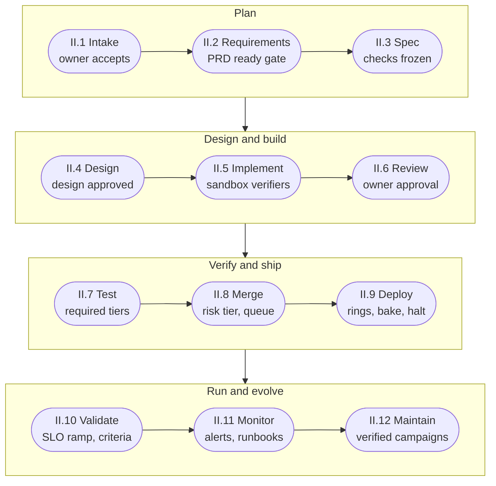
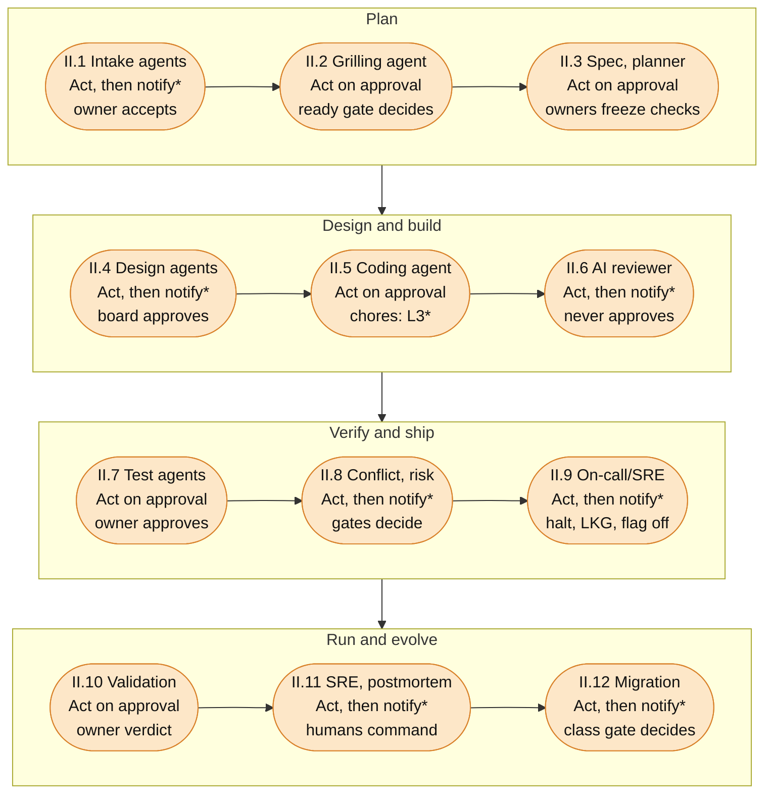

## Part 0: Front matter

### 0.1 Executive summary

When agents make code cheap, the bottleneck moves to specifying and verifying it: Google found review speed was the bottleneck in its AI migrations [GOOG2], and Spotify reports "76% more PRs to review" [SPOT2]. The rest of this summary is our synthesis.

**Recommendation (the thesis):** a software factory is mostly verification, identity, context and rollout infrastructure. Its shape is a **deterministic core with agentic edges**: gates, the merge queue, ring promotion and the watchdog stay policy-driven, while agents write the inputs (PRDs, specs, code, tests, rollout plans), interpret the outputs and take bounded mitigations. Autonomy is granted **per action**, and earned through the **trust ledger**: each action's success, revert, escaped-defect and override rates and cost per accepted change, against a human-only baseline (see III.1, III.2).

**The rungs, in one line:** Advise (the agent suggests), Prepare (the agent drafts, a human runs it), Act on approval (a human clicks or merges, then it runs), Act, then notify (pre-approved reversible actions; humans review afterwards), Autonomous within budget (future only).

**Recommendation (the five requirements that matter most):**

1. **Safety net first:** every production change, config and flags included, rides rings with policy-set bake and an automatic, deterministic halt (see II.9).
2. **Protected verifiers:** acceptance criteria become automated checks before any code is written, and agents cannot weaken or delete them (see II.3, II.5, II.7).
3. **No agent approves its own output:** an agent finding may block through policy; a human owner from the service catalog approves, except allow-listed mechanical classes promoted to Act, then notify, where the deterministic gates decide (see II.6, II.12, III.3).
4. **A per-action policy and ledger:** each action has a rung and a kill switch, is promoted one rung at a time on evidence and demoted automatically (see III.2; templates: D6, D7).
5. **Agent identity:** every agent runs under its own Entra Agent ID with a human sponsor, never a borrowed identity or static key (see III.3, IV.4).

**The first three of the nine roadmap steps** (Steps 0 to 8, see III.4):

- **Step 0, readiness:** one service and team; checklist (template: D8), service catalog, AGENTS.md, rings with an automatic halt, human-only baselines. Agents only Prepare.
- **Step 1, toil and test backfill:** the pilot; test-backfill, flaky-triage and flag-cleanup agents open PRs an owner approves (Act on approval).
- **Step 2, AI review as first pass** on every PR; findings block through policy only in categories with proven precision.

> **Takeaway:** **The decision for you now:** name a sponsor and one pilot service, fund Step 0, and set lead time and change failure rate, not PR counts, as the targets.

**Recommendation (what "done" looks like):** all nine roadmap steps have exited on ledger evidence, every agent action sits in the action policy at a rung it earned, and Act, then notify covers only reversible or mechanical classes. The sponsor sees lead time fall each quarter while change failure rate holds at or below the Step 0 baseline (see VI.4).

### 0.2 How to read this

| Part | What it gives you | Read it if you are |
|---|---|---|
| 0. Front matter | This summary, the overview charts, a primer on the systems cited | Everyone; ten minutes |
| I. What frontier companies learned | Eight cross-cutting lessons and an evidence map by stage | A sponsor deciding how far to trust the evidence |
| II. The PDLC reference model (II.1 to II.12) | Per stage: the deterministic process, agent roles with their rungs, enterprise complications, requirements | The tech lead or architect who owns that stage |
| III. Trust model and roadmap | The autonomy ladder, the trust ledger, agent accountability, the nine-step roadmap | The sponsor and the factory platform lead |
| IV. Enterprise complexity | Many repos, contracts, mixed pipelines and clusters, S2S identity, multi-team ownership, config, security, cost | Architects of multi-team services; security |
| V. Reference architecture | V.1 the service catalog; V.2 the other factory components | The platform team that builds it |
| VI. Transformation plan | Readiness, the first pilot, phases by day, measurement, operating model, risks | The sponsor and the service lead |
| VII. Worked example | One feature through the factory, on an illustrative composite service | Anyone who wants to see the whole flow once |
| Appendices | A glossary, B references, C open questions, D implementation kit, E requirements catalogue | Engineers doing the work |

**Citations and evidence grades.** Every factual claim carries a short code such as [MS4] (Microsoft reference 4). Codes resolve in the reference table at the end (Appendix B), which gives each source's title, publisher, link and grade: **A** is peer-reviewed or measured, **B** is a company post with numbers, **C** is guidance or anecdote. Conference talks are graded "talk", and the text says "one conference talk" when a claim rests on one. **Recommendation:** marks our own synthesis, never a company's practice; **[GAP: ...]** marks missing evidence; "vendor-reported" marks claims by tool vendors.

### 0.3 Scope and non-goals

- **In scope:** moving one existing, high-scale, multi-team service into a factory safely, Microsoft-native options first. Quality and safety come first; speed means shorter lead time at the same or lower change failure rate.
- **Not a PR-volume programme.** PR counts, lines of code and adoption rates are not success metrics (see VI.4).
- **Not a vendor or model comparison.** Products appear as examples of mechanisms; the harness, gates and ledger matter more, and are re-tested when a model changes (see III.2).
- **Not greenfield.** Practices proven only in new repos, such as OpenAI's agent-merged experiment [OAI1], are flagged as such.
- **Not a promise of autonomy.** Today's ceiling is Act, then notify for narrow classes; higher rungs are proposals (see III.1).

### 0.4 The uber chart

The uber chart has two layers. The deterministic spine shows every stage with the gate that decides it; each Part II section zooms into one box (II.9, for example, is the Deploy box).

Every spine box is deterministic or human and names the gate that decides it. Repair items from II.11 and new signals feed back into II.1.

The agent layer places each stage's agents on the same grid.

Orange boxes are each stage's agents, their highest rung today and what still decides; * (or L3*) means Act, then notify only for narrow, reversible or mechanical classes (see III.1), with the rest of that stage at Act on approval or lower.

**How to read it.** Work flows through the spine, and no orange box replaces a gate: agents feed the spine and read its outputs. At Act, then notify a change lands because the deterministic gates pass, not because the agent decided. Feature code, tests, validation and rollout plans stop at Act on approval; the Act, then notify rows in II.2 and II.3, II.6's opt-in low-risk class (approved by the deterministic risk gate) and the II.9 and II.11 runbook actions are our proposals; Autonomous within budget is a future proposal everywhere. The service catalog (see V.1) and the trust ledger (see III.2) sit under every box.

### 0.5 Real-world systems in two minutes

**Microsoft and GitHub**

- **Azure Safe Deployment Practices (SDP) and Gandalf.** SDP moves all code and configuration changes through canary regions, a pilot phase and incremental regions, with mandatory health signals and centrally set bake times [MS2]. Gandalf, Azure's global deployment watchdog, works out which rollout caused a fault and issues a go or no-go that the deploy engine enforces [MS4, MS5].
- **Copilot coding agent and AI code review.** Copilot coding agent opens a PR for an issue a maintainer assigns; in dotnet/runtime about 71% of its PRs now merge [MS8]. Microsoft's internal AI code review joins over 90% of PRs and proposes fixes that land only if the author clicks to apply them [MS6].
- **Entra Agent ID** gives each agent its own Entra identity with the creating user as sponsor, acting on behalf of a user (OBO), on its own, or through a paired agent user [MS12, MS22, MS23].
- **Azure SRE Agent.** Microsoft's GA announcement calls it an "AI operations teammate" that loads a team's code, telemetry and runbooks and moves from recommended actions to automated responses "within defined guardrails" [MS10].
- **Spec Kit,** GitHub's open-source spec-driven toolkit, moves from what and why to agent-sized tasks under a `constitution.md` of fixed principles; Microsoft calls it an experiment [MS13].
- **Microsoft Digital's service catalog** links services to repos and owners, and its metadata decides which compliance checks apply [MS28]; it is the model for V.1.
- **AKS Fleet Manager** stages Kubernetes and node-image upgrades across many AKS clusters, with approval gates; it does not roll out applications [MS21].

**Other frontier references**

- **Google's AI-assisted migrations.** A fine-tuned Gemini model writes edits inside a deterministic shell of static analysis, build, tests and human review; about 50% of end-to-end time was saved [GOOG2].
- **Meta's Diff Risk Score.** A fine-tuned Llama model predicts how likely a change is to cause a severe incident, so only the riskiest diffs are gated instead of freezing everything [META2, META3].
- **Spotify Honk and Backstage.** Honk, Spotify's background coding agent, replaced migration scripts inside its existing fleet PR, review and merge infrastructure [SPOT1]; Backstage, its developer portal, builds the catalog from YAML in each repo [SPOT8].
- **Stripe Minions** turn a Slack message, ticket or flaky-test alert into a CI-passing PR in an isolated devbox, through a code-defined blueprint of deterministic and agent steps [STRIPE1].
- **DORA,** Google's DevOps research program, finds AI is a "mirror and a multiplier" of the organization [GOOG3], and its AI Capabilities Model names the foundations Step 0 checks [GOOG4]; Part VI measures with DORA's delivery metrics.
- **Also cited:** Meta's on-call agent, "Grant autonomy action by action." (one conference talk) [AIE4]; Anthropic's split of writer and grader agents [AN3]; OpenAI's AGENTS.md as "a map" [OAI1]; Amazon's auto-rollback and two-phase deploys [AWS1, AWS3]; Uber's uReview [UBER1]; Duolingo's test backfill (one conference talk) [AIE6]; Shopify's human review of every merge (an interview) [SHOP1]; and mabl, whose AI review blocks but cannot approve (vendor-reported) [MABL1].

### Open gaps

- Where the overlay shows Act, then notify as our proposal (II.8 textual conflicts, II.9 and II.11 runbook actions), no published precedent exists. [GAP: no source describes an agent at Act, then notify for rollout or runbook mitigations in production.]
- Evidence is thin for intake, requirements, specification and promotion thresholds (see I.2), so roadmap Steps 4 and 8 rest mostly on synthesis.
- The notes hold no Microsoft example of a merge queue, a risk score or agent test generation (see I.2).
