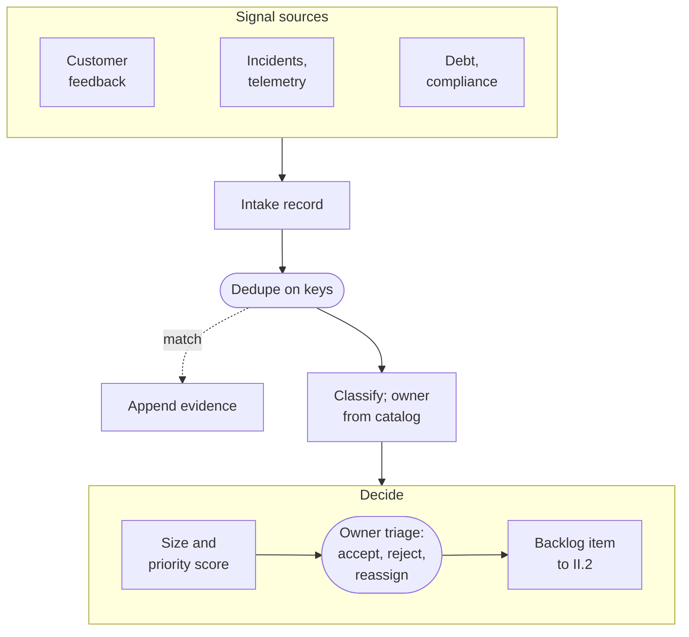
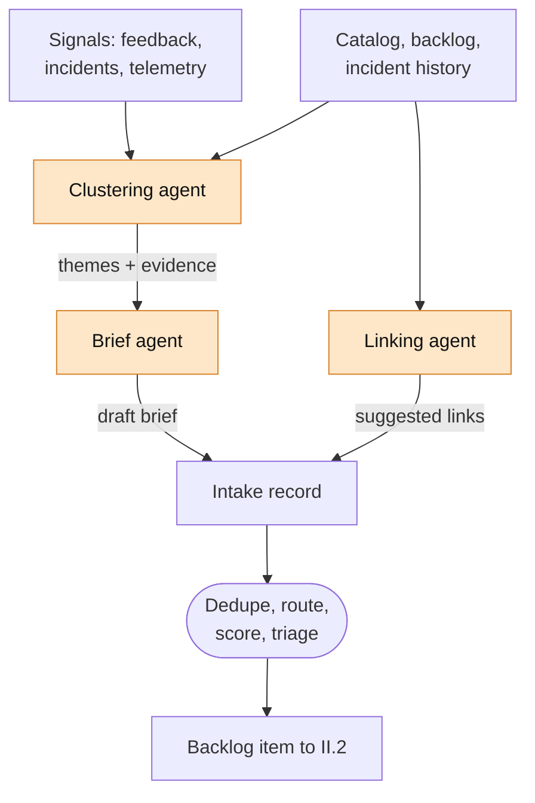

## II.1 Intake and ideation (signal → opportunity)

### Purpose

This stage turns signals (customer feedback, incidents, telemetry, tech debt, compliance asks) into deduplicated, owned and prioritized intake items that II.2 can grill into a PRD. Once agents make coding cheap, the constraint moves to human decisions, review and prioritization, as Spotify put it in a 2026 talk [SPOT2], so the intake queue is where a factory decides what it spends review capacity on.

### The ideal deterministic process

Gates in the chart:

- **Intake record.** Every signal becomes one record with source, affected service, customer or SLO impact, evidence links and any deadline.
- **Dedupe on keys.** Deterministic matching only: same incident ID, same error fingerprint, same compliance control, or an explicit link to existing work. A match appends evidence instead of creating an item.
- **Classify and route.** Type and service come from the record; the owner comes from the service catalog (see V.1). At Microsoft Digital (Microsoft's internal IT organization), "Every area path in Azure DevOps has a team and associated set of repositories" [MS28], so routing is a lookup.
- **Size and priority.** T-shirt size, then a published scoring rule (SLO impact, customers affected, signal count, deadline). Compliance deadlines and repeat-incident follow-ups set a priority floor that the score cannot lower.
- **Owner triage.** The owning team accepts, rejects with a reason, or reassigns, within a fixed age limit.

Key metrics: untriaged age, duplicate rate after triage, and time from signal to accepted item. [GAP: no source publishes intake metrics for a high-scale service.]

### Real-world reference

**Microsoft Digital's Azure DevOps agents** are the closest Microsoft reference, described in a self-reported Inside Track post [MS14]. Microsoft Digital built a DevOps Assistant, whose specialist agents (one of them a Work Item agent) are routed by an Orchestrator Agent, and an inline AI Work Item Assistant. Both inherit existing ADO permissions, so an agent sees only what its user may see. Microsoft publishes no intake-specific number for these tools [MS14].

**Linear's triage agent** (Linear is a commercial issue tracker) is the only reference that does exactly this stage's job. One conference talk describes it: it labels, routes and deduplicates incoming issues, flags open product decisions, and leaves its investigation (logs, traces, customer history) on the issue [AIE11].

Other references: Microsoft's RCACopilot classifies incidents into root-cause categories with up to 0.766 accuracy on one year of Microsoft incidents [MS11], a measured baseline for LLM classification of incidents with collected diagnostics. One Uber talk describes a context graph linking Jira and incidents [AIE2], and the GA announcement says Azure SRE Agent (see II.11) keeps a memory of past resolutions [MS10]. [GAP: neither source shows how an incident pattern becomes a backlog item.]

### What to agentify, and how far

> **Takeaway:** **Recommendation, in one line:** agents cluster signals into themes, draft opportunity briefs and link to existing work; the dedupe keys, catalog routing and priority rule stay deterministic, and a human owner accepts every item. Start clustering and linking at Advise (L0) and the brief agent at Prepare (L1).

Shopify's head of engineering puts the line plainly: "You shouldn't abdicate the thinking." / "You should abdicate the toil." [SHOP1]. Applied to intake, choosing what to build is the thinking; reading a thousand feedback rows is the toil. **Recommendation:** measure intake agents by owner triage time saved, not by items filed, because every extra item spends the review capacity this stage exists to protect.

Orange boxes are agents; everything else is the deterministic core.

| Agent role | Rung | What it does | Guardrail | Evidence to promote |
|---|---|---|---|---|
| Clustering agent | Advise (L0) | Groups feedback, incidents and alerts into themes, each with counts and evidence links | Read-only; PII redacted before model calls | Owners confirm most themes as real and distinct |
| | Prepare (L1) | Drafts an intake record per theme | Owner submits it | Few drafts rejected as noise or duplicate |
| | Act on approval (L2) | Batch-files every theme above a signal-count threshold after one owner click | Rate limit per service; approval in the trust ledger | Low reject rate at triage |
| Brief agent | Prepare (L1) | Drafts an opportunity brief: problem, evidence, affected customers, likely services (template: proposed) | Never sets priority; owner edits | Briefs accepted with few edits; II.2 clarification rate does not rise |
| Linking agent | Advise (L0) | Suggests near-duplicates the keys missed, related items and earlier decisions | Read-only | Suggestions accepted |
| | Act on approval (L2) | Merges a near-duplicate after one owner click | Reversible; approval in the trust ledger | Merges rarely undone |
| | Act, then notify (L3) | Adds "related" links at once, then notifies | Links only; any owner can undo; merges stay at L2 | Links rarely removed |

No intake role is proposed at Autonomous within budget (L4): priority expresses human intent and capacity. Uncontrolled agent filing is a known failure: one talk warns that "fix every alert" floods PRs and recommends triaging signals into handled, needs a person, or noise [AIE12]. [GAP: no source measures clustering quality or agent-drafted briefs for a production service; the rungs above are synthesis.]

### Enterprise complications

- **Asks that span several owning teams.** **Recommendation:** one parent item with a single accountable driver, and one child item per owning service, routed from the catalog; each owner accepts or rejects only its own child. In Spotify's dataset migration, one data team drove work across pipelines owned by many teams, who reviewed and merged their own [SPOT5]. [GAP: no source describes cross-team prioritization when owners disagree.]
- **Shared backlog.** Agents must see only what their caller may see: Microsoft's agents inherit ADO permissions [MS14], and Atlassian's vendor-reported Agent Context Controls set which agents operate where [ATL1].
- **Compliance asks.** Catalog metadata decides which compliance tasks apply to a service [MS28]; **Recommendation:** the same metadata creates compliance intake items with their deadlines.
- **Customer data in feedback.** Redact PII before any model call, as for interview transcripts (see II.2).
- **Agent-ready items.** In dotnet/runtime, issues are filed specifically for the Copilot coding agent, and well-scoped tasks succeed more often [MS8]. **Recommendation:** triage marks such items.

### Requirements

| ID | Priority | Statement | Rationale | Source |
|---|---|---|---|---|
| REQ-PRD-01 | MUST | Every signal enters as an intake record from one template (template: proposed); deduplication uses deterministic keys, and agent-suggested duplicates are merged only after owner approval and remain reversible. | Dedupe must be explainable and undoable | Recommendation; AIE11 (agent dedupe) |
| REQ-OWN-01 | MUST | The owner of every intake item comes from the service catalog; an item with no catalog owner is a catalog defect, not a backlog item. | Routing is a lookup, not a guess | MS28 |
| REQ-OWN-02 | MUST | A cross-team ask is a parent item with one accountable driver and one child per owning service; only that service's owner accepts its child. | No team commits another | SPOT5; Recommendation |
| REQ-PRD-02 | MUST | Priority is computed by a published rule with floors for compliance deadlines and repeat incidents; agents may supply inputs but never set or override priority. | Prioritization is human intent | SHOP1, SPOT2; Recommendation |
| REQ-SEC-01 | MUST | Intake agents inherit the caller's backlog permissions; feedback and incident text is PII-redacted as in II.2. | Shared backlogs hold customer data | MS14 |
| REQ-GOV-01 | SHOULD | Each intake agent has a per-service filing rate limit, and its themes, drafts and merges are recorded in the trust ledger with owner accept and undo rates. | Agent filing can flood triage | AIE12; Recommendation |
| REQ-CTX-01 | SHOULD | Accepted items link to their evidence (incidents, telemetry, feedback) so II.2 can read it. | The grilling agent needs the history | AIE2, AIE11 |

### Open gaps

- No source measures clustering, agent dedupe or agent-drafted briefs in production.
- No source shows how an incident pattern becomes a backlog item, at Uber or Microsoft (SRE Agent, RCACopilot).
- No source covers cross-team prioritization when owning teams disagree.
- Proposed kit item: an intake record and opportunity brief template (template: proposed; see kit-proposals.md).
- AIE2, AIE11 and AIE12 are conference talks; ATL1 is vendor-reported.
