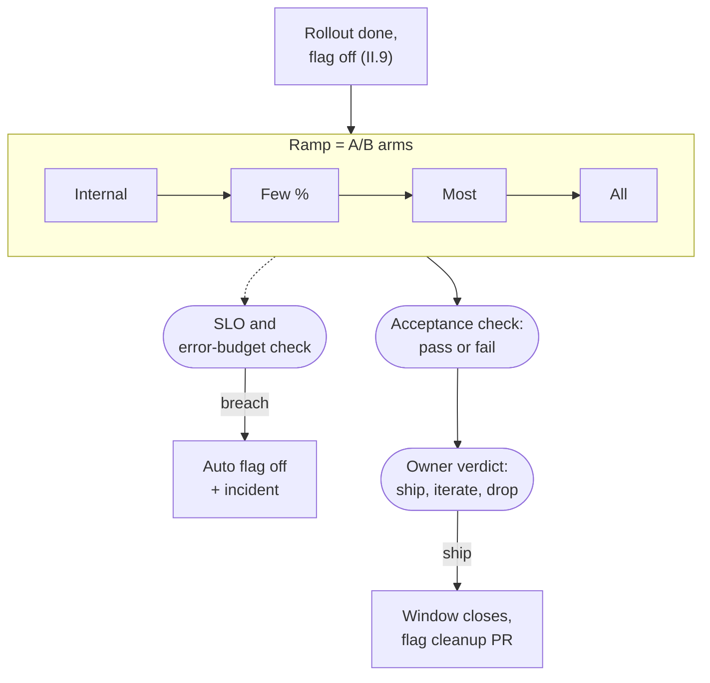
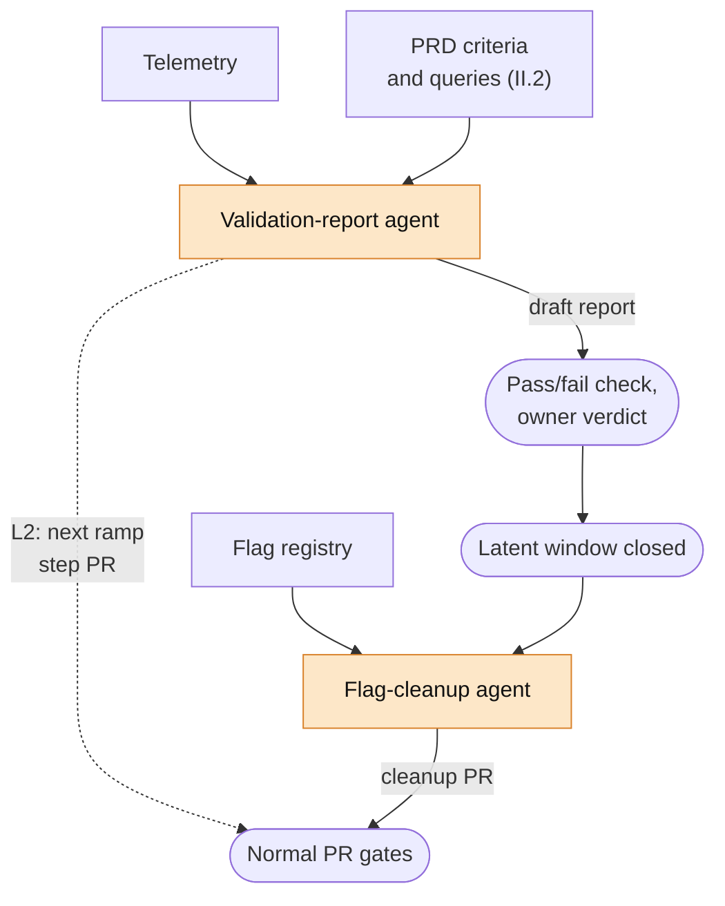

## II.10 Post-deploy customer and engineering validation (flags, experiments, SLOs)

### Purpose

II.9's watchdog only answers "did this break the fleet?". This stage asks two more questions: does the feature meet the PRD's acceptance criteria for customers (see II.2), and do service SLOs hold as exposure grows? It ends when the feature flag has been removed.

### The ideal deterministic process

Gates in the chart:

- **Exposure ramp.** Microsoft Learn guidance describes code shipped dark and enabled per tier, deployment or user [MS1], and Azure's Well-Architected guidance (a docs page) treats every flag change as a deployment [MS3], so flag changes ride the rings of II.9. **Recommendation:** where a PRD names a customer-outcome metric, the flag's cohorts are the experiment arms. [GAP: no source gives ramp steps or hold times for a flag, or describes a product experimentation platform.]
- **SLO check.** Each ramp step is judged on a few user-visible SLIs against a control and absolute SLOs, as in Google's canary rules (below) [GOOG5]; the Well-Architected health model also adds usage metrics to catch silent failures [MS3]. **Recommendation:** a breach turns the flag off automatically, like II.9's halt; this is deterministic. [GAP: no source describes an error-budget policy that pauses a feature ramp; that box is our synthesis.]
- **Acceptance check.** **Recommendation:** each acceptance criterion from the PRD (template: D1) is bound, before the ramp starts, to a named telemetry query and threshold. The check computes pass or fail per criterion; the owner then signs the ship, iterate or drop decision, which no agent makes.
- **Latent-fault window and cleanup.** The flag stays as a kill switch until the window (30 days by default, see below) closes; then it and its dead code path are removed through the normal PR gates (II.6 to II.8).

Key metrics: criteria passed at first ship, SLO breaches per ramp, flag age at removal.

### Real-world reference

**Gandalf's batch layer.** Gandalf, Azure's global deployment watchdog (see II.9), pairs a streaming check of ±1 hour around each node deployment with a batch analysis over 30 days for latent issues [MS4]. **Recommendation:** use the same 30 days as the default latent-fault window after full exposure.

**Google's canarying chapter** in the SRE Workbook defines a canary as a partial, time-limited deployment evaluated against a control: "Canarying is effectively an A/B testing process." [GOOG5]. Its rules transfer to a flag ramp: one canary at a time, SLIs as metrics ("perhaps no more than a dozen"), user-visible metrics over CPU, and a relative comparison backed by absolute SLO checks [GOOG5].

### What to agentify, and how far

**Recommendation, in one line:** a validation-report agent turns telemetry into evidence against each acceptance criterion and a flag-cleanup agent removes flags once the window closes; neither decides that a feature succeeded. Realistic ceiling today: Act on approval (L2).

The ramp, the SLO alarm and automatic flag-off, the pass/fail check and the PR gates stay deterministic. After an automatic flag-off, or an alarm no policy covers, investigating and choosing the next mitigation is the on-call/SRE agent's job in II.9, not repeated here.

Orange boxes are agents; everything else is the deterministic core.

For cleanup, Google applied its LLM migration toolkit to flag cleanup among other migrations [GOOG2], and one conference talk (Booking.com) names experiment flags and dead code as toil targets [AIE5]. Spotify's Fleet Management, its system for automated changes across thousands of repos, kept its normal targeting, PR, review and merge infrastructure when it added an agent [SPOT1]; most of its 2.5M+ automated maintenance PRs were auto-merged [SPOT2]. [GAP: no Microsoft source on flag cleanup; no source measures agent-driven flag removal or any agent writing a post-launch validation report.]

| Agent role | Rung | What it does | Guardrail | Evidence to promote |
|---|---|---|---|---|
| Validation-report agent | Advise (L0) | Queries telemetry for each criterion, explains anomalies and segment differences | Read-only, aggregated data only | Owners agree with its reading of the data |
| | Prepare (L1) | Drafts the report: per criterion, query, result and caveats | Pass/fail is computed by the check; the owner signs the verdict | No missed SLO regressions; owners rarely correct the report |
| | Act on approval (L2) | Opens the next ramp step as a flag-change PR, with the report attached | Owner merges; the change still rides II.9 rings | Low override rate on ramp proposals |
| | Act, then notify (L3) and above | Not proposed | Whether a feature delivers customer value is a human product decision | n/a |
| Flag-cleanup agent | Advise (L0) | Lists flags at full exposure past their window or expiry | Read-only registry access | Lists confirmed by owners |
| | Prepare (L1) | Drafts a PR that removes the flag and its dead path, with tests | Owner adopts and submits it | High adoption rate, low revert rate |
| | Act on approval (L2) | Opens the cleanup PR; after the owner's merge, removes the flag from the flag service on owner click | Owner merges; approvals logged in the trust ledger | No incidents traced to removals |
| | Act, then notify (L3) | Future proposal: cleanup PRs for single-repo flags merge when every gate passes, then notify | Only flags at full exposure, past the window, with zero traffic on the removed code path | Clean L2 record over a long sample |
| | Autonomous within budget (L4) | Not proposed | Cleanup needs no non-routine actions | n/a |

### Enterprise complications

- **Telemetry owned by other teams.** **Recommendation:** the service catalog (see V.1) records who owns each signal; the agent reads through owner-approved queries only. [GAP: no source covers cross-team telemetry access for validation.]
- **Privacy limits on customer data.** One conference talk reports that Uber's model gateway includes a data anonymizer and redacts more than 20 PII types [AIE2]. **Recommendation:** the agent sees aggregates above a minimum cohort size, never row-level customer data. [GAP: no source covers privacy rules for experiment telemetry read by agents.]
- **Features spanning services.** One criterion can depend on three services' telemetry and three flags in three repos. **Recommendation:** each owner signs their part; cleanup runs as a fleet change (see II.12), consumers before producers. [GAP: no source gives a removal order for cross-service flags.]

### Requirements

| ID | Priority | Statement | Rationale | Source |
|---|---|---|---|---|
| REQ-PRD-06 | MUST | Before the ramp starts, every acceptance criterion is bound to a named telemetry query and threshold, so pass or fail is computed, not judged. | The check must be mechanical | Recommendation; links II.2 |
| REQ-OBS-02 | MUST | Each ramp step is gated on a small set of user-visible SLIs compared with a control and against absolute SLOs; a breach turns the flag off automatically. | Relative and absolute checks catch different faults | GOOG5, MS3; Recommendation for the flag-off |
| REQ-OBS-03 | MUST | A latent-fault window (30 days by default) follows full exposure; the flag stays as a kill switch until it closes. | Latent faults surface late | MS4; Recommendation for the default |
| REQ-CFG-02 | MUST | Every flag is registered at creation with owner, expiry date and cleanup ticket; flag changes ride the II.9 rings. | Flags are deployments and debt | MS3, MS1; Recommendation |
| REQ-CFG-03 | SHOULD | Flag removal PRs go through the normal PR gates; auto-merge only after a clean Act on approval record. | Cleanup is a code change | SPOT1, SPOT2, GOOG2; Recommendation |
| REQ-GOV-05 | MUST | The ship, iterate or drop verdict is the owner's; the report, queries and sign-off are stored with the flag record, and the agent's proposal outcomes go to the trust ledger. | No agent approves its own output | Recommendation |
| REQ-SEC-05 | MUST | Agents read only aggregated, privacy-approved telemetry with PII redacted. | Customer data limits | AIE2; Recommendation |

### Open gaps

- No source gives flag ramp steps, hold times, or an error-budget policy for a feature ramp.
- No source describes a product experimentation platform or its statistics, at Microsoft or elsewhere.
- No source describes an agent writing a post-launch validation report, or measures agent-driven flag cleanup; no Microsoft source on flag cleanup.
- No source covers cross-team telemetry access, privacy rules for agent-read telemetry, or cross-service flag removal order.
- Kit item needed: a validation report template (template: proposed). The flag registry record is part of the rollout plan (template: D5).
- AIE2 and AIE5 are conference talks.
