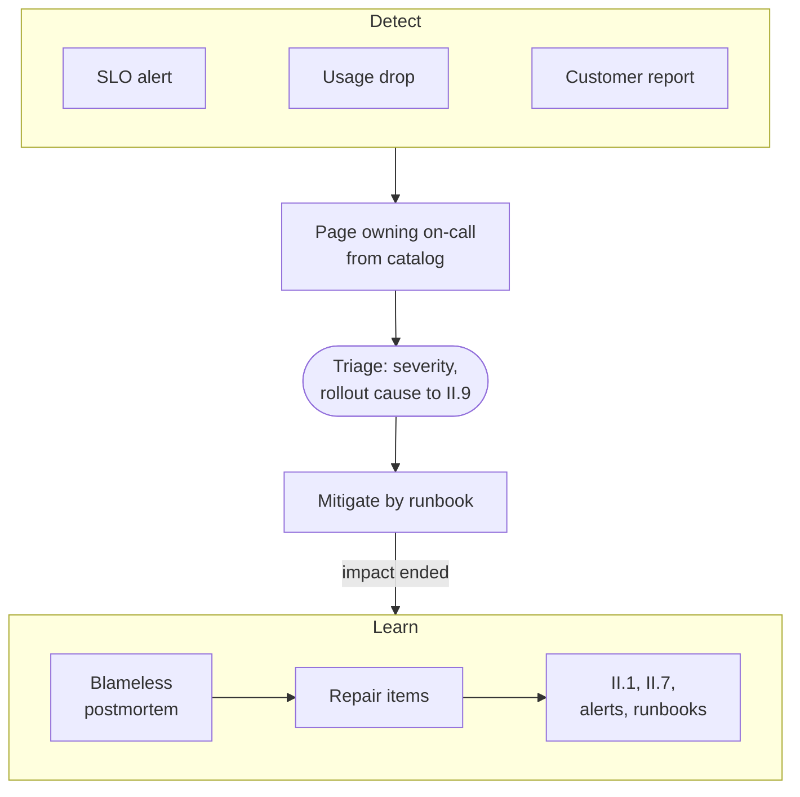
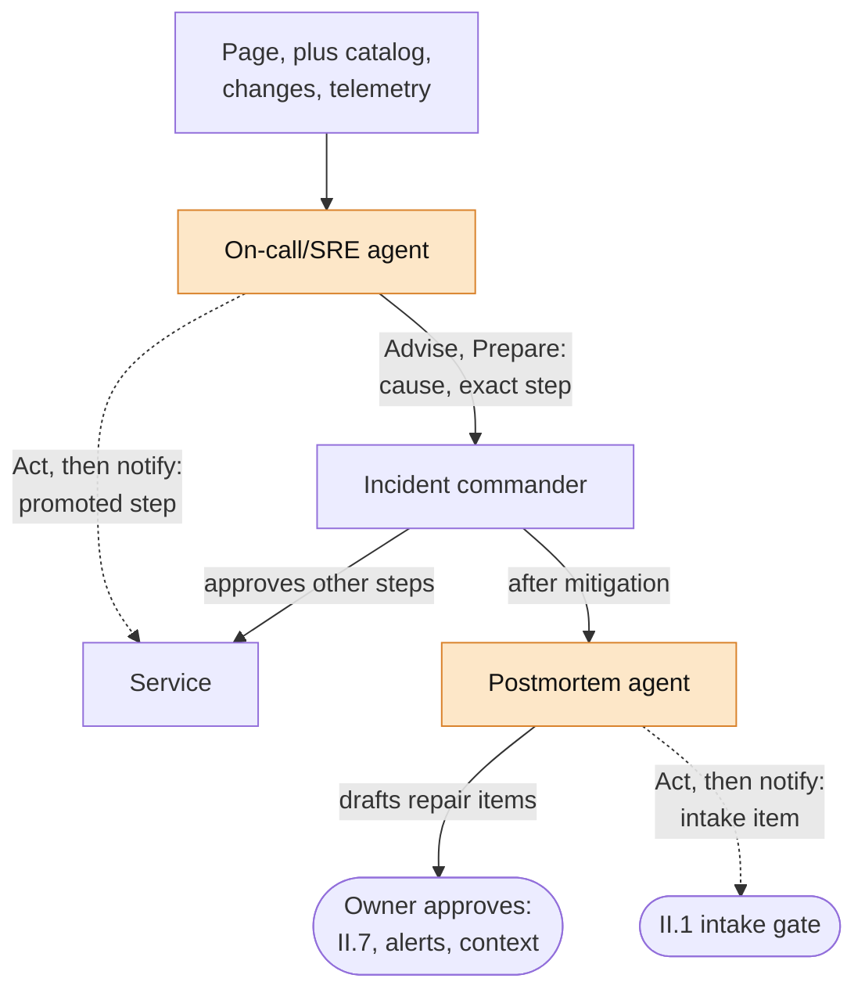

## II.11 Monitoring, incidents, learning loop

### Purpose

This stage keeps the service inside its SLOs and turns incidents into repairs. II.9 covers rollout mitigations (halt, roll back to LKG, flag off); this section covers incidents not caused by a rollout, mitigated by runbook actions, and the learning loop back into II.1.

### The ideal deterministic process

Gates in the chart:

- **Detect.** **Recommendation:** paging alerts fire on user-visible service-level indicators (SLIs: error rate, latency) against SLO targets, not host counters, the rule Google's canary guidance applies to canaries [GOOG5]; usage drops catch silent failures [MS3]. Other alerts open tickets. [GAP: no source describes SLO burn-rate alerting or an error-budget policy.]
- **Page and triage.** The owning on-call comes from the service catalog (see V.1). At GitHub, a SERVICEOWNERS file maps each service to its owning team, and incident commanders reportedly use it to find whom to page [GH3]. A published rule sets severity; humans can raise it, and above a threshold a human incident commander leads.
- **Mitigate.** The on-call runs a runbook step (config revert, flag off, fail over, scale out, restart). Impact ends when the SLIs are back within SLO; the incident commander confirms it.
- **Postmortem and repair items.** A blameless review records why verifiers and alerts missed it. Each repair item has an owner, a due date and a type: fix (to II.1), verifier (II.7), alert, runbook or context. The postmortem closes only when every item is closed or declined.

Key metrics: time to detect and mitigate, repeat-incident rate, repair-item closure rate.

### Real-world reference

**Azure SRE Agent** is Microsoft's "AI operations teammate", generally available since March 2026 [MS10]. The GA announcement says it preloads a team's code, telemetry and runbooks and lets teams choose between recommended actions and automated responses "within defined guardrails" [MS10]. Self-reported over nine months: 35,000+ incidents handled autonomously; 89% positive responses to RCA results on Azure Container Apps; time to mitigation on Azure App Service down to 3 minutes against a 40.5-hour human-only average [MS9]. That post also stresses "human approval checks". [GAP: neither post says which actions ran without human approval.]

**RCACopilot** is Microsoft's peer-reviewed (EuroSys '24) root-cause system [MS11]. It routes each incident to a handler by alert type; the handler collects diagnostics, and an LLM predicts the root-cause category with a narrative. On one year of Microsoft incidents, "RCACopilot achieves RCA accuracy up to 0.766"; diagnostic collection has run in production for over four years [MS11]. We treat its output as Advise.

**Meta's on-call agent**, described in one conference talk, is one shared agent per rotation that investigates alerts, tickets and config pushes, keeping team memory across shifts [AIE4]. Autonomy depends on the cost of a mistake, the checks that would catch it, and the track record: "Promotion applies to a particular action." Production mitigations stay human [AIE4].

### What to agentify, and how far

> **Takeaway:** **Recommendation, in one line:** the SRE agent investigates from the first page and prepares the runbook mitigation, earning Act, then notify one action at a time; a postmortem agent drafts repair items; a published rule sets severity, and humans own incident command and closure.

Alert rules, paging, severity, runbook steps and repair-item tracking stay deterministic. **Recommendation:** the agent first correlates everything that changed (config, flags, infrastructure), as one vendor talk also urges [AIE14].

**How trust is earned per action.** **Recommendation:** each runbook action has its own rung in the agent action policy (template: D6) and its own trust-ledger record (template: D7), built first from replay (running the agent on past incidents against what on-call did). Using the three criteria from Meta's talk [AIE4], we would let a single-service scale-out reach Act, then notify, and keep a failover that moves load onto other teams at Act on approval.

**Realistic ceiling today:** Act, then notify for a few reversible, single-service runbook actions. Azure's posts do not say which responses ran unapproved, and Meta keeps production mitigations human [AIE4], so this ceiling is our proposal. For the postmortem agent, the ceiling is Act, then notify for filing intake records; II.1's dedupe, priority rule and owner triage still decide whether each becomes a backlog item. Higher rungs are future proposals.

**The learning loop.** The postmortem agent drafts the timeline from the SRE agent's log, then repair items: a regression test, an alert, a runbook edit, an AGENTS.md note, an intake item. Azure SRE Agent learns from past incidents and feedback [MS9]; one Uber talk describes a context graph linking incidents to design docs and Jira [AIE2] that II.2 can read. [GAP: no source measures whether agent-drafted repair items reduce repeat incidents.]

Orange boxes are agents; everything else is the deterministic core.

Same on-call/SRE agent as II.9, whose ladder covers rollout mitigations; these rows cover runbook actions.

| Agent role | Rung | What it does | Guardrail | Evidence to promote |
|---|---|---|---|---|
| On-call/SRE agent | Advise (L0) | On page, runs the alert-type diagnostic handler, correlates with recent changes and dependency health, posts likely cause and evidence | Read-only access; never lowers severity | On-call rates investigations useful; predicted cause matches the postmortem |
| | Prepare (L1) | Prepares the exact runbook step, target and expected effect | Human runs it | Prepared step matches the human's choice, in replay and live |
| | Act on approval (L2) | Runs the step after one click | As II.9 | As II.9 |
| | Act, then notify (L3) | Runs a promoted runbook step on its own, then notifies | As II.9 (reversible actions only, one service at a time), plus a per-action allowlist (D6), rate limit and kill switch | Per action: replay agreement in nearly all cases, zero wrong-target actions, time to mitigate below the human baseline |
| | Autonomous within budget (L4) | Future proposal, as II.9 | As II.9 | As II.9 |
| Postmortem agent | Advise (L0) | Reviews a human postmortem; flags a missing timeline, cause or repair type | Read-only | Owners act on most flags |
| | Prepare (L1) | Drafts the postmortem and repair items | Owner edits and approves | Owner edits shrink |
| | Act on approval (L2) | Opens the repair PRs after owner approval | PRs pass II.6 review and all gates | Low rejection of its repair items |
| | Act, then notify (L3) | Files repair intake items in II.1, then notifies the owner | Files an intake record only; II.1's dedupe keys, priority rule and owner triage decide whether it becomes a backlog item; II.1's filing rate limit applies; the agent does not set priority | Few duplicates or rejected items |

### Enterprise complications

- **Incidents spanning teams.** Meta's agent is per team [AIE4], so a cross-team incident has several. Gandalf correlates faults against all ongoing rollouts, not one team's [MS5]. **Recommendation:** one human incident commander; each team's agent acts only on its own service and posts to the shared incident record. [GAP: no source shows agents coordinating within one cross-team incident.]
- **Access to telemetry and production (see IV.4).** Entra agents act on behalf of a user, as an app-only identity, or as an agent user [MS23]; activity is logged as an agent's [MS12]. **Recommendation:** a read-only app-only identity for investigation, a separate identity scoped per promoted action, and no static API keys, which Conditional Access does not cover [MS24].
- **Runbooks as code.** RCACopilot's handler per alert type is an automated runbook [MS11]; Anthropic reports, anecdotally, that its teams keep markdown runbooks beside CLAUDE.md [AN1]. **Recommendation:** runbooks live in the service repo, are reviewed like code, and bind each executable step to an action ID (template: D10).

### Requirements

| ID | Priority | Statement | Rationale | Source |
|---|---|---|---|---|
| REQ-OBS-04 | MUST | Paging alerts fire on user-visible SLIs against SLO targets and page the owning on-call from the service catalog; alerts without customer impact open tickets. Alert rules change only by PR. | Pages must mean customer impact | Recommendation; GOOG5, MS3, GH3 |
| REQ-OBS-05 | MUST | Every incident above a set severity gets a blameless postmortem whose repair items each carry an owner, a due date and a type (fix, verifier, alert, runbook or context). The postmortem closes only when every item is closed or declined; repeat incidents set a priority floor in II.1. | Incidents must change the factory | Recommendation |
| REQ-OBS-06 | MUST | Runbooks are versioned in the service repo and reviewed like code; each executable step names an action ID in the agent action policy (D6) with its current rung. | Autonomy needs a defined action | Recommendation; MS11, AIE4 |
| REQ-OBS-07 | MUST | SRE-agent autonomy is granted per runbook action from trust-ledger evidence (D7): replay on past incidents, then live Prepare runs. Any wrong-target action demotes that action. This rule covers runbook actions; rollout mitigations (halt, LKG, flag off) follow REQ-OBS-01 in II.9. | Trust is per action | AIE4, MS10; Recommendation |
| REQ-OBS-08 | SHOULD | The SRE agent's investigation, evidence and every action it took are attached to the incident record, and the postmortem draft is built from it; a named human owner signs the postmortem. | Audit and learning from one record | MS9, AIE4; Recommendation |
| REQ-IDN-03 | MUST | The SRE agent has its own Entra agent identity: read-only app-only access for investigation, and a separate identity scoped per promoted action for mitigation. No static API keys. | Least privilege; Conditional Access applies | MS23, MS12, MS24 |
| REQ-OWN-07 | MUST | In a cross-team incident, a human incident commander leads; each team's agent acts only on its own service, and a mitigation on another team's service needs that owner's approval. | No agent acts for another team | AIE4; Recommendation |
| REQ-CTX-05 | SHOULD | Postmortem findings update the context layer (runbooks, AGENTS.md, incident history linked in the catalog) by PR, with periodic pruning of instruction files. | Agents need incident history; files grow | AIE2, MS9; Recommendation |

### Open gaps

- No source describes SLO burn-rate alerting or an error-budget policy.
- Azure SRE Agent's figures are self-reported; the posts do not say which actions ran without approval.
- No source measures whether agent-drafted repair items reduce repeat incidents.
- No source shows agents from several teams coordinating within one incident.
- Meta's ladder (AIE4) is one talk with illustrative numbers.
- The runbook-as-code template and the postmortem record are in the kit (template: D10).
