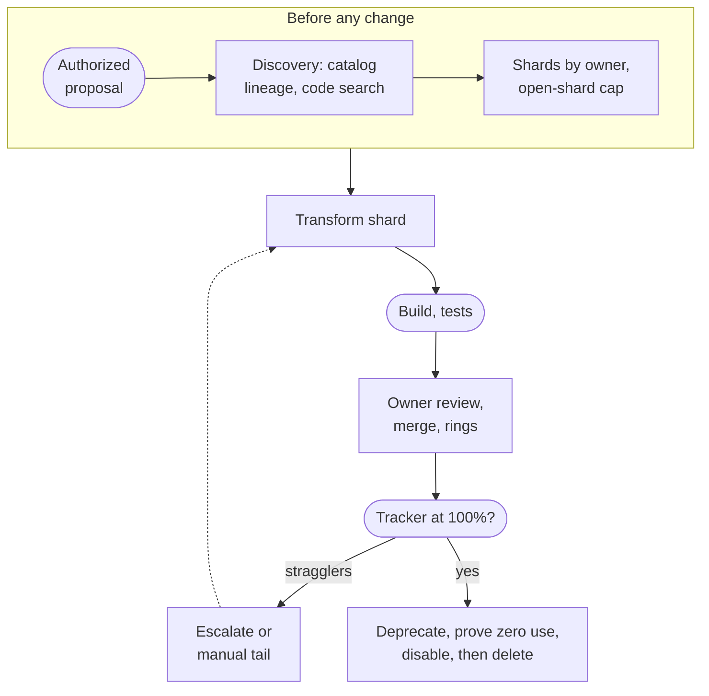
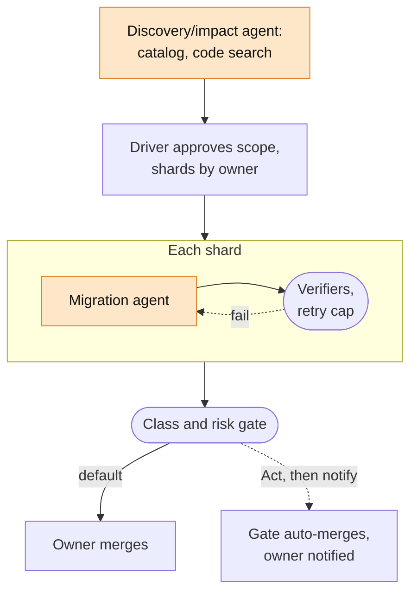

## II.12 Maintenance, migrations, decommissioning

### Purpose

This stage keeps a running fleet current: dependency and framework upgrades, language and API moves, deprecations and removals. Agents have their strongest published evidence here, because the end state is known and the verifiers usually exist. The hard parts are finding every consumer, getting many owners to review, and finishing the long tail.

### The ideal deterministic process

Gates in the chart:

- **Authorization.** At Google, a large-scale change (LSC) starts with a proposal giving the reason, estimated shards and an FAQ, reviewed by the API owners and a committee of about a dozen people [GOOG6] (template: D11).
- **Discovery.** Deterministic tools decide *where*. Google expands code references from a seed [GOOG2]; Spotify used catalog lineage and code search to fix the consumer list and owners before any change [SPOT5]. Here that is the reverse dependency graph in the service catalog (see V.1).
- **Sharding.** Google's Rosie "takes a large change and shards it based upon project boundaries and ownership rules", and caps outstanding shards [GOOG6].
- **Per shard and tracking.** Each shard passes build and tests, then normal review, merge and rings (see II.6, II.8, II.9); the tracker holds per-consumer status and communication [SPOT5].
- **Decommissioning.** Azure's Well-Architected guidance: validate inactivity over a full business cycle, snapshot, disable before delete, and watch through peaks; "Treat every deletion as irreversible and follow a deliberate, safety-first approach" [MS3]. Azure's REST API guidelines recommend signalling deprecation in-band with an `azure-deprecating` header, as emails often miss developers [MS26]; when a generally available (GA) API version must break, Azure typically gives three years to migrate [MS25].

Key metrics: share of in-scope consumers migrated, end-to-end time saved including review and landing (Google's success metric [GOOG2]), revert rate per change class, and age of open stragglers.

### Real-world reference

**Microsoft.** Microsoft's 1ES Customer Zero post says it delegates toil such as framework upgrades to agents, and reports 80 to 90% accuracy migrating hundreds of repos (an Entra SDK migration), with no published mechanism [MS7].

**Google's AI-assisted migrations** use a fine-tuned Gemini model inside a deterministic shell [GOOG2]. An expert finds a seed and candidate files, the toolkit runs on its own to test-passing changes, and the engineer reviews them before sharding to code owners. The principle: tools decide where and verify, the LLM writes the edit, because "The use of LLMs alone through simple prompting is not sufficient for anything but the simplest of migrations." In the main case (int32 to int64 IDs in Google Ads, 500M+ lines), 80% of modifications in landed changes were fully AI-authored and about 50% of time was saved, including review and landing.

**Spotify's Honk** is its background coding agent; it replaced deterministic migration scripts while keeping Fleet Management, the infrastructure that targets repos, opens PRs and handles review and merge [SPOT1]. Fleetshift is the fleet tool where in-scope repos are marked and progress tracked [SPOT5]. Spotify reports 2.5M+ automated maintenance PRs, mostly auto-merged, and its latest Java migration in 3 days [SPOT2]. One data team migrated about 1,800 pipelines owned by many teams off two deprecated datasets in six months, with 240 automated PRs [SPOT5]. Airbnb (test files, six weeks against a 1.5-year estimate [ABNB1]) and Amazon (Java upgrades, from a self-reported CEO quote [AWS2]) report similar gains.

### What to agentify, and how far

**Recommendation, in one line:** agents write the edits and propose the scope, while discovery, sharding, verification, the merge gate and the tracker stay deterministic. Act, then notify applies only to allow-listed mechanical classes.

Orange boxes are agents; everything else is the deterministic core. The class and risk gate checks the change class against an allow-list and the risk score (see II.8). It must be live before the Act, then notify rung opens: the roadmap makes II.8's deterministic risk gate a prerequisite of Step 3, and Step 6 adds only the risk-explanation agent (see III.4).

**Green but wrong.** Early Honk agents took shortcuts "such as commenting out failing tests or downgrading Java versions" [SPOT7]; an LLM judge vetoed about 25% of sessions [SPOT4], though Spotify later removed it as too rigid [SPOT7].

**Review is the bottleneck.** Google: "The bottleneck in the process was the speed at which engineers could review the changes." [GOOG2]. Published responses: global approvers for mechanical patterns [GOOG6], the migration driver (the engineer running the campaign) approving PRs [SPOT7], and auto-merge for safe classes [SPOT2]; see II.6 and II.8.

**Realistic ceiling today:** Act, then notify; Autonomous within budget is our proposal for the future.

| Agent role | Rung | What it does | Guardrail | Evidence to promote |
|---|---|---|---|---|
| Migration agent | Advise (L0) | Runs a sample of shards and reports failure clusters | Sandbox, no PRs | Clusters match what the expert finds |
| | Prepare (L1) | Produces test-passing diffs; the expert reviews and fixes before sharding [GOOG2] | No push rights | High share committed unchanged |
| | Act on approval (L2) | Opens sharded PRs, retries on verifier errors [ABNB1]; the owner's merge is the approval [SPOT5] | Verifiers before PR, retry cap, protected tests | Merge and revert rates per class at the human baseline |
| | Act, then notify (L3) | PRs in an allow-listed mechanical class merge once every deterministic gate passes; owner notified. Spotify auto-merges what is safe [SPOT2]; the allow-list is our Recommendation | Class and risk gate decide, not the agent (see II.8); sampled audit; demoted on revert | Zero escaped defects in the class over a long sample |
| | Autonomous within budget (L4) | Proposal: re-tunes its prompt on failure clusters and re-sweeps failed shards inside an approved campaign (Airbnb did this by hand [ABNB1]) | Fixed scope and compute budget; prompt changes versioned; same gates | Clean L3 record across several campaigns |
| Discovery/impact agent | Advise (L0) | Explains the consumer list; flags gaps between declared and observed dependencies (see V.1) | Read-only | Flags confirmed by owners |
| | Prepare (L1) | Proposes in-scope list, exclusions and shard plan; drafts the decommission evidence (usage over a full business cycle) | Driver approves; deletion is always human-run | Few consumers found later |
| | Act on approval (L2) | Notifies owners and opens tracker entries after driver approval | Catalog owners only | Few wrong-owner routings |
| | Act, then notify (L3) | Sends reminders, flags stale PRs and escalates stragglers on schedule | Cannot close, merge or delete | Straggler age falls |

Rungs follow the agent action policy (template: D6) and the trust ledger (template: D7).

### Enterprise complications

- **Many owning teams.** Google's local owners can appeal but "they don't hold a veto over the broader LSC" [GOOG6]. Spotify's target repos rarely had tests, so owners tested by hand [SPOT5]. **Recommendation:** a shard without tests stays at Act on approval; backfill first (see II.7).
- **Legacy and non-standard code.** Spotify dropped one framework for per-team variability [SPOT5]: "a diverse codebase produces a diverse set of problems" [SPOT7].
- **The long tail.** Deterministic scripts moved about 70% of Spotify's fleet in under a week and the last 30% lingered; Honk now handles the tail [SPOT7]. Airbnb reached 75% in four hours, 97% after four days of tuning, and finished the rest by hand [ABNB1]. **Recommendation:** every campaign has an end date, dated exceptions and an escalation path.
- **Heterogeneous builds and clusters.** Spotify hides build differences behind one verify tool [SPOT3]; for AKS clusters, see II.9.
- **Unknown owners at decommission.** Microsoft IT once found owners by switching servers off (the "Scream Test"); now Azure Resource Graph queries raise action items for owners (see V.1), and a Commerce Financial Platforms pilot reduced 233 resources across 36 subscriptions, saving more than $15,000 a month [MS31].

### Requirements

| ID | Priority | Statement | Rationale | Source |
|---|---|---|---|---|
| REQ-REPO-03 | MUST | Each migration starts from an authoritative consumer list (reverse dependency graph from the service catalog plus code search) with owners; exclusions are recorded with a reason. | No change before the blast radius is known | SPOT5, GOOG2; see V.1 |
| REQ-REPO-04 | MUST | Each campaign has an approved proposal: reason, estimated shards, exclusions, verifier set, end date, escalation path (template: D11). | Authorize bulk change once, then run it | GOOG6; Recommendation for end date |
| REQ-OWN-08 | MUST | Shards follow ownership boundaries, with a cap on open shards per owner; mechanical patterns may route to a global approver. | Owners are the scarce resource | GOOG6, SPOT7 |
| REQ-VER-13 | MUST | Deterministic verifiers chosen by repo contents run before any PR opens; diffs that delete or disable tests or change toolchain versions outside scope are blocked. | Agents take shortcuts to go green | SPOT4, SPOT7; Recommendation for the block rule |
| REQ-CTX-06 | SHOULD | The migration prompt is version-controlled, with explicit mapping tables and "do not migrate" rules; where judgment is needed the agent leaves code unchanged with a comment. | Guides invite wrong assumptions | SPOT3, SPOT5 |
| REQ-MRG-07 | SHOULD | Merge without an owner applies only to allow-listed mechanical classes that pass the deterministic class and risk gate, with sampled audit and demotion on revert. | Spend review where it matters | SPOT2, GOOG6; Recommendation |
| REQ-GOV-06 | MUST | The tracker records per-consumer status to 100% and the trust ledger records end-to-end time (including review and landing) and revert rate per class. | Measure finishing, not PR count | GOOG2, SPOT5; Recommendation |
| REQ-DEP-05 | MUST | Decommissioning signals deprecation in-band, proves zero use from telemetry over a full business cycle, snapshots and disables before delete; a human runs the delete. | Deletion is irreversible | MS3, MS26, MS31 |

### Open gaps

- Microsoft's Entra SDK migration figure has no published mechanism or quality data [MS7].
- No source reports post-merge defect or revert rates for agent migrations [SPOT5].
- Spotify adopted, then removed, its LLM judge; its accuracy was never published [SPOT4, SPOT7].
- No source describes an agent tuning its own prompt within a campaign budget (the L4 rung), agent-assisted decommissioning, or declared versus observed dependencies during discovery.
- The migration campaign record (proposal, scope, exclusions, shard plan, tracker fields) is in the kit (template: D11).
