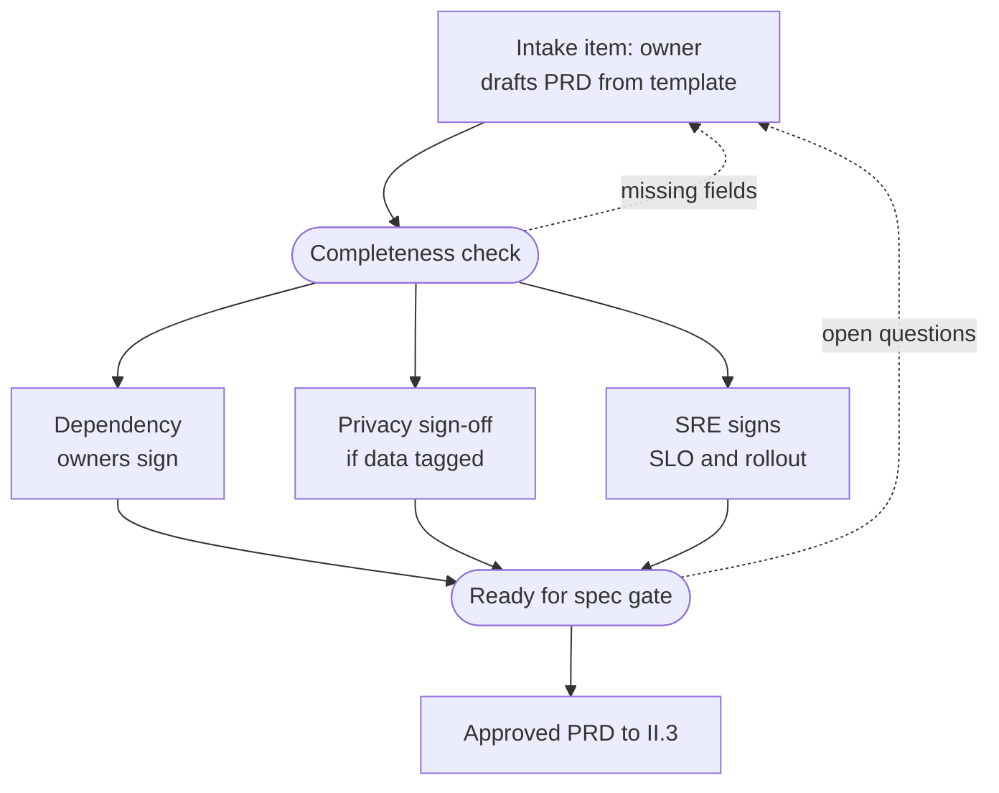
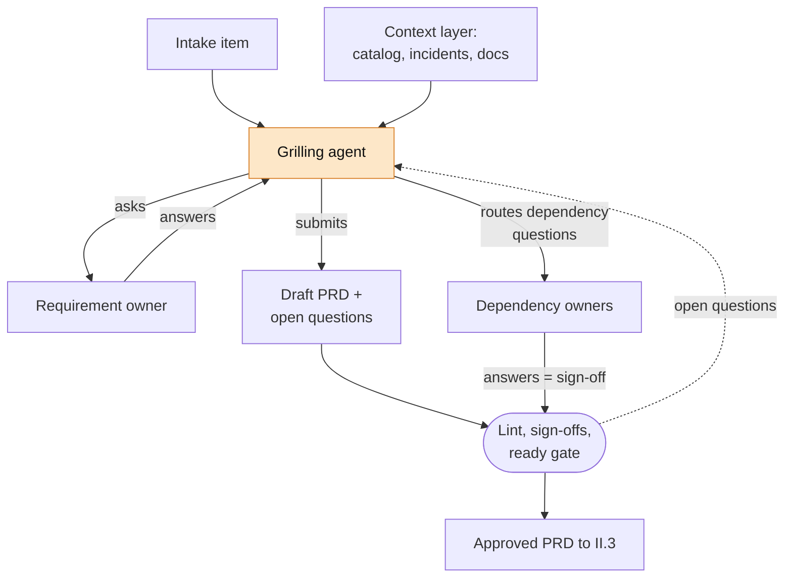

## II.2 Requirements (PRD; the "grilling" interview)

### Purpose

This stage turns an accepted intake item (see II.1) into an approved, testable product requirements document (PRD) that a spec writer or an agent can pick up without asking anyone. If the PRD is vague, every later stage multiplies the ambiguity. Agents can make this worse by filling gaps with plausible assumptions instead of asking, as Spotify found (see below) [SPOT5].

### The ideal deterministic process

Gates in the chart:

- **Completeness check.** A template linter. Required fields (our template, enforced by REQ-PRD-03; template: D1): problem and user, acceptance criteria written as observable checks, non-goals, a named accountable owner, dependencies (services and the teams that own them, read from the service catalog, see V.1), SLO impact, data classification, and rollout constraints (rings, flags, two-phase needs; see II.9).
- **Sign-offs.** Each dependency owner confirms what the PRD assumes about their service. Privacy and compliance sign off when the data classification requires it. SRE confirms the SLO and rollout constraints.
- **Ready for spec.** Zero open questions, every acceptance criterion testable, every sign-off recorded. Then the PRD moves to II.3.

Key metrics: share of PRDs that need clarification after the gate, rework traced back to requirements, and time from intake to ready. Microsoft Digital (Microsoft's internal IT organization) measures AI by impact, including rework, not usage [MS15]. [GAP: no source publishes any of these for a requirements stage.]

### Real-world reference

**GitHub Spec Kit** is GitHub's open-source toolkit for spec-driven development, described on Microsoft's developer blog [MS13]. Its first command, `/specify`, captures what is wanted and why, and explicitly excludes technical decisions (later commands belong to II.3). Specs are plain Markdown reviewed by humans or agents, and Spec Kit contrasts itself with waterfall PRDs: the spec is a living document that evolves with the code. Microsoft presents it as an experiment in a single blog post with an illustrative scenario [MS13]; the post asserts benefits but measures none.

**Anthropic's interview pattern** is the closest published version of the grilling agent. In Anthropic's Claude Code best practices, the agent interviews the requester (using the AskUserQuestion tool), writes the answers into a SPEC.md, and a fresh session implements from that file [AN5]. It is practice, not measured.

Other references: Microsoft Digital reports that its AI Work Item Assistant enforces structure at the start (work items with acceptance criteria), on the claim that this makes downstream agents produce better code [MS14]. GitHub's product guide (vendor marketing) puts issues with acceptance criteria and human plan approval at the front of its loop [GH2]. Spotify's Honk, its internal background coding agent for fleet-wide changes, uses an interactive intake agent that gathers information before handing a prompt to the coding agent [SPOT1].

### What to agentify, and how far

**Recommendation, in one line:** an agent grills the requirement owner and drafts a PRD that another agent can pick up, but the deterministic gate, not the agent, decides when it is clear; anything unresolved stays on an open-questions list. Start at Prepare (L1).

The template, the completeness check, the sign-offs and the ready gate stay deterministic. The agent asks the questions and writes the input (the PRD); even at its highest rung it only submits the PRD to the ready gate, and it never approves its own output.

**When grilling stops.** "Clear" has a mechanical definition: the draft passes the completeness lint and every acceptance criterion is an observable check. The agent stops asking when that holds, or when each remaining unknown is written on the open-questions list with a named person to answer it.

The chart shows the agent at Prepare and Act on approval; the table gives all five rungs.

Orange box is the agent; everything else is the deterministic core.

Spotify's dataset migration shows the failure mode: given a human migration guide, Honk "was left to make assumptions about how to map from one dataset field to another that were often incorrect" [SPOT5]. **Recommendation:** the agent reads the context layer before asking (see REQ-CTX-02), so its questions are specific: having read a past incident, it asks "What should happen to in-flight requests when the flag turns off?" rather than "Any edge cases?" (illustrative). It ends with a list of open questions, never with silent assumptions.

| Agent role | Rung | What it does | Guardrail | Evidence to promote |
|---|---|---|---|---|
| Grilling agent | Advise (L0) | Reviews a human-written PRD; lists missing fields, untestable criteria and unstated dependencies | Read-only | Owners act on most flagged gaps |
| | Prepare (L1) | Interviews the owner, drafts the PRD with an explicit open-questions list | Owner edits and submits; deterministic gate unchanged | Clarification rate after the gate at or below the human-only baseline; owner edits shrink over time |
| | Act on approval (L2) | Sends dependency questions to owners found in the service catalog; submits the PRD to the gate after one owner click | Can ask, never answer for another team; approval in the trust ledger | Dependency owners rarely reject its questions as wrong-target or irrelevant |
| | Act, then notify (L3) | Our proposal: submits single-service, no-sensitive-data PRDs to the ready gate without waiting for the owner's click, then notifies the owner, who can pull it back | The lint and SRE sign-off still apply; only with no privacy tags and no cross-team dependency; the gate, not the agent, approves | Rework traced to requirements no higher than for human-gated PRDs over a long sample |
| | Autonomous within budget (L4) | Not proposed | Requirements express human intent; a named human owner is accountable | n/a |

**Recommendation:** measure the clarification rate on agent-drafted versus human-drafted PRDs before promoting. [GAP: no source measures whether interview-driven specs reduce clarification or rework; all the rungs above are synthesis.]

### Enterprise complications

- **Requirements that span teams, and who answers.** A feature touching three services has three owners, and the requirement owner cannot speak for a dependency they do not own. The service catalog maps services to repos and owners [MS28]. **Recommendation:** the agent routes those questions to the dependency owner and records the answer as that owner's sign-off; unanswered questions block the ready gate. [GAP: no source describes a requirements stage negotiating across owning teams before work starts.]
- **Compliance and privacy.** **Recommendation:** let data classification in the PRD trigger the review, as catalog metadata triggers compliance scans at Microsoft Digital [MS28]. Interview transcripts may contain customer data; one conference talk reports that Uber's gateway redacts more than 20 PII types before model calls [AIE2]. [GAP: no source covers privacy review inside an agentic requirements flow.]
- **Living spec versus signed PRD.** Spec Kit treats specs as living documents [MS13], while enterprise approvals assume a fixed version. **Recommendation:** approve a versioned PRD; any later change to acceptance criteria or non-goals re-enters the ready gate.

### Requirements

| ID | Priority | Statement | Rationale | Source |
|---|---|---|---|---|
| REQ-PRD-03 | MUST | Every PRD uses one template whose required fields (see the completeness check above) are enforced by a linter. | A gate needs fields it can check | Recommendation; MS14, MS13 |
| REQ-PRD-04 | MUST | A PRD passes "ready for spec" only with zero open questions, testable criteria and all required sign-offs recorded. The gate is deterministic; no agent approves a PRD. | Ambiguity multiplies downstream | Recommendation; AN5, GH2 |
| REQ-PRD-05 | MUST | The grilling agent outputs open questions explicitly and never resolves an ambiguity by assumption. | Agents guess wrong silently | SPOT5; Recommendation |
| REQ-OWN-03 | MUST | Questions about a dependency go to its owner from the service catalog; only that owner's answer counts as a sign-off. | The requester cannot commit another team | MS28; Recommendation |
| REQ-CTX-02 | SHOULD | The grilling agent reads the service catalog, incident history and design docs before asking (as Uber's context graph links design docs, Jira and incidents, and Linear's triage agent flags open product decisions), and the approved PRD is stored in the repo. | OpenAI: what is not in the repo is invisible to agents | AIE2, AIE11, OAI1 |
| REQ-SEC-02 | MUST | Data classification in a PRD triggers privacy and compliance review automatically; transcripts pass PII redaction before model calls. | Compliance driven by metadata | MS28, AIE2 |
| REQ-GOV-02 | MUST | Clarification rate after the gate and rework traced to requirements are recorded per PRD in the trust ledger, for agent-drafted and human-drafted PRDs alike. | Promotion needs a baseline | Recommendation; MS15 |

### Open gaps

- No source measures whether interview-driven specs or requirements agents reduce clarification, rework or defects; Spec Kit, the Anthropic interview pattern and Honk's intake agent are practice only.
- No source describes requirements negotiated across several owning teams before work starts.
- No source covers privacy or compliance review inside an agentic requirements flow.
- No published metric definitions for "clarification rate" or "requirements rework"; the ones here are ours.
- AIE2 and AIE11 are conference talks, not published write-ups.
