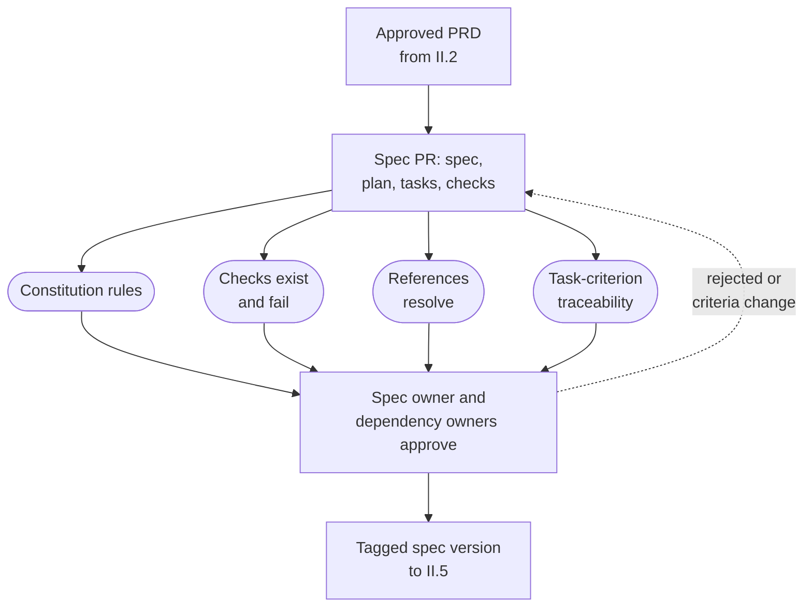
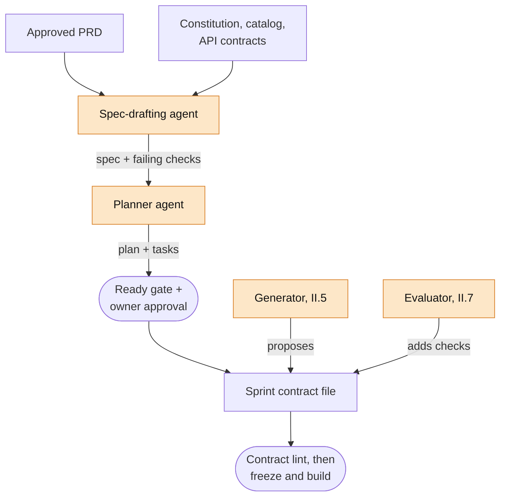

## II.3 Specification (constitution, acceptance criteria, sprint contracts)

### Purpose

This stage turns an approved PRD (see II.2) into a spec, plan and tasks that an agent can execute and a verifier can check. Its output is a versioned definition of done: every acceptance criterion exists as a failing check before code is written. Otherwise the code's author grades it, and agents "reliably skew positive" grading their own work [AN3].

### The ideal deterministic process

Gates in the chart (template for spec, plan, constitution and sprint contract: D4). Failures return the PR to its author. **Recommendation:** this ready gate is our synthesis; no source publishes one.

- **Constitution.** The plan is checked against the repo's `constitution.md`: approved stacks, layering rules, two-phase data changes (see II.9), security rules. **Recommendation:** each principle is a blocking lint or marked advisory, as Anthropic's Claude Code guidance separates hooks (scripts that always run) from CLAUDE.md (advice the model may ignore) [AN5].
- **Checks exist and fail.** Every acceptance criterion has an ID and at least one committed check (test, contract diff, lint rule or end-to-end script) that runs and fails. A criterion with no check, or a check that already passes, blocks the spec. The exception is non-regression criteria (existing behavior that must not change): they are marked as such and must pass.
- **References resolve.** APIs are named by contract and version (see II.4), services by their ID from the service catalog (see V.1).
- **Traceability.** Every task lists the criterion IDs it satisfies, and every criterion is covered by at least one task.
- **Approval and tag.** The spec owner and each changed dependency's owner approve; the merged spec gets a version tag that II.5 implements against.

The four checks are a script over repo files; the only human step is the owners' approval, which the script verifies before tagging. Key metrics: tasks needing a spec change mid-implementation, review findings traced to a missing criterion, and PRD-to-tag time. [GAP: no source publishes these.]

### Real-world reference

**Spec Kit** (see II.2): `/plan` adds frameworks, libraries and data contracts; `/tasks` splits the plan into phased chunks an agent can execute; and `constitution.md` holds non-negotiable principles every plan must obey, and can define organization-wide "opinionated stacks". The post calls it an experiment [MS13]. Microsoft's 1ES aims at "treating specs as a single source of truth to define what we're building" [MS7].

**Anthropic's long-running harnesses** are two write-ups on keeping coding agents productive for hours. In the first, an initializer agent writes a JSON feature list with every feature failing, and coding agents may change only its "passes" field: "It is unacceptable to remove or edit tests because this could lead to missing or buggy functionality." [AN2]. In the second, a planner writes a 16-feature spec over 10 sprints. Before each sprint, the generator (the coding agent) and the evaluator (a separate testing agent) negotiate a **sprint contract**: testable criteria (27 in one sprint) with hard thresholds; any failure fails the sprint [AN3]. With newer models Anthropic removed sprints, because "every component in a harness encodes an assumption about what the model can't do on its own" [AN3]. **Recommendation:** keep sprint contracts anyway at first, since in production they are also the audit record of what was checked; drop them only when the trust ledger shows they catch nothing.

Other references: OpenAI versions execution plans in the repo with progress and decision logs [OAI1]. GitHub's plan mode has a human approve the plan before implementation (vendor marketing) [GH2].

### What to agentify, and how far

> **Takeaway:** **Recommendation, in one line:** agents draft the spec, checks and plan; owners approve and freeze the checks, and the implementing agent can never weaken them. Start both agents at Prepare (L1).

The constitution, the ready-gate script, the owner approvals, the version tag and the contract lint stay deterministic; agents write inputs to them and never approve.

Orange boxes are agents; everything else is the deterministic core. This stage sets the sprint contract's rules; II.5 and II.7 apply them per task.

- **Spec-drafting agent.** From the PRD, constitution and context layer, writes `spec.md` and a failing check per criterion. Gaps go back to the PRD's open questions (see II.2), never invented.
- **Planner agent.** Writes tasks scoped to named services, files and criterion IDs. Anthropic keeps its planner high-level so spec errors do not cascade [AN3]; OpenAI's usage guide (no metrics) suggests about an hour or a few hundred lines per task [OAI2].
- **Sprint contract.** **Recommendation:** go beyond Anthropic's "passes"-only rule [AN2]: a lint ensures the contract only adds checks, and only the evaluator records results.

| Agent role | Rung | What it does | Guardrail | Evidence to promote |
|---|---|---|---|---|
| Spec-drafting agent | Advise (L0) | Reviews a human-written spec; flags criteria with no check, constitution conflicts and names that do not resolve | Read-only | Owners act on most flags |
| | Prepare (L1) | Drafts the spec and failing check stubs from the PRD, then opens a draft PR | Owner edits and approves; cannot edit `constitution.md` | Owner edits to the checks shrink over time; mid-implementation spec changes at or below the human baseline |
| | Act on approval (L2) | Submits to the ready gate and requests reviews from dependency owners found in the catalog | Cannot approve; gate unchanged | Dependency owners rarely reject its requests |
| | Act, then notify (L3) | Our proposal: fixes non-semantic defects in a tagged spec (broken links, renamed paths, typos), re-runs the gate and notifies the owner | The gate, not the agent, re-tags, and only when the diff touches no criterion, check, non-goal or contract reference | No amendment reverted as semantic over a long sample |
| | Autonomous within budget (L4) | Not proposed | The spec is the definition of done; weakening it weakens every later gate | n/a |
| Planner agent | Advise (L0) | Flags oversized tasks, criteria no task covers and conflicting file scopes | Read-only | Flags acted on |
| | Prepare (L1) | Drafts the plan and tasks with criterion IDs, scopes and order | Human approves the plan [GH2] | Tasks finish without a re-plan; tasks stay inside the size budget |
| | Act on approval (L2) | Files the tasks and announces which files each task will edit (see Cross-service specs below), after approval | Only tasks inside the tagged spec | Few claim conflicts with other teams |
| | Act, then notify (L3) | Our proposal: re-plans within the approved spec (splits or reorders tasks) after a task fails CI twice, then notifies | Criteria and checks untouched; the gate script, not the agent, accepts the new plan | Re-plans do not raise the revert rate |
| | Autonomous within budget (L4) | Not proposed | Scope belongs to the spec owner | n/a |

[GAP: no source measures spec or planner agents; the rungs are synthesis.]

### Enterprise complications

- **Cross-service specs.** **Recommendation:** a parent spec with a child per owning repo, each approved by its owner; the parent is ready when every child is. Criteria spanning services need checks across them: one conference talk warns "Two passing PRs can disagree about the meaning of a value." and recommends announcing intended file edits early [AIE10]. [GAP: no source describes a spec split across owning teams.]
- **API contracts.** Specs cite contracts by version. At Azure, "Any change of behavior requires a change in the API version." [MS25], so new behavior needs a new contract version, agreed in II.4.
- **Service catalog.** Service IDs, owners and dependencies come from the service catalog (see V.1). **Recommendation:** the gate fails on an unknown or retired ID.
- **Decisions outside the code.** In one talk, Linear's review agent searches past decisions, reverts and incidents [AIE11]. **Recommendation:** keep a decision log in the spec, as OpenAI does in plans [OAI1].

### Requirements

| ID | Priority | Statement | Rationale | Source |
|---|---|---|---|---|
| REQ-VER-01 | MUST | Every acceptance criterion has an ID and at least one committed check, and that check fails before implementation starts. | Done is fixed before the code exists | AN2, AN3; Recommendation |
| REQ-VER-02 | MUST | Implementing agents cannot edit, delete or loosen spec checks or sprint-contract checks; only the evaluator records results. | Self-grading skews positive | AN2, AN3; Recommendation |
| REQ-VER-03 | MUST | The ready-for-implementation gate is a deterministic script that checks constitution rules, red checks, resolved references and two-way traceability, and verifies that owner approvals are recorded. No agent approves a spec; the one exception is the non-semantic amendments allowed at Act, then notify, which the script re-validates. | Repeatable, auditable gate | Recommendation; MS13, GH2 (constitution, plan approval only) |
| REQ-CTX-03 | MUST | Spec, plan, tasks, constitution and decision log live in the repo; implementation runs against a tagged spec version, and changes to criteria or non-goals re-enter the gate. | Versioned intent; the repo is what agents see | OAI1, MS13, MS7 |
| REQ-API-01 | MUST | Specs refer to API contracts by name and version (see II.4); a criterion implying new behavior requires a new contract version. | Behavior change means a version change | MS25 |
| REQ-OWN-04 | MUST | A cross-service spec has one child spec per owning repo, approved by that owner from the service catalog (see V.1); the parent is ready only when all children are. | No team commits another's service | Recommendation; AIE10 |
| REQ-GOV-03 | SHOULD | Mid-implementation spec changes and review findings traced to a missing criterion are recorded in the trust ledger, for agent-drafted and human-drafted specs alike. | Promotion needs a baseline | Recommendation |

### Open gaps

- No source measures whether checks-before-code reduces rework or escaped defects.
- Sprint contracts are published only for single apps built from a prompt [AN3].
- No source describes cross-team specs or a "ready for implementation" gate.
- AIE10 and AIE11 are talks.
- The sprint-contract file schema (criterion IDs, checks, thresholds, evaluator results) is now in the kit (template: D4).
