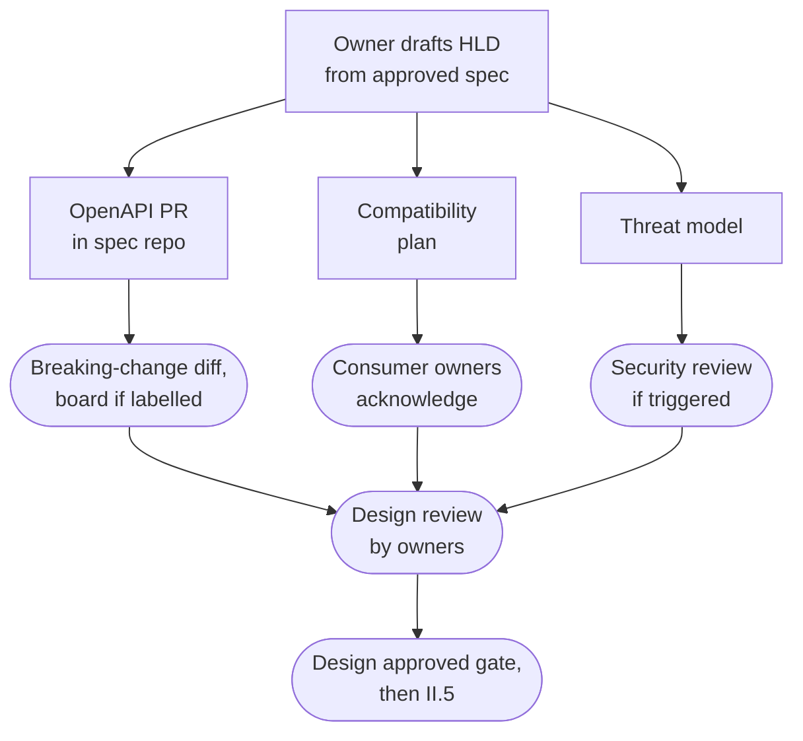
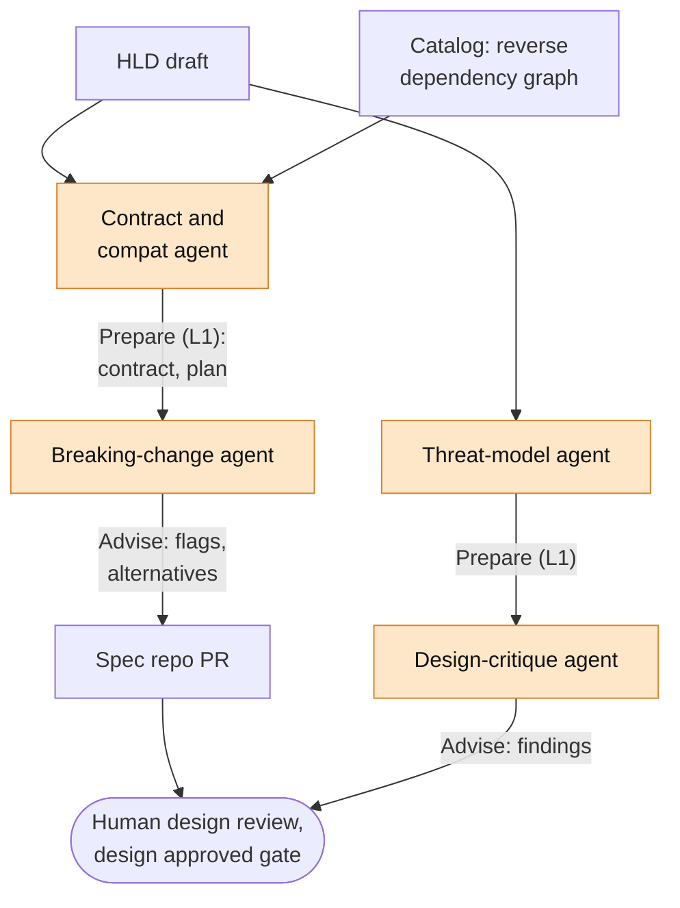

## II.4 High-level design, API contracts, threat model

### Purpose

This stage turns an approved spec (see II.3) into a reviewed design for a change that crosses service boundaries: a high-level design (HLD), any API contract change written spec-first in OpenAPI, a compatibility and rollback plan, and a threat model. Breaking changes and one-way doors (changes that cannot be rolled back) are cheapest to catch here.

### The ideal deterministic process

Gates in the chart:

- **Breaking-change diff.** The contract change is a PR against a central spec repo. Azure's tool, azure-openapi-diff, compares it with the latest GA and preview versions and labels breaking changes, which only a human review board can clear [MS25]. The rule behind it: "Any change of behavior requires a change in the API version." [MS25].
- **Compatibility plan and consumer acknowledgement.** Rollback safety is planned here and executed in II.9. AWS's rule is "we fully prepare ourselves for a rollback before every deployment." [AWS3]. Owners of every consumer, listed from the service catalog (see V.1), acknowledge a breaking or deprecating change.
- **Security review and design review.** **Recommendation:** a new endpoint, caller, data class or trust boundary in the threat model triggers security review; the service owner and dependency owners named in the PRD (see II.2) then review the whole design (template: D9).
- **Design approved.** **Recommendation:** a checklist, not a judgment: artifacts present, labels resolved, sign-offs recorded (template: D9).

Key metrics: breaking changes caught at design rather than later, and board turnaround. [GAP: no source publishes either.]

### Real-world reference

**Azure's breaking-change model** is Microsoft's answer to cross-team contract safety [MS25]. All Azure REST API definitions live as OpenAPI in one GitHub repo, azure-rest-api-specs. On every PR, azure-openapi-diff compares the change with the latest GA and preview versions and applies `BreakingChangeReviewRequired`; a change without a version bump gets `NewApiVersionRequired`. The PR cannot merge until the Breaking Change Review Board (Azure API reviewers who must approve any breaking change) grants `Approved-BreakingChange`. The board holds weekly office hours and usually proposes a non-breaking alternative instead [MS25].

**Two-phase deployment** is AWS's discipline for avoiding one-way doors [AWS3]. Most failed rollbacks come from protocol or serialization changes that the old version cannot read. The Prepare phase ships the ability to read the new format while still writing the old; the Activate phase, after bake, starts writing it. Rolling forward, readers go before writers; rolling back, writers go before readers, and an upgrade-downgrade test proves both [AWS3].

For the threat model, the published guidance (not a measured practice) gives the properties a design must show. Microsoft's Secure Future Initiative (SFI) overview names agents: "Restrict developer, agent, and pipeline access based on role and build context." [MS19]. Google's BeyondProd: "Only authenticated, trusted, and specifically authorized callers or services can access any other service.", with end-user context carried separately from service identity [GOOG7].

### What to agentify, and how far

**Recommendation, in one line:** agents critique the design, draft the contract, compatibility plan and threat model, and pre-check for breaking changes; the diff tool, the board, the design review and the design-approved gate stay deterministic or human, and no agent applies an approval label.

Design itself stays human: the .NET team found Copilot Coding Agent weaker at architecture [MS8]. But Microsoft built its AI reviewer partly because humans missed architecture and security issues [MS6], and the Azure SRE Agent team runs specialized security-review agents [MS9]. Anthropic separates the agent doing the work from the agent judging it, because agents "reliably skew positive" grading their own work [AN3]; the critique agent is that separate judge and drafts nothing.

Orange boxes are agents; everything else is the deterministic core.

| Agent role | Rung | What it does | Guardrail | Evidence to promote |
|---|---|---|---|---|
| Design-critique agent | Advise (L0) | Reviews the HLD, contract and threat model against the API guidelines, SFI properties and past incidents; lists findings | Read-only; drafts nothing it judges | Reviewers accept most findings; few design issues found later in II.6 |
| Threat-model agent | Prepare (L1) | Drafts the first-pass threat model: new callers, data classes, trust boundaries | Security reviewer owns it; critiqued by the critique agent, never by itself | Reviewer edits shrink over time |
| Contract and compat agent | Prepare (L1) | Drafts the OpenAPI change and the compatibility plan (Prepare-phase/Activate-phase split, order, upgrade-downgrade test); lists consumers from the catalog | Human owner edits and opens the PR | Plans accepted unchanged; no rollback later blocked by an unplanned format change |
| | Act on approval (L2) | Opens the spec-repo PR and notifies consumer owners | Owner approves; cannot touch consumer repos | Low revert rate on its contract PRs |
| Breaking-change agent | Advise (L0) | Runs the diff tool on the draft before the PR, explains each flagged change, proposes a non-breaking alternative | Read-only; CI's labels stay authoritative | Pre-PR verdicts match CI; the board accepts its alternatives |
| | Act, then notify (L3) | Applies `BreakingChangeReviewRequired` when it finds a behavior change the diff missed (for example a unit change), then notifies the author | Can add that blocking label, never remove or approve one; the board can clear it (a logged human override), and the label is never an approval | Board upholds nearly all its labels; few later-confirmed misses |

Its highest rung only makes the gate stricter, which is why Act, then notify is safe. No role reaches Autonomous within budget (L4): a design commits other teams. Action limits follow the agent action policy (template: D6). [GAP: no source describes agents in a design or API-review stage; the rungs are synthesis.]

### Enterprise complications

- **Consumers owned by other teams.** **Recommendation:** list consumers from the reverse dependency graph in the service catalog (see V.1), which at Microsoft Digital links services to repos and owners [MS28], and gate on their acknowledgement. mabl, a test-automation vendor, reports a coordination graph across 79 repos that prescribes release order, upstream first: "Any breaking change requires coordinated PRs." [MABL1].
- **Heterogeneous architectures.** azure-openapi-diff covers REST only [MS25]. gRPC, events and shared tables need their own schema diff; mabl's graph tracks Pub/Sub topics and table ownership [MABL1].
- **Consumer-driven contracts.** [GAP: no frontier company has published consumer-driven contract testing at scale.] In our reading, the published checks run from the provider side; AWS adds a pre-production stage (zeta) that calls real production endpoints [AWS1].
- **Semantic changes.** One conference talk warns "Two passing PRs can disagree about the meaning of a value." [AIE10]; a schema diff misses a unit change. Under Azure's rule that any behavior change needs a new version [MS25], a unit change would need one.
- **Internal APIs.** **Recommendation:** keep Azure's diff and labels, with a shorter deprecation window recorded in the catalog.

### Requirements

| ID | Priority | Statement | Rationale | Source |
|---|---|---|---|---|
| REQ-API-02 | MUST | Every API contract change is written spec-first as OpenAPI (or the protocol's schema) in a central spec repo before implementation starts. | One reviewable contract | MS25, MS26 |
| REQ-API-03 | MUST | CI diffs each contract PR against the latest GA and preview versions and applies blocking labels for breaking changes and missing version bumps; only a human board member can apply the approval label. | Deterministic, auditable breaking-change gate | MS25 |
| REQ-API-04 | MUST | Any behavior change gets a new dated version (`api-version=YYYY-MM-DD[-preview]`), versioned from the first release. Breaking a GA version needs board approval, a documented reason (security, compliance, legal or rare architecture needs) and a recorded migration window (Azure: typically three years; previews 90 days). | Consumers never break silently | MS25, MS26 |
| REQ-API-05 | MUST | Every data-format or protocol change has a compatibility plan at design time: Prepare-phase/Activate-phase split, reader/writer order and an upgrade-downgrade test. Execution and Prepare-phase verification are REQ-DEP-04 (see II.9). | Rollback must stay possible | AWS3 |
| REQ-OWN-05 | MUST | Consumers are listed from the service catalog's reverse dependency graph, and each consumer owner acknowledges a breaking or deprecating change before design approval (complements REQ-OWN-03 in II.2). | The provider cannot commit other teams | MS28, MABL1; Recommendation |
| REQ-SEC-03 | MUST | A threat model accompanies every HLD; a new endpoint, caller identity, data class or trust boundary triggers security review, and the design states per-caller authorization and agent access by role. | SFI and zero-trust properties shown at design time | Recommendation; MS19, GOOG7 |
| REQ-REV-01 | MUST | "Design approved" is a deterministic check: HLD, contract PR with labels resolved, compatibility plan, consumer acknowledgements, threat model and sign-offs all present. No agent approves a design or applies an approval label. | Agents grade their own work too kindly | AN3; Recommendation |

### Open gaps

- No source describes an HLD template, a design-review process or a threat-modelling method; our design review and threat-model template is D9.
- No frontier company has published consumer-driven contract testing.
- No source shows a breaking-change gate for gRPC, event or database-schema contracts.
- No source describes agents in design critique, contract drafting or breaking-change review.
- No published metrics for a design stage.
- mabl is a 25-engineer vendor, and AIE10 is a single conference talk.
