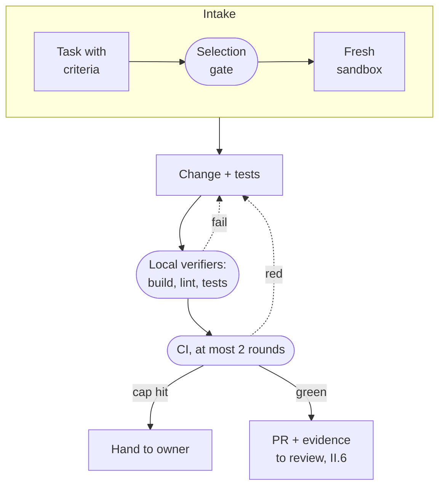
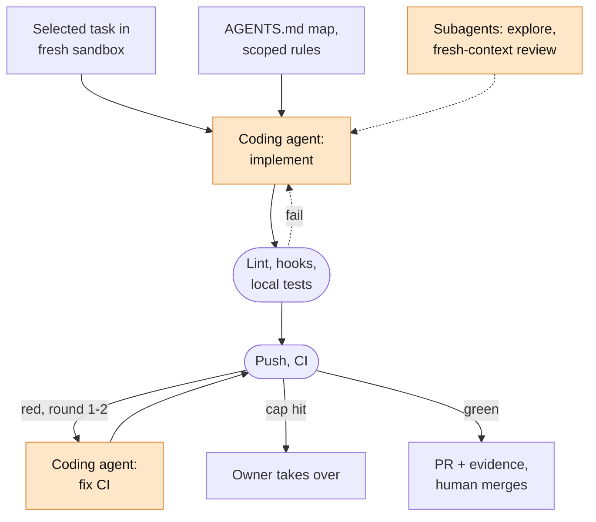

## II.5 Implementation (task decomposition, sandboxes, blueprints)

### Purpose

This stage turns an approved spec and task plan (see II.3) into a pull request against an existing service. Agents write the code; a deterministic shell decides what they may touch, which checks they must pass and when they stop. The output is a PR carrying its own evidence (see II.6).

### The ideal deterministic process

Gates:

- **Task selection by verifiability.** A task enters only if it is scoped (OpenAI suggests about an hour or a few hundred lines [OAI2]) and verifiable, as Anthropic engineers choose what to delegate [AN4]. The gate is a rule: the task's class is on the trust-ledger allow-list (REQ-GOV-04) and the task names its verifying command.
- **Sandbox.** Fresh, isolated, built from the repo's setup, with no production access.
- **Local verifiers** (build, lint, fast tests) enforce the service's invariants before anything is pushed.
- **CI-round cap.** After the cap (two rounds at Stripe [STRIPE1]) the task returns to a human with its log.
- **PR with evidence.** A conference talk (Neo4j): "A passing-test claim needs a command, a result and the version of the code it checked." [AIE13]

### Real-world reference

**GitHub Copilot coding agent (CCA)** is GitHub's cloud coding agent. A maintainer assigns it an issue and it opens a PR that humans review [MS8]; GitHub's product guide says it works in a cloud sandbox on an isolated copy of the repo, guided by repository instructions with validation commands [GH2]. In dotnet/runtime, "CCA cannot open PRs on its own": every PR exists because a maintainer asked for it, and GitHub's AI reviewer, Copilot Code Review (see II.6), runs on every PR [MS8].

**Stripe Minions** are unattended coding agents: a Slack message, ticket or flaky-test alert goes in; a CI-passing PR ready for human review comes out [STRIPE1]. Each run gets a pre-warmed devbox, ready in about 10 seconds and isolated from production and the internet, so the agent runs with full permissions and no prompts. A **blueprint**, written in code, interleaves deterministic nodes (lint, push) with agent nodes (implement, fix CI) [STRIPE1].

Ten months of numbers:

- **CCA** [MS8]. Merge rate 67.9% (535 of 878), rising from 41.7% in month one to about 71%; Microsoft employees' PRs: 87.1% (different populations, directional only).
- Small changes do better (1 to 10 lines: 80.0%; 101 to 500 lines: 64.0%); reverts 3 of 535, too few to compare.
- **Minions** [STRIPE1]. More than 1,300 fully minion-written, human-reviewed PRs merge each week. CI runs more than 3 million tests.

### What to agentify, and how far

**Recommendation, in one line:** the agent writes code and fixes its CI failures inside a sandbox and blueprint; selection, verifiers, the CI cap and the merge stay deterministic. For feature code the ceiling today is Act on approval: the agent opens the PR, and a human merge is the approval. Act, then notify applies only to allow-listed maintenance classes, where the deterministic gates, not the agent, approve the merge.

Orange boxes are agents; the rest is the blueprint's deterministic core. The chart shows Act on approval; the table gives all five rungs.

**Context as a map.** OpenAI gave Codex, its coding agent, "a map, not a 1,000-page instruction manual": a roughly 100-line AGENTS.md (a Markdown file at the repo root that agents read first) pointing into versioned in-repo docs [OAI1] (template: D3). Owners and dependencies come from the service catalog (see V.1).

**The inner loop enforces invariants.** OpenAI's custom lints feed remediation text to the agent [OAI1]. Instruction files are advisory, but hooks (scripts the harness runs at fixed points) "are deterministic and guarantee the action happens", so a stop hook blocks completion until checks pass [AN5]. Spotify's Honk, its fleet-wide coding agent, runs verifiers chosen by repo contents before any PR opens, then an LLM judge, aimed at scope creep, that vetoes about 25% of sessions (its accuracy is not yet evaluated) [SPOT4]. GitHub's Applied Science team reports a contract-test area only humans can change [GH1].

**Subagents.** A fresh context reviews better, "since Claude won't be biased toward code it just wrote" [AN5]. One conference talk by a Microsoft engineer argues that subagents need distributed-systems discipline: fan-out budgets and explicit unknown outcomes [AIE1]. **Recommendation:** use subagents to explore and review independently, not to vote on unverified claims. A second agent, the context gardener, proposes AGENTS.md, lint and test fixes after repeated failures.

| Agent role | Rung | What it does | Guardrail | Evidence to promote |
|---|---|---|---|---|
| Coding agent (implement and fix-CI nodes) | Advise (L0) | Investigates the issue, explains the code path, proposes a plan | Read-only sandbox | Plans accepted by maintainers |
| | Prepare (L1) | Produces a branch and diff in the sandbox; a human opens the PR | No push rights | Diffs kept with few edits |
| | Act on approval (L2) | Opens the PR, fixes CI up to the cap, answers review comments; a human merge is the approval. This is where CCA and Minions run today [MS8, STRIPE1] | Sandbox isolation, CI cap, protected tests, required human review | Merge and revert rates per task class at or near the human baseline over hundreds of PRs |
| | Act, then notify (L3) | Its PR in an allow-listed class (lint fixes, dependency bumps) merges once every deterministic gate passes; it then notifies the owner | Allow-listed maintenance classes only; risk score low (see II.8) | Zero escaped defects in the class over a long sample |
| | Autonomous within budget (L4) | Picks backlog items itself and ships them | Not proposed (future at most) | n/a |
| Subagents (explore, fresh-context review) | Advise (L0) | Explore code paths; review the diff without the author's context [AN5] | Read-only; findings go to the coding agent and into the PR | Findings humans confirm |
| Context-gardener agent | Prepare (L1) | Proposes AGENTS.md, lint and test-gap fixes after failures | A human adopts the proposal and opens the PR | Proposed rules reduce repeat failures |
| | Act on approval (L2) | Opens context-fix PRs on a schedule [OAI1, GH1] | Cannot weaken a lint or delete a test | Low revert rate |

Precedents for Act, then notify (policy template: D6): Spotify auto-merges most of its maintenance PRs [SPOT2]; OpenAI's team let agents merge their own, but in a greenfield repo [OAI1]. [GAP: no source measures promotion from Act on approval to auto-merge for feature code on a production service.]

### Enterprise complications

- **Multi-repo changes.** mabl (vendor-reported, 25 engineers) keeps a 79-repo coordination graph giving agents the repos to change, merge order (upstream first) and reviewers [MABL1]. **Recommendation:** open linked PRs in dependency order from the service catalog (see IV.1, V.1).
- **Legacy code is harder.** One talk reports that gaps humans tolerate (50 to 60% coverage, flaky builds) become hard constraints for agents [AIE8]. CCA is weaker at architecture [MS8]. Where Spotify's target repos lacked tests, owners tested by hand [SPOT5]. **Recommendation:** backfill tests and verifiers first (see II.7). [GAP: no measured legacy versus modern comparison.]
- **Secrets and agent identity.** Stripe's sandbox has no production access or real user data [STRIPE1]. Entra Agent ID gives each agent an audited identity with a human sponsor [MS12], preferring managed identity over secrets [MS22] (see IV.4). [GAP: no source says which identity CCA acts under.]
- **Cost and time bounds.** The CI cap bounds spend [STRIPE1]; mabl stops after two consecutive auto-fix commits [MABL1]. Anthropic's harness runs ranged from $9 in 20 minutes (core feature broken) to $200 in 6 hours [AN3]. [GAP: CCA compute and CI cost is unmeasured.]

### Requirements

| ID | Priority | Statement | Rationale | Source |
|---|---|---|---|---|
| REQ-CTX-04 | MUST | Each repo has a short AGENTS.md that maps into versioned in-repo docs and lists build, test and validation commands; rules are scoped by directory (template: D3). | Agents see only the repo | OAI1, STRIPE1, MS8 |
| REQ-PIPE-01 | MUST | Every agent task runs in a fresh, ephemeral sandbox built from the repo's environment definition, with no production access, no real customer data and network egress limited to an allow-list. | Isolation replaces per-action prompts | STRIPE1, SPOT4, GH2; Recommendation for egress allow-list |
| REQ-VER-04 | MUST | Local verifiers (build, lint with remediation text, fast tests) run as deterministic hooks before a PR opens; any failure blocks it. Agents cannot edit protected tests or weaken lints. | Invariants enforced, not requested | OAI1, AN5, SPOT4, GH1, AN2 |
| REQ-COST-01 | MUST | Each task has a CI-round cap (default 2), a wall-clock limit and a token budget; on any limit it stops and hands its log to the owner. | Bounded cost and time | STRIPE1, MABL1; Recommendation for budgets |
| REQ-REV-02 | MUST | Every agent PR lists each verification claim with the command, result and commit SHA, links the originating task, and is merged only by a human with ownership of the code, except allow-listed classes promoted to Act, then notify, which merge only after every gate passes. | Cheaper, honest review | AIE13, MS8 |
| REQ-GOV-04 | MUST | The trust ledger records, per task class, merge rate, revert rate, CI rounds and human-pushed commits; tasks are routed to agents only in classes that meet the bar. | Route by evidence, not by hope | MS8; Recommendation (template: D7) |
| REQ-IDN-01 | MUST | Each coding agent acts under its own identity with a human sponsor (Entra Agent ID), using managed identity rather than stored secrets; its commits and PRs are attributed to that identity. | Audit and least privilege | MS12, MS22 |
| REQ-REPO-01 | SHOULD | A change spanning repos is opened as linked PRs in dependency order taken from the service catalog, with reviewers from code owners. | Breaking changes need coordinated PRs | MABL1; see IV.1, V.1 |

### Open gaps

- No evidence on auto-merging agent feature code on a production service; the Act, then notify rung is synthesis.
- No measured legacy versus modern comparison.
- CCA's runtime identity, network policy and credentials are undescribed.
- Cost per accepted PR is unpublished.
- Blueprint template with caps and budgets as config (template: proposed).
