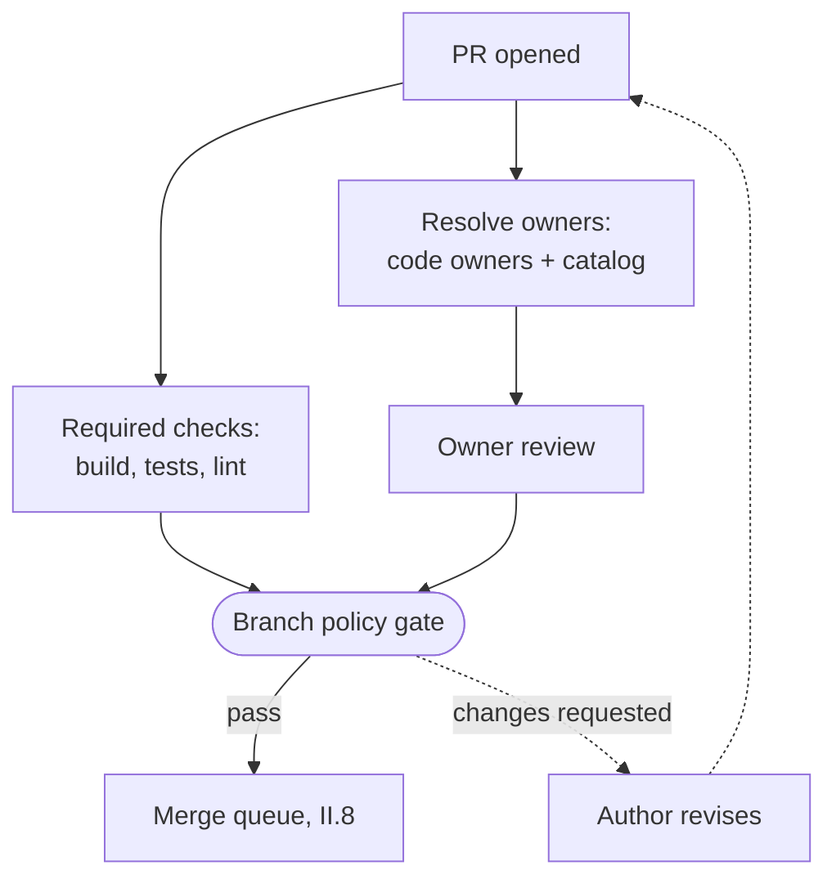
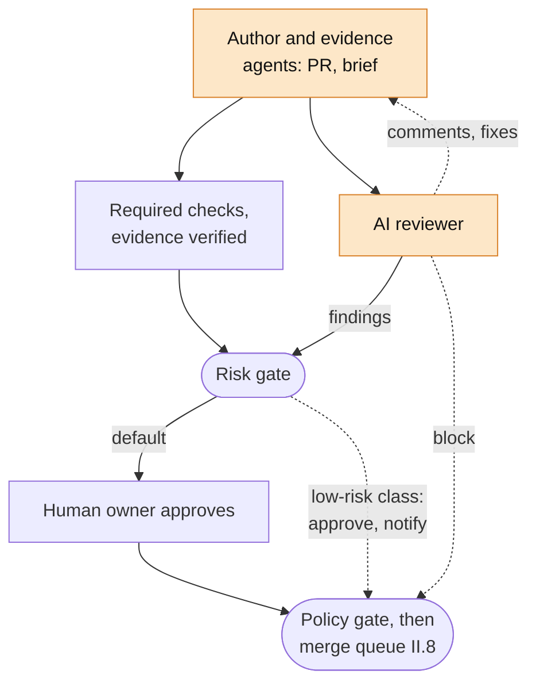

## II.6 Code review (AI first pass, human ownership)

### Purpose

This stage decides whether a change may enter the merge queue (see II.8), and who is accountable for it. When agents write most of the code, review becomes the constraint: Spotify reports "we now have 76% more PRs to review" [SPOT2], and Google found in its AI migrations that "The bottleneck in the process was the speed at which engineers could review the changes" [GOOG2]. The goal is cheaper, better-aimed human review, not removing the owner.

### The ideal deterministic process

This follows Microsoft's release flow (its trunk-based branch and PR model), where owners of touched code become required reviewers automatically [MS27]. Gates in the chart:

- **Required checks.** Build policies and a fast test pass on every PR [MS27]; lint is our addition.
- **Owner resolution.** **Recommendation:** reconcile code-owner files with owners from the service catalog (see V.1) [MS28].
- **Branch policy.** No direct pushes to `main` [MS27]. mabl, a test-automation vendor, encodes one human approval, required checks and a merge queue as org rules in code [MABL1] (vendor-reported).

Key metrics: time to first review, review rounds, revert rate, and time to merge.

### Real-world reference

**Microsoft's AI code review** is an internal assistant that joins every PR as an automatic reviewer and leaves categorized line comments (null checks, exception handling, sensitive data) and PR summaries in the normal thread [MS6]. "When AI suggests code changes, it does not commit them directly."; the author applies them and "All changes are attributed to the commit history" [MS6]. It covers more than 90% of PRs company-wide (more than 600K PRs a month, 5,000 repos), and early experiments showed a 10 to 20% improvement in median PR completion time, method not detailed [MS6]. In dotnet/runtime, Copilot Code Review runs on every PR, including the coding agent's [MS8].

**uReview** is Uber's in-house AI second reviewer, running in CI across six monorepos [UBER1]. It filters its own comments for confidence and suppresses categories developers dislike, because "comment quality matters far more than quantity." Every comment gets a Useful/Not Useful vote, and a check on the final commit records whether it was addressed. It covers more than 90% of about 65,000 weekly diffs; 75% of comments are rated useful and 65% are addressed in the changeset, against 51% for human reviewers' comments; Uber estimates about 1,500 hours saved a week, assuming 10 minutes per second human review [UBER1].

### What to agentify, and how far

> **Takeaway:** **Recommendation, in one line:** an AI reviewer gives every PR a first pass whose high-precision findings can block it, but no agent approves; the only exception, our proposal, is that the deterministic risk gate (see II.8) approves named low-risk change classes and notifies the owner.

Checks, owner resolution, the risk gate and branch policy stay deterministic.

Orange boxes are agents; everything else is the deterministic core.

**Human review of agent-authored PRs.** Google's rule: "Humans review the LLM-generated code the same way as any other code" [GOOG2]. Every dotnet/runtime coding-agent PR is opened at a maintainer's request [MS8]; Shopify's head of engineering says in an interview that a human reviews every merge [SHOP1]. **Recommendation:** whoever requested the agent's work counts as its author, so another owner approves, except in mechanical low-risk classes (Spotify lets the engineer driving a fleet-wide migration with its Honk agent approve those PRs [SPOT7]).

**Block early, approve last.** mabl's rule: "AI code review blocks problematic PRs but explicitly cannot approve them." [MABL1] (vendor-reported). We keep it except for the opt-in L3 class. A block only adds a deterministic check, so it comes once a category's precision is proven; an approval removes a human, so it comes last, and the risk gate decides, not the agent.

**Evidence makes review cheaper.** One conference talk generates PR descriptions from the agent's session trace and requires evidence for every claim: "A passing-test claim needs a command, a result and the version of the code it checked." Cheaper models then check the description for unsupported claims and omitted facts [AIE13]. **Recommendation:** the pipeline re-checks each claimed test run against the commit SHA, so the human reads verified facts (tests and proofs come from II.7; template: D7).

| Agent role | Rung | What it does | Guardrail | Evidence to promote |
|---|---|---|---|---|
| AI reviewer | Advise (L0) | Categorized comments, PR summary, in-thread answers | Confidence thresholds, low-value categories suppressed; rolled out team by team [UBER1] | Per-category useful and addressed rates at or above human comments |
| | Prepare (L1) | Proposes a fix as a suggestion | Author must apply it [MS6] | Suggestions applied with few edits |
| | Act on approval (L2) | Commits the fix after one author click | Commit attributed [MS6] | No reverted applied fixes |
| | Act, then notify (L3): block | Findings in proven categories feed a required check that blocks merge; owner notified | Owner can dismiss with a reason (a human override), logged in the trust ledger (template: D7); a block is never an approval | Low dismissal rate per category |
| | Act, then notify (L3): low-risk class | A clean review is one input to the deterministic risk gate, which approves named low-risk classes (docs, lint, generated config) and notifies the owner. Our recommendation | Owner opts in per repo; class and risk checks are deterministic (see II.8); sampled human audit; demoted on any revert (template: D6) | Over a long sample, revert and escaped-defect rates no higher than human-approved PRs of the same class |
| | Autonomous within budget (L4) | Not proposed | Approving non-routine changes would remove the accountable human owner | n/a |
| Evidence agent | Prepare (L1) | Drafts the PR description and evidence brief from the session trace | Pipeline verifies each claim against the commit | Reviewers rarely find unsupported or omitted claims |

### Enterprise complications

- **Cross-team PRs.** Google shards large-scale changes by ownership, sends mechanical patterns to a small group of global approvers and has local owners review only where local context matters [GOOG6]; owning reviewers approve sharded AI migrations [GOOG2]. Spotify's owning teams tested and merged 240 agent PRs themselves [SPOT5]. mabl's coordination graph supplies reviewers and merge order [MABL1] (vendor-reported).
- **Owners overloaded by agent PRs.** Spotify auto-merges what is safe, closes stale PRs and prioritizes the PR inbox [SPOT2, SPOT7]; Google caps outstanding shards [GOOG6]. Meta uses its Diff Risk Score, a model that predicts how likely a diff is to cause an incident (see II.8), for reviewer selection [META2]. **Recommendation:** a per-owner cap on open agent PRs.
- **Provenance and identity.** Entra Agent ID's documentation says each agent gets its own identity, with its sponsor recorded and activity logged as an agent's [MS12]; Microsoft's own pilot uses it [MS18]. **Recommendation:** the PR shows agent identity, sponsor, task, model and evidence brief. [GAP: no source shows this in a PR.]
- **The reviewer reads untrusted text.** PR text and code can carry instructions aimed at the AI reviewer. **Recommendation:** the reviewer can only comment and set its check; L3 approval rests on the deterministic class check. [GAP: no source covers prompt injection against AI reviewers.]

### Requirements

| ID | Priority | Statement | Rationale | Source |
|---|---|---|---|---|
| REQ-REV-03 | MUST | Owners of touched code, from code-owner files reconciled with the service catalog, are added as required reviewers automatically; branch policy blocks direct pushes and requires passing checks and one human owner approval, except under REQ-REV-08. | Ownership stays human and deterministic | MS27, MS28, MABL1; Recommendation for reconciliation |
| REQ-REV-04 | MUST | The same AI reviewer runs on every PR, human or agent; fixes are applied only by an explicit author action and attributed in commit history. | Uniform first pass; accountability | MS6, MS8 |
| REQ-REV-05 | MUST | The AI reviewer's findings in proven high-precision categories feed a required blocking check, which a human owner can dismiss with a logged reason; approval happens only under REQ-REV-08. | A block adds safety; an approval removes a human | MABL1; Recommendation |
| REQ-REV-06 | MUST | Each AI comment carries a usefulness vote and an addressed-or-not record; categories below a precision threshold are suppressed, and rollout proceeds team by team. | False positives make developers ignore the tool | UBER1 |
| REQ-REV-07 | MUST | Agent PRs carry an evidence brief: each claimed test run gives command, result and commit SHA, re-verified by the pipeline. | Reviewers read facts, not claims | AIE13; Recommendation |
| REQ-REV-08 | SHOULD | Approval without a human applies only to named low-risk classes, decided by the deterministic risk gate, opted in per repo, with sampled audit and automatic demotion on revert. | Spend human review where it matters | Recommendation; SPOT2, META2 |
| REQ-IDN-02 | MUST | Agent PRs are authored under the agent's own identity, show its sponsor and task, and the sponsor is not the sole approver outside low-risk classes. | Reviewers know who and what wrote the change | MS12, MS18; Recommendation |
| REQ-OWN-06 | SHOULD | Cross-team agent changes are sharded by ownership, with a global approver for mechanical patterns and a per-owner cap on open agent PRs. | Owners are the scarce resource | GOOG6, GOOG2, SPOT7; Recommendation for the cap |

### Open gaps

- No source describes a risk gate approving low-risk classes after AI review; the L3 low-risk rung is our proposal.
- Microsoft publishes no method for its 10 to 20% figure and no precision or addressed rates.
- No source compares revert or defect rates of AI-reviewed against human-only-reviewed PRs.
- Evidence-carrying PRs rest on one conference talk (AIE13).
- The PR evidence brief is in the kit (template: D7).
