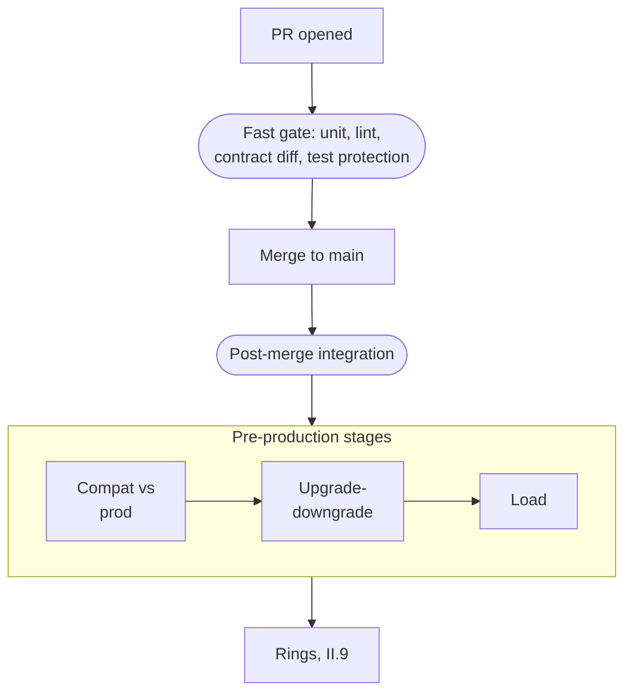
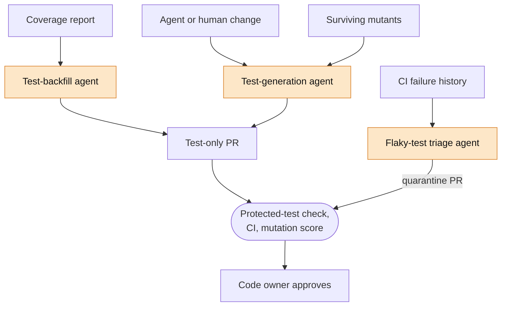

## II.7 Validation and testing (unit, mutation, integration, upgrade/downgrade)

### Purpose

This stage proves a change meets its spec and breaks nothing else before rings expose it (see II.9). Tests are also the verifier agents are judged against: "The agent needs a verifiable goal so it can iterate on a solution as it goes." [SPOT3]. Yet Spotify's early agents took "shortcuts to make builds pass, such as commenting out failing tests or downgrading Java versions" [SPOT7], so the suite must be protected, measured and grown.

### The ideal deterministic process

Any failed gate blocks the PR or the release. Gates in the chart:

- **Fast gate.** Some Microsoft repos run about 60,000 tests in under 5 minutes per PR, with acceptance tests after merge [MS27]. A contract diff catches breaking API changes (see IV.2), and a test-protection check blocks deleting, disabling or weakening existing tests.
- **Pre-production stages.** Amazon runs alpha, beta and gamma stages, then a "zeta" stage in which pre-production calls production endpoints to check backward compatibility [AWS1].
- **Upgrade-downgrade tests.** Failed rollbacks mostly come from protocol changes the old version cannot read. Amazon tests both directions in production-like environments with the real deployment order and multi-AZ topology [AWS3]. **Recommendation:** make this II.9's entry gate for two-phase changes.
- **Load.** [GAP: no source describes a load gate.] **Recommendation:** load-test against the SLO any change the change risk score (see II.8) marks hot-path.
- **Flaky failures.** Google's continuous test system (TAP) bisects non-flaky failures to the change that caused them [GOOG6]. **Recommendation:** a flake must never silently block or pass a change.

Key metrics: escaped defects per tier, gate time, flake rate, mutation score on changed code (share of injected faults caught), and agent edits to existing tests.

### Real-world reference

No Microsoft source describes agent test generation; the nearest evidence is that tests are 65.7% of Copilot coding agent's added lines in dotnet/runtime (49.9% for humans) [MS8].

**ACH (Meta)** is mutation-guided test generation [META1]. It takes a named concern (privacy in the paper, but any regression class), generates mutants of that kind that current tests miss, and has an LLM write tests that kill them, while an LLM detector discards equivalent mutants (faults that change nothing). Pre-processing lifted that detector's precision and recall from 0.79 and 0.47 to 0.95 and 0.96. Across 10,795 Android Kotlin classes on 7 platforms it produced 9,095 mutants and 571 privacy-hardening tests; engineers "accepted 73% of its tests, judging 36% to privacy relevant." **Recommendation:** aim generated tests at a risk class and measure acceptance, not coverage.

**Duolingo's test backfill**, from one conference talk, is a full legacy-code loop [AIE6]. A selector ranks files from the coverage report, and an agent writes tests per file and opens a labelled PR. A state machine runs a repair agent on failures (5 attempts), assigns the top git-blame contributor on green with auto-merge armed, and cools down rejected files for 30 days. A deterministic check closes any PR touching files outside tests, mocks, fakes or stubs, because "A test PR could pass CI by weakening an existing test." More than 700 human-approved PRs (about 225K lines) lifted repository-layer coverage from 11% to 72%.

### What to agentify, and how far

> **Takeaway:** **Recommendation, in one line:** agents write, repair and triage tests; gates, test protection and mutation score stay deterministic, today an owner approves every test PR, and no agent writes the tests that judge its own change (the evaluator role, see II.3). Today's realistic ceiling is Act on approval.

Agents "reliably skew positive" grading their own work, which is why Anthropic separates generator from evaluator [AN3]. GitHub's Copilot Applied Science team, by its own blog account, keeps a contract-test area only humans can change [GH1].

Orange boxes are agents; everything else is the deterministic core.

| Agent role | Rung | What it does | Guardrail | Evidence to promote |
|---|---|---|---|---|
| Test-backfill agent | Advise (L0) | Lists risky untested code from coverage and the change risk score | Read-only | Owners act on most findings |
| | Prepare (L1) | Writes tests for one file; opens a draft PR | Test-only diff check; owner edits and submits | Acceptance rate per batch (Duolingo's early batches: 8 of 17, then 19 of 40 [AIE6]) |
| | Act on approval (L2) | Opens labelled PRs, repairs CI, routes to the top contributor; auto-merge is armed and lands on owner approval. Duolingo runs here [AIE6] | Cooldown after rejection; cannot touch production files or existing tests | Sustained acceptance, no reverted test PRs, rising mutation score |
| | Act, then notify (L3) | Future proposal: test-only PRs that raise mutation score merge when every gate passes; owner notified | Lands only because every deterministic gate passes; the agent decides nothing; new test files only | Long clean L2 record in the trust ledger |
| | Autonomous within budget (L4) | Not proposed | Tests are the oracle | n/a |
| Test-generation agent | Advise (L0) | Comments on a PR with surviving mutants and criteria no test covers | Read-only | Authors act on comments |
| | Prepare (L1) | Proposes tests that kill surviving mutants of a named risk class, as in ACH [META1], in a PR comment; the author copies them in | Equivalent-mutant filter; never for a change it wrote | Acceptance near Meta's 73%; owners judge most relevant |
| | Act on approval (L2) | Pushes the tests to the PR after the owner's click | Can only add checks | Escaped defects in covered concerns fall |
| | Act, then notify (L3) and above | Not proposed | It would be judging what it defines | n/a |
| Flaky-test triage agent | Advise (L0) | Classifies a failure as flaky or real from rerun history; names the likely cause | Read-only | Classifications match owner verdicts |
| | Prepare (L1) | Drafts a fix or a quarantine PR with an owner and deadline | Owner adopts and submits it | Fixes stick; quarantines are short |
| | Act on approval (L2) | Opens the quarantine after one owner click | Never quarantines a protected or contract test | Low override rate |
| | Act, then notify (L3) | Future proposal: quarantines tests the deterministic flake detector already flagged | Detector decides, not the agent; auto-expiry | No real defect masked over a long sample |

[GAP: no source measures agent flaky-test triage.]

**LLM judges are an extra verifier, not a gate of record.** Spotify's fleet-change agent, Honk, ran a scope-creep judge that vetoed about 25% of sessions but had no evals [SPOT4]; an InfoQ report of a later QCon talk says Spotify removed it as too rigid [SPOT7]. **Recommendation:** a judge may comment or veto, never approve, and is measured against human labels before it blocks [AN3].

### Enterprise complications

- **Shared test environments.** Agents multiply runs in shared pre-production. Stripe gives each run an isolated devbox [STRIPE1]; OpenAI boots the app per worktree [OAI1]. [GAP: no source covers contention or quotas on shared pre-production environments.]
- **Cross-service tests no team owns.** End-to-end tests span services, so failures bounce between teams; Amazon coordinates two-phase changes across microservices [AWS3]. **Recommendation:** each integration test has an owner from the service catalog (see V.1), normally the consumer, who receives its failures.
- **Heterogeneous CI.** Spotify moved verification into a separate service partly because iOS cannot build on Linux [SPOT7] (see IV.3).
- **Test data and privacy.** Stripe's devboxes hold no real user data [STRIPE1]; one talk reports Uber redacts more than 20 PII types before model calls [AIE2]. ACH shows tests can harden privacy itself [META1]. [GAP: no source on synthetic test data for agents.]
- **Legacy code.** One talk reports that gaps humans tolerate (50 to 60% coverage, flaky builds) become hard constraints for agents [AIE8]; a Maersk talk reports that checking took about 90% of agent time [AIE7]. Backfill first (see II.5).

### Requirements

| ID | Priority | Statement | Rationale | Source |
|---|---|---|---|---|
| REQ-VER-05 | MUST | Each service class defines required tiers (fast PR gate, contract diff, post-merge integration, pre-production with backward-compatibility checks against production endpoints) and no change, human or agent, skips one. | One pyramid for all authors | MS27, AWS1 |
| REQ-VER-06 | MUST | Any change to serialization, protocol or stored data runs upgrade-downgrade tests in a production-like topology with the real deployment order before entering rings. | Rollback must stay possible | AWS3 |
| REQ-VER-07 | MUST | A deterministic check blocks agent PRs that delete, disable or weaken existing tests, and test PRs that touch non-test files; contract tests live in a human-only area. | Agents game weak oracles | AIE6, GH1, AN2, SPOT7 |
| REQ-VER-08 | SHOULD | Mutation score on changed code, per named risk class, is a recorded verifier for generated tests, with an equivalent-mutant filter. | Coverage is not fault detection | META1 |
| REQ-VER-09 | MUST | Agent-written tests merge only after approval by an owner from the service catalog (see V.1), until a test-only class is promoted to Act, then notify through the trust ledger; acceptance, rejection and revert rates go to the trust ledger (template: D7). No agent writes the tests that judge its own change. | Separate maker and checker | AIE6, META1, AN3 |
| REQ-VER-10 | MUST | LLM judges run after deterministic verifiers, may comment or veto but never approve, and are measured against human labels before they block. | Judges are unproven | SPOT4, SPOT7; Recommendation |
| REQ-VER-11 | MUST | Agents test in isolated environments with no production access and no real user data. | Contain blast radius and PII | STRIPE1, AIE2 |
| REQ-VER-12 | SHOULD | Flaky tests are detected deterministically, quarantined with an owner and expiry, and never quarantined if protected. | Flakes erode the verifier | GOOG6, AIE8; Recommendation |

### Open gaps

- No source on load or performance gates, or on contention in shared pre-production environments.
- No Microsoft source on mutation testing or agent test generation; ACH is the only measured case, and Duolingo is one talk (AIE6).
- No source measures agent flaky-test triage.
- The Spotify judge's removal comes from an InfoQ report of a talk, not a Spotify post; no published judge accuracy anywhere.
- No source on synthetic or redacted test data for agents, or on ownership of cross-service tests.
- Proposed kit item: test-ownership and flaky-quarantine record (template: proposed).
