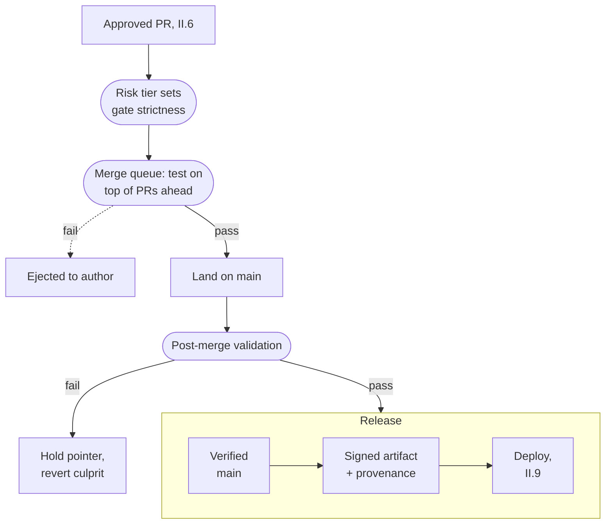
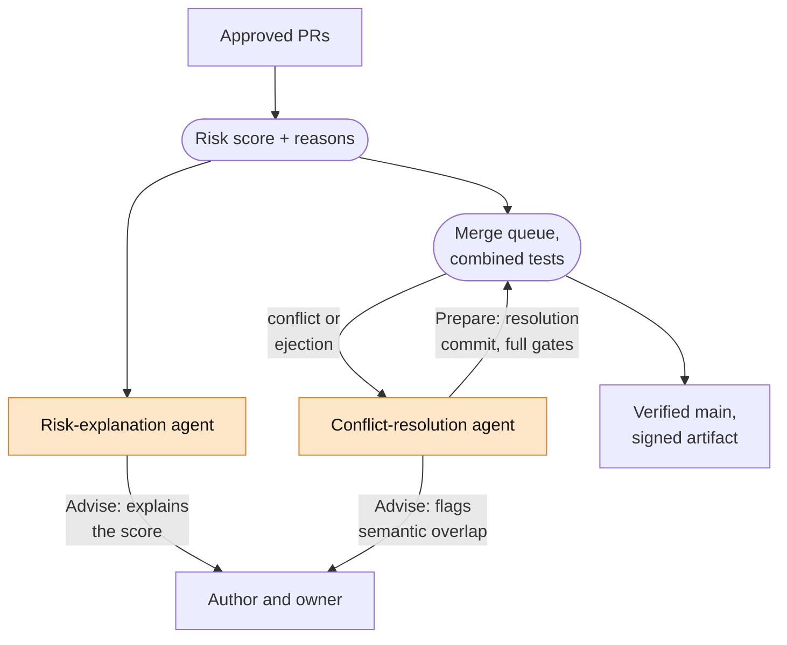

## II.8 Integration and merge (merge queues, semantic conflicts, risk scores)

### Purpose

This stage takes an approved PR (see II.6) to a verified `main` and a signed artifact that deployment (see II.9) can trust. As agents raise PR volume, merge capacity becomes the constraint: one conference talk by Uber engineers reports that 44% more hourly merge requests pushed P95 land time from 30 minutes to 3 to 4 hours [AIE3]. A Vorflux conference talk, "Merge is the bottleneck", asks teams to "Count the developer's time through to merge." [AIE12]

### The ideal deterministic process

Microsoft's release flow is the baseline: PRs run build policies and a fast test pass (about 60,000 tests in under 5 minutes), and acceptance tests run after merge, in some repos taking 200+ PRs a day [MS27]. Gates in the chart:

- **Risk tier.** A model scores each change, as Meta gates its riskiest diffs [META3]. **Recommendation:** the tier sets reviewers, test scope, and whether conflict relaxation and auto-merge apply.
- **Combined-state test.** Each PR is tested on top of the PRs queued ahead of it, because "Each pull request passes against its own base. Neither test run exercises the combined change." [AIE3]. [GAP: no Microsoft source describes a merge queue that tests combined states.]
- **Verified main.** Post-merge validation advances a "verified main" pointer only when a later integrated state passes [AIE3]; failures are bisected to the culprit change [GOOG6] (flaky tests: see II.7). Only verified commits build release artifacts.
- **Post-merge failure.** The pointer holds, the culprit's author is paged, and the culprit is reverted under policy. **Recommendation**; Uber lists automated reverts as a next step [AIE3].
- **Signed artifact.** Microsoft's Secure Future Initiative (SFI) overview page, a high-level summary, calls for "code signed and reproducible builds to prevent tampering" [MS19]. Deployment verifies signature and provenance before the first ring (see IV.7).

Key metrics: time from task start to merge, P95 time to land, verified-main lag, post-merge break rate, ejection rate, and the risk model's capture rate.

### Real-world reference

**SubmitQueue** is Uber's merge queue for six language monorepos (5,000+ developers, about 27,000 PRs a week) [AIE3]. It tests combined states before trunk. Under AI-driven load, Uber deferred expensive changes to a retry queue at peak, and "conflict relaxation" dropped weak dependency overlaps so more queues run in parallel: the biggest gain, knowingly accepting rare A+B failures that post-merge validation catches. Peak throughput reached about 300 lands an hour at a 30-minute P95 [AIE3].

**Diff Risk Score (DRS)** is Meta's fine-tuned Llama model that predicts how likely a change is to cause a SEV (severe incident) and highlights risky snippets [META2]. It replaces blanket code freezes: 10,000+ changes landed during a 2024 freeze "with minimal production impact" [META2]. In the paper behind it, release engineers gate the top-scoring diffs by zone (top 5% on weekends, top 10% in yellow periods, top 50% in red periods such as Black Friday); gated developers wait, reduce risk, or escalate [META3]. At the two stricter thresholds, the best LLM caught about 1.4 to 1.5 times as many SEVs as a simple baseline; at the loosest, about the same [META3].

### What to agentify, and how far

**Recommendation, in one line:** the queue, the risk model and the verified-main pointer stay deterministic; one agent finds and repairs conflicts between parallel changes, another explains a risk score and drafts ways to lower it, neither approves a change, edits a score or sets a threshold; a change lands only when the deterministic gates pass.

The risk model is ML, like Gandalf (see II.9), but it is a gate, not an agent: versioned, measured, with thresholds set by policy owners.

**Conflict resolution.** GitHub's Agent Merge, a Copilot feature, fixes failing checks, review comments and conflicts, and can auto-merge once verification passes if configured [GH2] (vendor-reported). **Semantic conflicts** are harder: "Two passing PRs can disagree about the meaning of a value." (one returns cents, the other dollars) [AIE10]. That talk proposes announcing intended files before coding and an agent tracing values across in-flight PRs [AIE10].

**Risk explanation.** Meta names risk-mitigating diffs and natural-language rationale as next steps [META2]; scores already ship with reasons and suggested actions [META3]. At Prepare it also drafts code, so it is gated like any author.

Orange boxes are agents; everything else is the deterministic core.

| Agent role | Rung | What it does | Guardrail | Evidence to promote |
|---|---|---|---|---|
| Conflict-resolution agent | Advise (L0) | Compares in-flight PRs that touch shared values, contracts or files; comments on likely semantic conflicts | Read-only | Flags confirmed by owners; few false alarms |
| | Prepare (L1) | Prepares a rebase or conflict-resolution commit | Author pushes it; full queue gates rerun | Prepared commits accepted unchanged |
| | Act on approval (L2) | Pushes the resolution after the author's click; the PR re-enters the queue | Re-review if the change goes beyond textual merge; logged in the trust ledger (template: D7) | Post-merge break rate of resolved PRs at the baseline |
| | Act, then notify (L3) | Resolves purely textual conflicts in allow-listed files (lockfiles, generated code), then notifies; the change lands only because every gate passes. Our proposal | No protected paths, no high tier; demoted on any revert (template: D6) | Zero escaped defects in the class over a long sample |
| | Autonomous within budget (L4) | Not proposed | Semantic resolution needs the owners' intent | n/a |
| Risk-explanation agent | Advise (L0) | Explains the score: risky snippets, which features drove it, past incidents in those files | Read-only; cannot edit score or threshold | Authors rate explanations useful |
| | Prepare (L1) | Drafts a lower-risk version: split the diff, wrap in a flag, add tests; the model rescores it | Author submits; no change to the gate; at most N rescoring attempts; drafts audited for gaming the model | Drafts lower the tier without hiding risk (sampled audit) |
| | Act on approval (L2) | Opens the drafted split or flag change as a PR. Highest rung proposed; L3 and L4 are not, because the change alters behaviour | Human merges | Low revert rate |

### Enterprise complications

- **Fleet-wide agent changes.** Google shards large-scale changes by ownership and runs them at low priority so they do not starve the queue [GOOG6]; see II.12.
- **Multi-repo merges in dependency order.** mabl (vendor-reported, 25 engineers) keeps a 79-repo coordination graph giving merge order (upstream first) and states "Any breaking change requires coordinated PRs." [MABL1]. **Recommendation:** take order from the service catalog (see V.1, IV.1); downstream PRs enter the queue only after the upstream artifact is on verified main. [GAP: no source describes a merge queue spanning repos.]
- **Heterogeneous build systems.** Uber runs SubmitQueue across six language monorepos [AIE3]; Spotify hides heterogeneous CI behind a verification service [SPOT7]. [GAP: no source tests a combined state across two pipeline systems, such as Azure DevOps and GitHub Actions.]
- **Throughput against correctness.** Conflict relaxation is a policy choice [AIE3]. **Recommendation:** disable it for the high-risk tier.
- **Risk model on agent code.** At Uber, 11% of PRs are opened by agents [UBER2]; DRS was trained on past diffs [META3]. [GAP: no source shows a risk model calibrated on agent-authored diffs, and no Microsoft risk-scoring source.]

### Requirements

| ID | Priority | Statement | Rationale | Source |
|---|---|---|---|---|
| REQ-MRG-01 | MUST | Every PR is tested in the merge queue on top of the changes ahead of it; none lands tested only against its own base. | Two green PRs can break together | AIE3; Recommendation |
| REQ-MRG-02 | MUST | Post-merge validation advances a verified-main pointer; failures are bisected to a culprit; only verified commits build release artifacts. | Relaxed queues trade rare breaks for throughput | AIE3, GOOG6 |
| REQ-MRG-03 | MUST | A versioned risk model scores every change with reasons; its capture rate at each threshold is measured on a chronological holdout; policy owners set thresholds; no agent edits a score or threshold. | A gate must be measured and tamper-proof | META2, META3 |
| REQ-MRG-04 | MUST | The risk tier sets gate strictness: required reviewers, test scope, whether conflict relaxation and auto-merge apply, and the rollout plan's input (see II.9). | Strictness where risk is | Recommendation; META3 |
| REQ-MRG-05 | MUST | Agent conflict resolutions are new commits that rerun every queue gate; a resolution beyond textual merge needs owner re-review. | Resolution can change meaning | Recommendation; AIE10, GH2 |
| REQ-MRG-06 | SHOULD | Fleet-wide agent changes run at low queue priority with a cap on queued shards, so they cannot starve interactive changes (sharding: see II.12). | Bulk changes must not starve the queue | GOOG6, AIE3 |
| REQ-REPO-02 | MUST | Cross-repo changes are a linked PR set, merged in catalog dependency order; downstream waits for the upstream artifact on verified main. | Breaking changes need coordinated PRs | MABL1; Recommendation |
| REQ-SEC-04 | MUST | Release artifacts are built hermetically from verified main, signed and immutable, with provenance (commit, PR, reviewers, agent identity and its accountable human sponsor (see IV.4), risk score and model version) that deployment verifies. | Tamper resistance and audit for agent code | MS19, GOOG7, AWS1 |

### Open gaps

- No Microsoft source describes a combined-state merge queue or a change risk score.
- No source measures agents resolving semantic conflicts or explaining risk; the rungs are synthesis.
- No source describes an agent preparing culprit reverts after a post-merge failure; a candidate per-action rung for later.
- SubmitQueue, semantic-conflict and merge-bottleneck evidence rests on conference talks (AIE3, AIE10, AIE12).
- The provenance record schema is part of the ledger record (template: D7).
