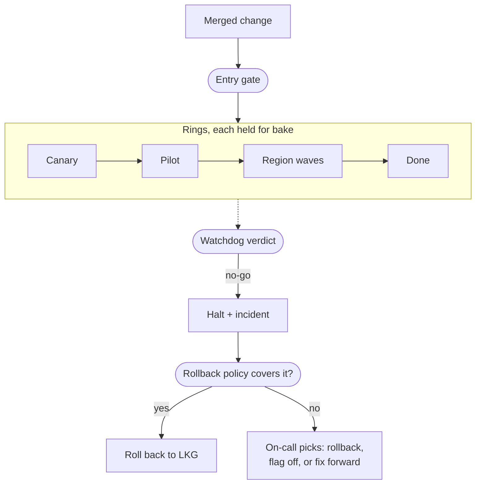
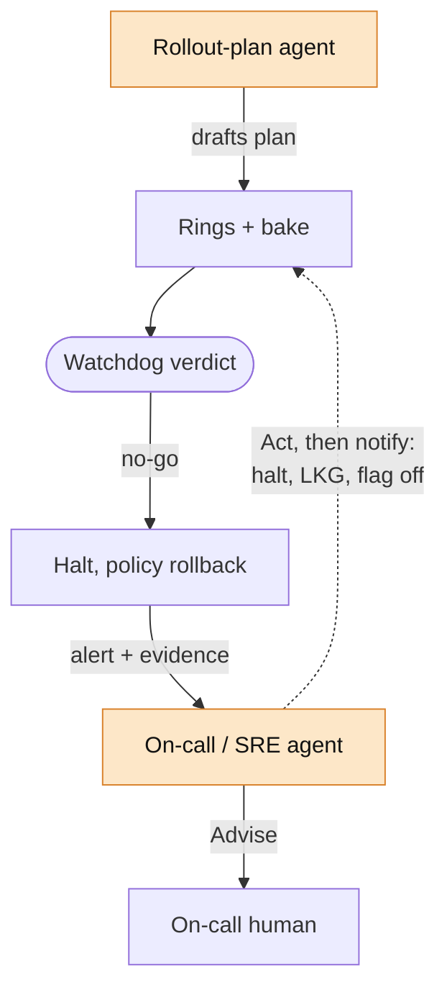

## II.9 Safe gradual deployment (rings, bake, auto-halt, config)

### Purpose

This stage moves a merged change (code, config, feature flag or IaC) into production in rings, and stops it automatically when health turns bad. It zooms into the Deploy box of the overview chart (0.4). It is the backstop for every earlier stage: "Some defects will reach production." [GOOG5]. Because agents raise change volume, the pipeline must stay deterministic and policy-driven.

### The ideal deterministic process

The rings are Azure's [MS5]; canary regions belong to the Early Updates Access Program, and the pilot adds hardware diversity [MS2]. Gates in the chart:

- **Entry gate.** Every touched component has registered health signals [MS4], and rollback is tested with upgrade-downgrade tests [AWS3] (see II.7).
- **Bake gate.** In Azure's Safe Deployment Practices (SDP), policies, not developers, set bake times, and the tooling and processes "intentionally sacrifice velocity" [MS2]. Microsoft's ADO guidance suggests about 24 hours in general [MS1]. A ring is promoted only if all indicators stay green through bake, and it halts on any end-user-impacting alert [MS3].
- **Halt and rollback.** The halt is automatic. AWS pipelines also roll back automatically on high-severity aggregate alarms, including during bake [AWS1], to the last known good (LKG) release. When no single policy decides between rollback, flag off and fix-forward, the choice is on-call work.
- **Two-phase changes.** For data-format or protocol changes, AWS ships **Prepare** (read new, still write old), verifies it on every server, bakes, then ships **Activate** (write new): "Avoid walking through one-way doors" [AWS3].
- **Config is code.** Azure gates configuration changes like code [MS2], and Windows restated "gradual and staged deployment of updates sent to customers" with "being able to pause or rollback if needed" [MS20]. At Meta, config is "another large category" of SEVs (severe incidents) after code [META2].

Key metrics: watchdog precision and recall, share of bad rollouts stopped before broad production, time to mitigate, and time to reach all regions (AWS: about 4 to 5 business days [AWS1]).

### Real-world reference

**Gandalf** is Azure's global deployment watchdog [MS4]. It reads deployment events, failure signals and performance counters across the fleet and learns a normal baseline. When faults appear, it works out which ongoing rollout most likely caused them from when and where each was deployed. A classifier judges the impact and writes go or no-go to a store that the deploy engine reads to stop the rollout; on no-go it also opens an incident with evidence for the owning team. Owning teams tune per-signal weights (weight 0 marks expected noise), and it is the last of four layers after testing, SDP policy and component watchdogs: "Gandalf serves as the last safeguard" [MS5].

Evidence from an Azure fleet running more than 300 deployments a day, with Gandalf in production for over 18 months: 92.4% precision and 100% recall on the data plane (155 critical failures caught in 8 months); 94.9% precision and 99.8% recall on the control plane (2 misses, 2 false alarms in 1,200+ region-level deployments) [MS5]. Reportedly, 99.2% of suspicious data-plane rollouts were stopped before broad production [MS5].

**AKS Fleet Manager** sequences Kubernetes and node-image upgrades across many AKS clusters [MS21]. An "update run" walks sequential stages, each holding parallel groups of member clusters, paced by approval gates and a failure budget.

Other references: Google compares canary against control and also checks absolute SLOs [GOOG5].

### What to agentify, and how far

> **Takeaway:** **Recommendation, in one line:** the pipeline halts, and rolls back where a policy says so, by itself; the agent investigates, picks the mitigation when no policy decides, and at higher rungs carries out reversible mitigations itself. It may halt a rollout but never promote one (a false halt costs hours, a false go costs customers).

The rings, bake policy and watchdog verdict stay deterministic. Gandalf-style analytics belong to that core: an automated, policy-enforced gate (ML-based, but not an agent). The watchdog only stops the rollout it blames. Choosing and running the mitigation, and handling alarms the watchdog does not attribute (during the 30-day watch, or from customer reports), is on-call work, and that is what the agent takes over, rung by rung. A second agent writes the rollout plan as an input.

Azure SRE Agent, generally available since March 2026, is Microsoft's AI operations teammate: it loads a team's code, logs, metrics and tools, investigates incidents, and lets teams choose between recommended actions and automated responses "within defined guardrails" [MS10]. Meta's on-call agent work says "Grant autonomy action by action." and keeps production mitigations human [AIE4]. [GAP: no source describes an agent halting or rolling back a ring rollout, or writing a rollout plan.]

The chart shows the lowest and highest everyday rungs; the table gives all five.

Orange boxes are agents; everything else is the deterministic core.

| Agent role | Rung | What it does | Guardrail | Evidence to promote |
|---|---|---|---|---|
| On-call/SRE agent | Advise (L0) | Correlates the halt or alarm with the rollout, signals and recent config pushes; explains the likely cause | Read-only access | Investigations accepted by on-call humans |
| | Prepare (L1) | Prepares the exact mitigation: roll back to LKG, turn off the flag, or fix-forward | Human runs it | Prepared action matches what humans chose |
| | Act on approval (L2) | Runs the mitigation after one-click approval | Approval logged in the trust ledger | Low override rate, no wrong-target actions |
| | Act, then notify (L3) | Halts a ring, rolls back to LKG, or turns off a flag on its own, then notifies. This goes beyond Meta's published ladder; it is our proposal for reversible actions only | Only these reversible actions, one service at a time | Replayed on past incidents, chose the same mitigation as humans in nearly all cases, with zero wrong-target actions; time to mitigate below the human baseline |
| | Autonomous within budget (L4) | Future proposal: opens and ships a fix-forward through the normal pipeline and rings | Scoped budget, automatic rollback, full audit | Clean L3 record, no escaped defects |
| Rollout-plan agent | Prepare (L1) | Drafts rings, bake and concurrency from the risk score and service catalog; flags a missing two-phase split | Policy linter; cannot shorten bake | Plans accepted unchanged |
| | Act on approval (L2) | Opens the plan as a PR | Human merges | Low revert rate |

**Recommendation:** emergency acceleration is never agentic; it needs defined approvers and criteria [MS3].

### Enterprise complications

- **Heterogeneous pipelines and clusters.** Azure DevOps and GitHub Actions run side by side, AKS beside App Service. Azure SDP sets policy centrally [MS2], and Microsoft's ADO guidance asks for the same deployment tooling in dev, test and prod [MS1]. Fleet sequences only Kubernetes and node-image upgrades on AKS, not application or flag rollouts. [GAP: no source shows one watchdog halting two pipeline systems.]
- **Mixed-version periods across teams.** When team 1's service writes a field that team 2's service reads, both versions run for days. Two-phase deployment is the discipline, coordinated across microservices [AWS3], but in practice team 1 often cannot see team 2's servers.
- **Platform-initiated upgrades.** These bypass Fleet sequencing, and node images are valid for 90 days [MS21]. A watchdog that sees only your rollouts can blame the wrong change; Gandalf correlates faults against all ongoing rollouts [MS5].
- **Risk-based gating.** Meta tightens gates only for its riskiest diffs during sensitive periods [META3] (see II.8). [GAP: no Microsoft source, and no source uses a risk score to set ring speed or bake.]

### Requirements

| ID | Priority | Statement | Rationale | Source |
|---|---|---|---|---|
| REQ-DEP-01 | MUST | Every production change, including config, flags and IaC, goes through the same rings with centrally set bake. No human or agent shortens bake except through emergency acceleration with defined approvers and criteria. | Policies, not authors, set speed | MS2, MS3, AWS1 |
| REQ-DEP-02 | MUST | A deterministic watchdog issues a per-ring go/no-go that the deploy engine enforces, opens an incident with evidence on no-go, and has its precision and recall measured per component class before it is trusted. Where a pre-defined policy covers the alarm, the pipeline also rolls back automatically. | Automated halt bounds blast radius; trust needs evidence | MS5, AWS1 |
| REQ-DEP-03 | MUST | Each component registers health signals, with owner-set noise weights, before its first rollout. | No signals, no gate | MS4, MS5 |
| REQ-DEP-04 | MUST | Data-format and cross-service protocol changes use two-phase Prepare/Activate, with Prepare verified on every server of every consuming service before Activate; backward compatibility is tested against production endpoints before rollout. | Rollback must stay possible | AWS3, AWS1 (zeta stage) |
| REQ-PIPE-02 | MUST | Automation checks per-member cluster state and never treats a Fleet group (and, by extension, run) status of `Completed` as success, because "A group can be `Completed` even if all members failed." Platform-initiated upgrades are recorded in the watchdog's event stream. | Status can hide total failure; attribution must see every change | MS21; Recommendation for event recording |
| REQ-PIPE-03 | SHOULD | The ring plan is defined once as data and executed by every pipeline system in use; one no-go halts all of them. | One stop button across pipelines | Recommendation; MS1 |
| REQ-CFG-01 | MUST | Config and feature-flag changes are versioned, canaried per ring, and can be paused, rolled back or turned off. | Config is a large SEV category | MS2, MS20, META2 |
| REQ-OBS-01 | MUST | For rollout mitigations, the on-call/SRE agent at Act, then notify may only halt, roll back to LKG or turn off a flag; each action is logged in the trust ledger and promoted per action. Runbook actions, such as a single-service scale-out, follow REQ-OBS-07 in II.11. | Bounded, reversible, auditable autonomy | Recommendation; MS10, AIE4 |

### Open gaps

- Azure's own region-level bake durations are not in the notes; only the generic ~24-hour ADO guidance is.
- No source describes an agent halting or rolling back a ring rollout, or writing a rollout plan; the rungs are synthesis.
- No source shows one watchdog halting two pipeline systems or non-AKS compute.
- No Microsoft risk-scoring source; no source uses a risk score to set ring speed or bake.
- No published mechanism or metric for config canary analysis.
- AI Engineer talks (AIE4) carry no grade in SOURCES.md.
