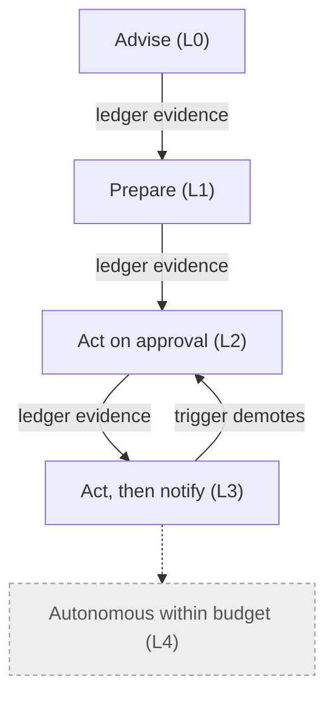
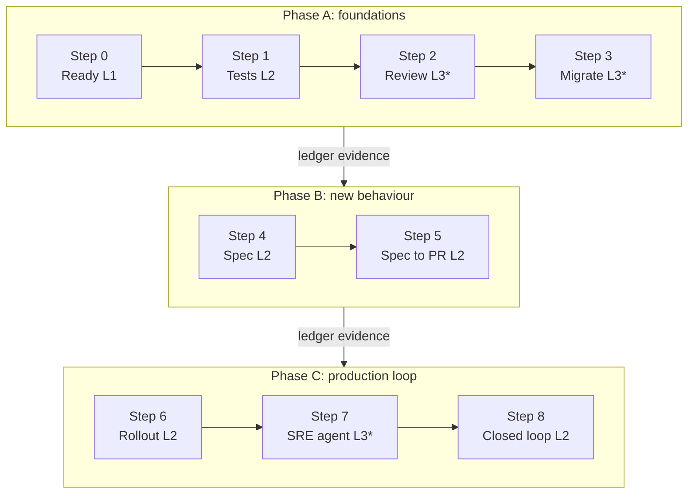

## Part III: Trust model and agentification roadmap

Part II gives each stage its own agent roles and rungs. This part pulls them into one trust model: how autonomy is defined (III.1), how it is earned and lost (III.2), who answers for an agent's action (III.3), and the order in which to agentify an existing service (III.4). Most of it is synthesis; published facts carry citations.

### III.1 The autonomy ladder

Microsoft's GA announcement for Azure SRE Agent makes autonomy a setting: teams move from recommended actions to automated responses "within defined guardrails", and "Teams can choose how autonomous the agent should be" [MS10]. Meta's on-call agent team states the sharper rule: "Grant autonomy action by action." and "Promotion applies to a particular action." [AIE4]. It sets each action's level from the cost of a mistake, the checks that would catch it, and the agent's track record on that action, and it keeps production mitigations human [AIE4] (one conference talk). So one agent holds several rungs at once: the on-call/SRE agent can roll back to the last known good (LKG) release on its own while a failover it proposes still waits for a click (see II.11).

| Rung | What the agent does | Example from Part II |
|---|---|---|
| **Advise (L0)** | Investigates, explains, suggests. A human decides and acts | The AI reviewer leaves categorized comments on every PR (II.6); the design-critique agent lists findings (II.4) |
| **Prepare (L1)** | Prepares the exact action; a human reviews and runs it | The grilling agent drafts the PRD with an open-questions list, and the owner submits it (II.2) |
| **Act on approval (L2)** | Carries out the action after one explicit human approval | The coding agent opens the PR and fixes CI; a human merge is the approval, which is where Copilot Coding Agent runs in dotnet/runtime [MS8] (II.5) |
| **Act, then notify (L3)** | Carries out a pre-approved, reversible action within guardrails, then notifies | The on-call/SRE agent halts a ring, rolls back to LKG or turns off a flag (II.9); a migration PR in an allow-listed mechanical class merges once every gate passes (II.12) |
| **Autonomous within budget (L4)** | Also takes non-routine actions inside a scoped budget, with automatic rollback and full audit | Future proposal only: a fix-forward shipped through the normal pipeline (II.9) |

Arrows move one action, not one agent; a demotion trigger drops an action one rung from any level. The grey box is a future proposal; no Part II stage recommends it today.

**Two principles hold on every rung.**

- **Deterministic core, agentic edges.** Builds, verifiers, the ready gates, the merge queue, risk thresholds, ring promotion, bake and the watchdog verdict stay deterministic and policy-driven (see II.8, II.9). Agents write inputs to them (PRDs, specs, code, tests, rollout plans), interpret their outputs (investigation, triage) and take bounded mitigations.
- **No agent approves its own output.** Agents "reliably skew positive" when grading their own work, which is why Anthropic separates generator from evaluator [AN3]. At Act, then notify, an agent's change lands because the deterministic gates pass, not because the agent decided. An agent finding that blocks a change through a deterministic policy is Act, then notify: a human can override it, and it is never an approval. Approving a change is never an agent action (see II.4, II.6).

**Recommendation:** today's ceiling is Act, then notify, and only for reversible or mechanical action classes. Part II reaches that rung only in narrow places: allow-listed maintenance and migration classes (II.5, II.12), purely textual conflicts in generated files (II.8), a few single-service runbook actions (II.9, II.11; our proposal, since Meta keeps them human [AIE4]), gate-tightening actions such as a blocking label or a blocking review finding (II.4, II.6), and low-impact bookkeeping such as adding links, reminders or filing intake items (II.1, II.11, II.12). II.6's low-risk class rung is approved by the deterministic risk gate, not the agent. Feature code, tests, validation and rollout plans stop at Act on approval (II.5, II.7, II.9, II.10); the L3 rungs II.2 and II.3 list for PRDs and specs are proposals for narrow cases. Autonomous within budget is a future proposal everywhere. Shopify's head of engineering said in an interview that the company is "not yet at the place where we allow AI to check in code automatically into the repos" [SHOP1], which is a reminder that L3 merges are ahead of mainstream practice.

### III.2 The trust ledger

The trust ledger is the per-action record that promotes or demotes an action (template: D7). Without it, rungs are opinions. The record must be per task class: across ten months in dotnet/runtime, Copilot Coding Agent PRs succeeded far more often when small (80.0% for 1 to 10 lines against 64.0% for 101 to 500) [MS8]; see II.5 for the full dataset. A ledger that averages across classes hides this.

**What gets recorded per action** (Recommendation; fields drawn from Part II):

- the action ID and its rung in the agent action policy (template: D6), the agent identity, its sponsor and the requester (see III.3);
- the model, prompt and harness version, and the context it read;
- each verifier's result, and the human decision: accepted unchanged, edited, overridden, dismissed with a reason;
- the outcome: merged, reverted, escaped defect, wrong-target action, time to mitigate;
- the cost: tokens, CI minutes and human review time per accepted change.

**Promotion evidence.** **Recommendation:** an action moves up one rung when, over a sample its owner judges long enough (as a starting point, at least several dozen actions and several weeks of production traffic per class, tuned in the promotion review; no source publishes a threshold), it matches a human baseline on the same class: merge and revert rates (II.5, II.12), override rate (II.9), useful and addressed rates per review category (see II.6), and, for operations, agreement with humans on replayed past incidents with zero wrong-target actions (II.11). Revert rate is also Shopify's health signal, per the same interview [SHOP1]. Outcome metrics beat usage metrics: Booking.com found "hours saved" too weak and moved to one-year delivery KPIs [AIE5] (one conference talk), and Microsoft Digital's Inside Track post reports a move from usage to flow, rework, incident and recovery times [MS15]. A named owner signs each promotion in a promotion review (template: D7), and the human-only baseline is recorded before the first agent touches the class.

**Demotion triggers.** **Recommendation:** demotion is automatic, not a meeting. One revert in an Act, then notify class drops that class to Act on approval (II.6, II.8, II.12); one wrong-target action demotes that runbook action (II.11); an escaped defect, or a rise in override or dismissal rate, does the same. mabl, a 25-engineer vendor, publishes concrete circuit breakers: its auto-fix stops after two consecutive auto-fix commits, never retries a reverted fix, and is limited to lint, imports and simple types [MABL1] (vendor-reported).

**Kill switches.** **Recommendation:** every action in D6 has its own off switch, and every agent identity has one too, both owned by the service's on-call. The switch must not rely on role edits alone: managed identity tokens are cached for about 24 hours and cannot be forced to refresh, so revocation can take hours [MS16]. Disabling the action in the policy that tools check before acting is immediate; Conditional Access with Continuous Access Evaluation is Microsoft's near-real-time enforcement on the token side [MS24]. [GAP: no source publishes an agent kill switch or its time to take effect.]

**Re-test when models change.** Anthropic found that "every component in a harness encodes an assumption about what the model can't do on its own", and advises removing one component at a time and re-examining on each new model [AN3]. Verifiers age in the other direction too: Spotify's scope-creep judge vetoed about 25% of sessions while "We have yet to invest in evals for our judge." [SPOT4], and Spotify later removed it as too rigid [SPOT7]. **Recommendation:** a model, prompt or harness change is a new version of every action it touches. It re-runs the evaluation and replay set, and Act, then notify actions fall back to Act on approval until the results match the old record.

### III.3 Agent identity and accountability

**The actor of record** is the human who answers for an agent's action. **Recommendation:** whoever requested the agent's work counts as its author, so a different owner approves it (see II.6). This extends what Microsoft does: every Copilot Coding Agent PR in dotnet/runtime is opened at a maintainer's explicit request, and "The .NET team has full ownership for everything we ship." [MS8]; Microsoft's AI reviewer never commits a fix itself, and applied fixes are attributed in the commit history [MS6].

**Entra Agent ID.** Per Microsoft Learn, Entra Agent ID gives each agent its own Entra identity, because agents fit neither the human nor the application identity model; it is created from a blueprint whose preferred credential is a managed identity, the creating user is recorded as its sponsor, and its activity is logged as performed by an agent [MS12, MS22]. Microsoft's own pilot gives each agent its own ID "instead of having it borrow a person's" [MS18].

**Three ways to act** [MS23]. We map each to factory work:

- **On behalf of a user (OBO).** The agent acts for the requester, with delegated rights, and stays separately auditable from that person [MS22]. Conditional Access then evaluates the user's policies, not the agent's [MS24]. Fits developer-requested work such as a coding agent opening a PR.
- **App-only.** The agent acts with rights on its own identity [MS12]. Fits pipeline and on-call agents that act with no one at the keyboard, such as an Act, then notify rollback.
- **Agent user.** A user account paired one to one with the agent identity, for systems that need a user [MS12]. A policy on the agent identity does not apply to its user account [MS24], so each mode needs its own policy.

**Audit.** **Recommendation:** each ledger record joins agent identity, sponsor, requester, approver and the token mode used. Static API keys bypass Conditional Access entirely [MS24]. Token flows, managed identity for service-to-service calls and audience-bound tool servers are covered in IV.4.

### III.4 The roadmap

**Recommendation, in one line:** on Monday, pick one service and one team, record human-only baselines and fill the readiness checklist (D8); turn on the first agent only after that, and promote each action one rung at a time on ledger evidence.

**Recommendation:** agentify in nine steps, each of which uses what the previous ones built. Readiness and verifiers come first, because gaps humans tolerate, such as flaky builds, become hard constraints for agents [AIE8] (one conference talk), and AI is a "mirror and a multiplier" of its organization [GOOG3]. DORA's capabilities model names the foundations: AI-accessible internal data, strong version control with practiced rollback, small batches and quality internal platforms [GOOG4].

The order follows risk, not value, in three phases. **Phase A, foundations** (Steps 0 to 3): Step 0 puts the deterministic safety net in place (rings, bake and an automatic halt, see II.9), so no agent change merges before it exists; Steps 1 to 3 touch only code that verifiers check mechanically. **Phase B, new behaviour** (Steps 4 and 5) needs the specs and review that earlier steps proved. **Phase C, production loop** (Steps 6 to 8) lets agents act around production, so it needs the full ledger. The rung column is the highest rung any action reaches at that step; it never exceeds the ceiling the Part II section states.

| Step | What agents do | Highest rung at this step | Prerequisites | Controls | Promotion metric |
|---|---|---|---|---|---|
| **0. Readiness** | Inventory verifier gaps (tests, lint, build, docs) with the readiness checklist [AIE8]; draft AGENTS.md; propose lint and test fixes (II.5, II.7) | Prepare (L1) | A sponsor; the service catalog (see V.1); rings with bake and an automatic, deterministic halt, with health signals registered (II.9); an LLM gateway; agent identities (III.3) | Checklist (template: D8); D6 and D7 live | Checklist passed; human-only baselines recorded for every class later steps touch |
| **1. Toil and test backfill** | Test-backfill, flaky-triage and flag-cleanup agents open labelled PRs (II.7, II.10) | Act on approval (L2) | Step 0 verifiers and baselines | Test-only diff check; owner approves every PR (Duolingo, conference talk: over 700 test PRs merged, each human-approved [AIE6]) | Acceptance rate per batch; no reverted test PRs |
| **2. AI review as first pass** | AI reviewer comments, and applies a proposed fix when the author clicks (II.6) | Act, then notify (L3) for blocking findings in proven categories, overridable by the owner; fixes at Act on approval (L2) | Step 1 tests; per-category feedback | Rolled out team by team [UBER1]; never approves [MABL1] | Useful and addressed rate per category at or above human comments |
| **3. Migrations and fleet-wide changes** | Migration agent opens sharded, verified PRs; discovery agent finds consumers (II.12, II.5) | Act, then notify (L3), only for allow-listed mechanical classes; L2 otherwise | Steps 1 and 2; class allow-list in D6; II.8's deterministic class and risk gate, live from this step (Step 6 adds only the risk-explanation agent) | Verifiers before PR; demote on revert | Merge and revert rate per class at the human baseline; zero escaped defects; end-to-end time (Google: about 50% saved [GOOG2]) |
| **4. Grilling agent → PRD → spec** | Grilling agent interviews the owner; spec-drafting and planner agents write the spec, checks and tasks (II.2, II.3, II.4) | Act on approval (L2) | Step 0 context layer; templates D1 and D4 | Deterministic ready gates (lint and sign-off that decide a PRD or spec is complete, see II.2); open-questions list | Clarification rate after the gate at or below the human baseline |
| **5. Spec → PR for bounded features** | Coding agent implements tasks from a tagged spec, fixes CI, answers review (II.5 to II.8) | Act on approval (L2): a human merge is the approval | Step 4 specs with frozen checks; Steps 1 and 2 | CI cap (Stripe: two rounds [STRIPE1]); requester is not the approver | Merge and revert rate per task class near the human baseline (see II.5) |
| **6. Rollout-plan and risk-explanation agents** | Rollout-plan agent drafts rings and bake; risk-explanation agent explains scores and drafts lower-risk splits (II.8, II.9, II.10) | Act on approval (L2); the watchdog and the risk gate (live since Step 3) stay deterministic | The Step 0 halt has a clean record; two-phase rollout of contract changes (II.4) | Gandalf-style go/no-go [MS5]; risk-zone thresholds set by release engineering [META3]; no agent shortens bake | Plans accepted unchanged; low revert rate |
| **7. SRE agent: diagnosis, then mitigation** | On-call/SRE agent investigates from the first page, then prepares and runs runbook mitigations (II.9, II.11) | Act, then notify (L3), per promoted reversible single-service action | Runbooks bound to D6 actions; a replay set of past incidents | Per-action allowlist and kill switch; mitigations stay human until promoted (our proposal; Meta keeps them human [AIE4]) | Replay agreement in nearly all cases; zero wrong-target actions; time to mitigate below the human baseline |
| **8. Closed loop: incidents → requirements** | Postmortem agent drafts repair items and opens repair PRs; intake agents cluster signals into briefs (II.1, II.11) | Act on approval (L2) for repair PRs; L3 only for filing intake items | Steps 1 to 7 | II.1 dedupe, owner triage and rate limit; repair PRs ride every gate | Few rejected items; repeat incidents fall [GAP] |

Each box shows the highest rung any action reaches at that step; L3* means only for blocking findings in proven review categories (Step 2), allow-listed mechanical classes (Step 3) or promoted single-service actions (Step 7). Every phase needs the trust-ledger record of the one before it.

**Exit criteria.** **Recommendation:** a step is done when its promotion metric holds over the owner's sample and its actions are recorded in D6 at their rung; the next step starts only then. The 0 to 180 day plan in Part VI maps these steps to time.

Two warnings shape the pace. Review becomes the bottleneck: Google says "The bottleneck in the process was the speed at which engineers could review the changes." [GOOG2], and Spotify saw "76% more PRs to review" [SPOT2]. And cost needs its own signal: Shopify routes all AI traffic through a central proxy and treats a token-spend alert at $250 per person per day as a reason to investigate, not to shut down [SHOP1] (an interview). **Recommendation:** track cost per accepted change from Step 0, through the gateway, and count human review hours in it.

### Requirements

| ID | Priority | Statement | Rationale | Source |
|---|---|---|---|---|
| REQ-GOV-07 | MUST | Autonomy is assigned per action in a versioned agent action policy (template: D6). Each entry names the action, its rung, scope, guardrail, owner and kill switch. Tools check the policy before acting. | Grant autonomy action by action | AIE4, MS10; Recommendation |
| REQ-GOV-08 | MUST | No agent approves its own output or the tests that judge it. At Act, then notify, a change lands only because deterministic gates pass. | Agents skew positive grading their own work | AN3, MABL1 |
| REQ-GOV-09 | MUST | Every agent action writes a trust-ledger record (template: D7): action ID, rung, agent identity, sponsor, requester, approver, model and harness version, verifier results, human decision, outcome and cost. | Rungs need evidence | MS8, SHOP1; Recommendation |
| REQ-GOV-10 | MUST | An action is promoted one rung at a time, by a named owner in a promotion review, against a human-only baseline for the same class recorded before agents start. Operations actions also need replay agreement on past incidents. | Baselines make promotion objective | MS8, AIE4; Recommendation |
| REQ-GOV-11 | MUST | Demotion is automatic: a revert in an Act, then notify class, a wrong-target action or an escaped defect drops that action one rung. Auto-fix loops stop after two consecutive auto-fix commits and never retry a reverted fix. | Trust is lost faster than it is earned | MABL1; Recommendation |
| REQ-GOV-12 | MUST | Each action and each agent identity has a kill switch owned by on-call that takes effect without waiting for token expiry. | Role edits can take hours to apply | MS16, MS24; Recommendation |
| REQ-GOV-13 | MUST | A model, prompt or harness change re-runs the evaluation and replay set; affected Act, then notify actions fall back to Act on approval until results match. LLM judges are measured against human labels before they block. | Harness assumptions expire with models | AN3, SPOT4, SPOT7; Recommendation |
| REQ-GOV-14 | MUST | Every agent runs under its own Entra Agent ID with a recorded sponsor, never a borrowed human identity or a static API key. Developer-requested work uses OBO; unattended work uses app-only, each with its own Conditional Access policy. | Distinct, auditable, policy-bound actors | MS12, MS18, MS22, MS23, MS24 |
| REQ-GOV-15 | MUST | The requester of an agent's work is its author of record; a different owner from the service catalog (see V.1) approves it, except in mechanical classes promoted to Act, then notify. | A named human answers for every change | MS8, MS6; Recommendation |
| REQ-GOV-16 | SHOULD | A roadmap step starts only when the previous step's exit criteria hold for that service. No action is enabled at Autonomous within budget without a separate review. | Each step depends on the one before | AIE8, GOOG4; Recommendation |
| REQ-GOV-17 | SHOULD | Cost per accepted change, including human review hours, is measured through a central gateway from Step 0, with spend alerts that trigger investigation. | Volume is not value | SHOP1, AIE5 |

### Open gaps

- No source publishes promotion thresholds (sample size, acceptable revert or override rate) for moving an agent action up a rung; the ledger thresholds are ours.
- No source describes an agent kill switch or measures how fast one takes effect.
- No source measures re-qualifying an agent action after a model upgrade in production.
- No source measures whether closing the loop (incidents to requirements) reduces repeat incidents.
- The per-action ladder rests on one conference talk (AIE4) and a product announcement (MS10); no peer-reviewed study of per-action autonomy exists in the notes.
- The per-action promotion and demotion log is part of D7 (template: D7).
