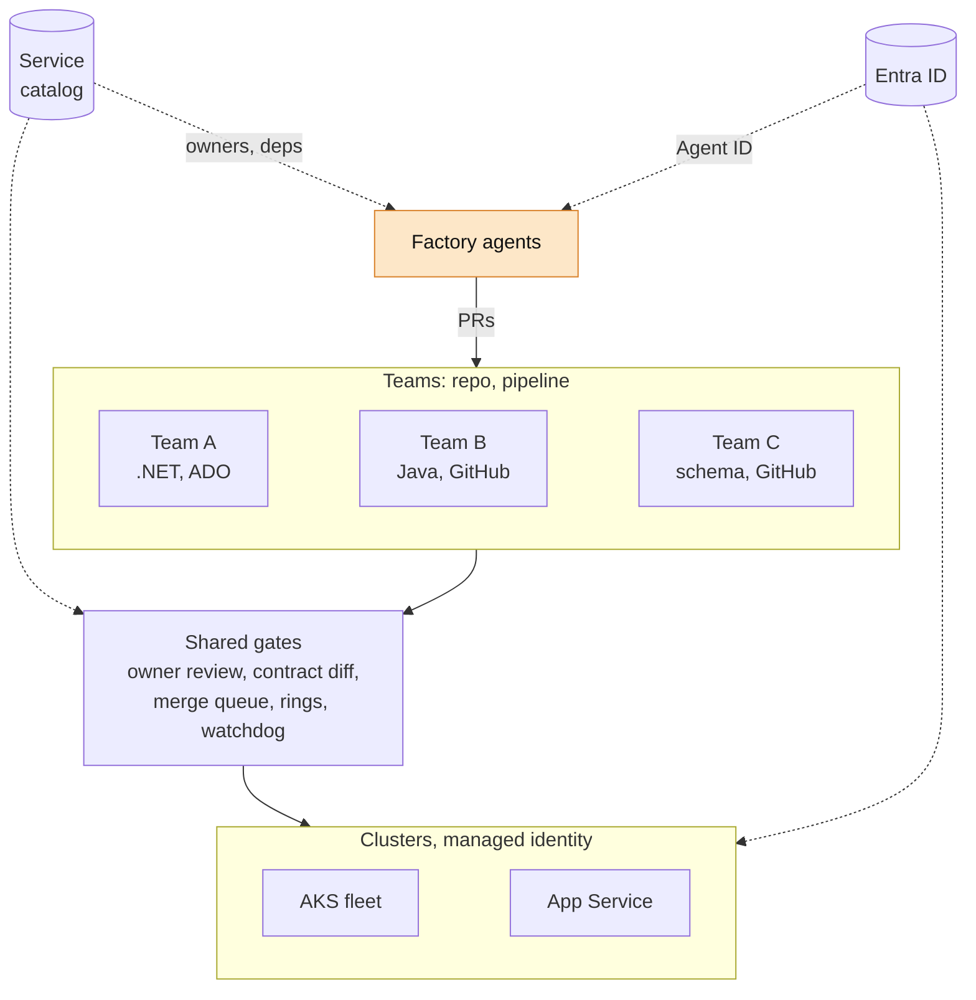
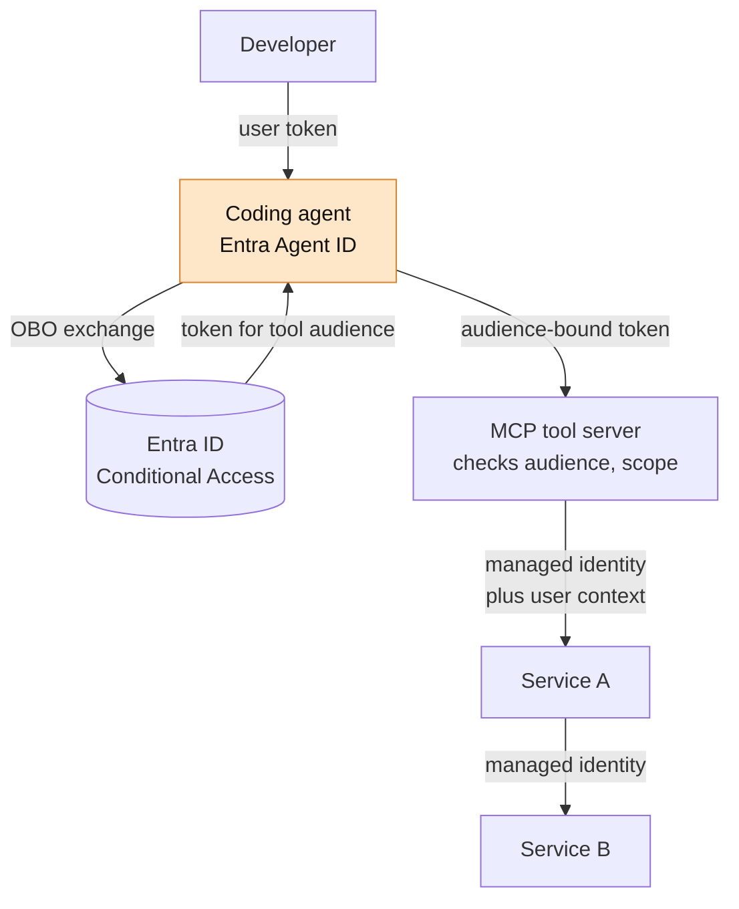

## Part IV: Enterprise complexity

The owner's question was about a service that is "highly complex, and built out of microservices in different repos, in different architectures, deployed through different pipelines on different clusters", with service-to-service (S2S) trust to overcome and several owning teams. Part II handles each at the stage where it bites; this part adds depth only where Part II is thin, mainly identity (IV.4).

> **Takeaway:** The message of this part: heterogeneity is acceptable as long as every repo, pipeline and cluster meets the same three contracts: owners and dependencies from the service catalog, one set of deterministic gates, and identity from Entra with no stored secrets.

Orange marks agents. Dotted lines are lookups or credentials, solid lines are the change path. The catalog tells agents and gates who owns what; Entra issues every identity; the gates, including human owner review, stay the same whatever repo, pipeline or cluster a change comes from.

### IV.1 Many repos and architectures

**Problem.** One customer-facing feature can touch a .NET API, a Java worker and a shared schema in three repos, and no single checkout shows all of it.

**What others did.** Microsoft runs both monorepos and multi-repo layouts, the latter often chosen by microservice teams [MS27], and Microsoft Digital's catalog links services to repos and owners (see V.1). One conference talk reports that Uber gives agents a "mega DevPod" holding all repos for cross-repo work [AIE2]. The repo coordination graph (mabl) and ownership sharding (Google) are covered in II.5, II.6 and II.8.

**Recommendation:** treat a cross-repo change as one change set with one ID carried by every PR, build, deployment and trust-ledger record, so it can be tracked, halted and reverted as a unit. Order comes from the catalog's reverse dependency graph (see V.1), and the same order governs merge (see II.8) and deployment (see II.9).

**Recommendation:** do not wait for one architecture. The factory needs each component, whatever its language or host, to expose the same three things: an AGENTS.md with its build and test commands (template: D3), the shared verification API (see IV.3), and a schema diff for each contract type it publishes (see II.4). Retire variants that cannot meet these; Spotify dropped one framework for this reason [SPOT5].

### IV.2 Cross-service API contracts and compatibility

**Problem.** Agents raise the rate of contract changes, and each consumer is owned by someone else. A green build in the provider proves nothing about consumers.

**What others did.** Part II covers Azure's breaking-change gate (azure-openapi-diff plus the Breaking Change Review Board, see II.4) and Amazon's two-phase Prepare and Activate rollouts (see II.9). Azure's stated next step is validating live traffic against the API definition [MS25].

**Recommendation:** agent-authored contract changes get no separate path: the same diff, labels and human board. Where agents help, they draft the non-breaking alternative the board would otherwise propose (Prepare, L1). The thin spot is non-REST contracts (gRPC, events, shared tables) and consumer-side checks; both stay open gaps.

Stage detail: II.3 (specs cite versions), II.4 (contract gate), II.7 (upgrade-downgrade tests), II.9 (two-phase rollout).

### IV.3 Heterogeneous pipelines and clusters

**Problem.** Team A ships through Azure DevOps to AKS, team B through GitHub Actions to App Service. Each pipeline has its own gates, credentials and idea of "done".

**What others did.** Microsoft Digital allows only `main` builds to deploy to production, with pipelines in folders that mirror the service tree [MS28]. Workload identity federation covers Azure Pipelines service connections, GitHub Actions and Kubernetes with one token-exchange model [MS17]. AKS Fleet Manager stages Kubernetes and node-image upgrades across AKS clusters (see II.9) [MS21]; it does not roll out applications and covers no other host. Amazon defines pipelines as code with inheritance [AWS1]; Spotify hides heterogeneous CI behind one verification service [SPOT7].

**Recommendation:** standardize the contract, not the tool. Each pipeline system implements three things: the ring plan as data (template: D5), a verification API agents call, and a halt signal from the shared watchdog. Each pipeline gets its own federated identity scoped to its repo and environment (see IV.4).

Stage detail: II.7 (verification), II.8 (merge across build systems), II.9 (rings; Fleet for cluster upgrades).

### IV.4 S2S trust and agent identity

**Problem.** Services in an older estate often trust each other through stored secrets, keys or network location. An agent given one of those holds every right the secret carries, for as long as it lives, with no record of which human asked.

**Recommendation:** the same three rules for services and agents:
1. Every caller proves who it is with a short-lived token from Entra, never a stored secret.
2. Every token is addressed to one service (its "audience") and works nowhere else.
3. The requesting human's identity travels with every call.

**Rule 1 for services.** Per Microsoft Learn, two mechanisms remove stored secrets:

- **Managed identity** for workloads on Azure: "always grant the least permissions needed" [MS16]. Two cautions shape the design: anyone who can run code on a resource inherits its identities, and tokens are cached for about 24 hours, so a role edit is not a fast revocation [MS16].
- **Workload identity federation** for everything else: Kubernetes, GitHub Actions, Azure Pipelines, other clouds and SPIFFE/SPIRE (an open standard for workload identity). The workload exchanges the token its own platform issues for an Entra token, which "eliminates the risk of leaking secrets or having certificates expire"; issuer, subject and audience must match exactly [MS17]. **Recommendation:** use that exact match as the blast-radius control, scoping each federated credential to one repo, branch, environment or namespace.

Google's BeyondProd is the published reference for the target state: trust comes from code provenance, service identity and trusted hardware, not the network; identity is bound to the microservice, not the host or IP; every call is authorized; and "Only authenticated, trusted, and specifically authorized callers or services can access any other service." [GOOG7].

**Rule 1 for agents.** III.3 sets the actor of record and the three Entra Agent ID modes. In plain words, the on-behalf-of (OBO) flow works like this: Entra trades the developer's token for a new token that is addressed to one tool and still names the developer, so the tool sees both who asked and which agent acted [MS22]. No password is involved: the agent's blueprint (the template its identity is created from) proves itself with a managed identity, and background work continues on refresh tokens, not stored secrets [MS22]. Every agent identity can also act as an API that receives such a token [MS23]. Conditional Access, Entra's sign-in policy engine, runs every time a token is issued or refreshed; under OBO it evaluates the user's policies, not the agent's (see III.3), and one policy can cover a whole class of agents [MS24]. API keys bypass it entirely [MS24], which is why REQ-IDN-04 bans them.

**Rule 2: tools behind audience-bound MCP servers.** The draft MCP authorization spec, for HTTP transport, makes each tool server an OAuth 2.1 resource server: "MCP servers MUST only accept tokens that are valid for use with their own resources." [MCP1]. A token stolen from the CI tool server is therefore useless at the cluster tool server. Servers must not pass the client's token on to downstream APIs, and a server can demand extra permission for one high-impact operation at the moment it is needed (step-up) [MCP1]. Uber exposes internal Thrift, Protobuf and HTTP endpoints as MCP tools through a central gateway that handles authentication, authorization, telemetry and logging [UBER2]. **Recommendation:** one MCP server or gateway per tool domain (repo, CI, cluster, telemetry), each its own audience.

**Rule 3: user context across hops.** BeyondProd carries the end user in a separate, short-lived, integrity-protected context ticket, distinct from the calling service's identity [GOOG7]. **Recommendation:**
- Where the service must enforce the user's own rights (customer data, a production change): chain OBO, so the user stays the person named in the token.
- Otherwise: the tool server calls with its own managed identity and attaches the requester and agent IDs as signed context for audit. Each hop logs both.

Orange marks the agent. No token is passed through: each hop gets a token for its own audience. The chart shows the second case; where Service A must enforce the user's rights, the tool server uses OBO instead of its managed identity.

**Migrating an existing estate.** Google reportedly had to roll out mutual authentication before access management, and started by logging violations before blocking them [GOOG7]. Microsoft's agent-security pilot (about 100 users on resettable Cloud PCs) rolled controls out in phases and did not bypass "any of the security parameters that we've already deployed" [MS18]. **Recommendation:** inventory stored secrets and API keys from the catalog; move services and pipelines to managed identity and federation; run per-call authorization in log-only mode; enforce service by service once its violation count stays at zero for an agreed window; only then give agents tool access to that service.

### IV.5 Multi-team ownership and accountability

**Problem.** The team that wants a change rarely owns everything it touches, and an agent can generate PRs faster than any owner can absorb them.

**What others did.** At Microsoft Digital, "Every area path in Azure DevOps has a team and associated set of repositories." [MS28], and owners of touched code are required reviewers [MS27]. Google authorizes large changes once, and local owners "don't hold a veto over the broader LSC" [GOOG6]. In a fireside chat, Spotify framed accountability as "someone who's accountable for the outcome" regardless of author [SPOT6].

**Recommendation:** every change names three humans from the catalog: the requester (author of record), the owner who approves each touched service, and, for campaigns, one driver. An agent working for team A never acts on team B's service without approval from B, or from the global approver an approved campaign names (see II.12). When an owner does not answer within the intake path's response time (see V.1), escalation goes to a named human; silence never becomes an auto-merge.

Stage detail: II.1 (cross-team intake), II.2 and II.3 (sign-offs), II.6 (reviewers), II.11 (incidents), II.12 (campaigns).

### IV.6 Configuration and feature-flag changes

**Problem.** Config and flags change behavior without a build, and in an agent factory the agents' own configuration (prompts, skills, the action policy, the tool registry) is also config.

**What others did.** Part II already sends config and flags through the same rings as code (see II.9, II.10) [MS2, AWS1]. What is new is the agents' own configuration.

**Recommendation:** classify agent configuration as production config. A new prompt, skill, tool scope or action-policy entry ships by PR, rides the rings for the services it touches, and can be rolled back like a flag. III.2 already treats a model or harness change the same way.

### IV.7 Security and compliance of the engineering system itself

**Problem.** The factory becomes a high-value target: it holds write access to many repos, pipelines and clusters, and its agents read untrusted text all day.

**What others did.** Microsoft's Secure Future Initiative pillar 4 requires engineering systems to be tamper-resistant and auditable: "Restrict developer, agent, and pipeline access based on role and build context." and "enforce code signed and reproducible builds to prevent tampering" [MS19]. BeyondProd verifies signed build manifests and two-person review at deploy time, and isolates less-trusted code in a sandbox (gVisor) [GOOG7].

**Recommendation:**
- Run sandboxes, gateways and tool servers as production services in SFI scope, with their own identities and no standing access to production.
- At deploy time, verify not only provenance (see II.8) but that the approving human differs from the requester.
- Treat everything an agent reads (issues, PR text, logs, web pages) as untrusted. Write scopes come from the task's action-policy entry (template: D6), never from content, and high-impact tools demand step-up scope [MCP1].

### IV.8 Cost, capacity and review load

**Problem.** The factory moves the bottleneck. Tokens, CI minutes, shared pre-production and human review hours all grow with agent volume.

**What others did.** III.4 covers Spotify's 76% rise in PRs to review and Shopify's token-spend alert. Spotify reached 1,000 merged PRs in 10 days and found review was the bottleneck [SPOT7]. Uber's move to many parallel background agents brought resource and cost pressure, with AI costs up six times since 2024 [UBER2]; one Uber talk frames "Earlier validation is part of capacity management" [AIE2].

**Recommendation:** plan three capacities, not one. Tokens go through the central gateway (see III.4). CI and pre-production get per-agent quotas so agent runs cannot starve humans. Review hours are the scarcest: size each campaign against the owners' measured review throughput before launch, and slow agent PR generation when review queue time rises.

Stage detail: II.5 (task budgets), II.6 (per-owner caps), II.8 (queue priority), III.2 (cost per accepted change).

### Requirements

Only requirements not already stated in Part II, III or V.1.

| ID | Priority | Statement | Rationale | Source |
|---|---|---|---|---|
| REQ-IDN-04 | MUST | Service-to-service and pipeline-to-cloud calls use managed identity or workload identity federation; no stored secrets, certificates or API keys in services, pipelines or agent sandboxes. | Secrets leak and expire; API keys bypass Conditional Access | MS16, MS17, MS24; Recommendation |
| REQ-IDN-05 | MUST | Each federated credential is scoped to one repo, branch, environment or namespace; each pipeline and runner pool has its own identity with least privilege. | Anyone who runs code on a runner inherits its identity | MS16, MS17; Recommendation |
| REQ-IDN-06 | MUST | Every tool exposed to agents sits behind an MCP server or gateway that is an OAuth resource server: it accepts only tokens for its own audience, never passes a token through, and calls downstream with its own managed identity or an OBO exchange. | Audience binding contains a stolen token | MCP1, UBER2; Recommendation |
| REQ-IDN-07 | MUST | The requester and agent identity travel with every hop: as the token subject (OBO) where the service enforces user rights, otherwise as signed context; each hop logs both. | Audit and authorization survive the call chain | GOOG7, MS22, MS23; Recommendation |
| REQ-IDN-08 | SHOULD | Per-call S2S authorization is introduced log-only, then enforced per service once violations stay at zero for an agreed window; agents get tool access to a service only after enforcement. | Blocking an existing estate blind breaks it | GOOG7 (summary), MS18; Recommendation |
| REQ-PIPE-04 | MUST | Every pipeline system in use implements the shared ring plan (template: D5), a verification API that agents call, and the shared watchdog's halt signal. | Standardize the contract, not the tool | MS1, MS2, SPOT7; Recommendation |
| REQ-PIPE-05 | SHOULD | Every component, whatever its language or host, exposes an AGENTS.md with build and test commands, the shared verification API and a schema diff per published contract type before agents change it. | Architectures differ; contracts must not | SPOT5; Recommendation |
| REQ-REPO-05 | MUST | A cross-repo change carries one change-set ID on every PR, build, deployment and ledger record, so it can be tracked, halted and reverted as a unit. | Many repos, one change | MABL1; Recommendation |
| REQ-OWN-09 | MUST | An agent acting for one team never changes another team's service without that owner's approval, or the global approver named by an approved campaign (see II.12); an unanswered request escalates to a named human and never defaults to auto-merge. | Silence is not consent | GOOG6, SPOT5; Recommendation |
| REQ-CFG-04 | MUST | Agent prompts, skills, tool scopes and action-policy entries are production config: changed by PR, rolled through rings, reversible. | Agent behavior is config | MS2, MS20, AWS1; Recommendation |
| REQ-SEC-06 | MUST | Agent sandboxes, model and MCP gateways and tool servers are in SFI scope, with their own identities and no standing production access; the deploy gate verifies that the approver is not the requester. | The factory is a high-value target | MS19, GOOG7; Recommendation |
| REQ-SEC-07 | MUST | Content agents read is untrusted; write scopes come only from the task's action-policy entry, and high-impact tools require step-up scope per operation. | Prompt injection must not grant scope | MCP1; Recommendation |
| REQ-COST-02 | SHOULD | Agents get per-agent quotas on CI and shared pre-production; each campaign is sized against owners' measured review throughput, and agent PR generation slows when review queue time rises. | Review hours are the scarcest capacity | SPOT2, SPOT7, UBER2, AIE2; Recommendation |

### Open gaps

- Non-REST contract gates and consumer-driven contract testing (see II.4).
- No Microsoft source describes a forwardable end-user context separate from the access token, as BeyondProd's context tickets are.
- The MCP enterprise-managed authorization extension was not read; how an enterprise identity provider governs MCP consent is open.
- The log-then-enforce lesson from BeyondProd comes from a summary, and no source gives the enforcement exit criterion; the zero-violation window is ours.
- No source shows one watchdog halting both Azure DevOps and GitHub Actions, or a merge queue spanning repos.
- No source measures prompt-injection defenses for coding or review agents.
- No Microsoft source publishes factory cost, CI capacity or review-capacity data.
- Change-set links (PRs, builds, deployments) are fields of the ledger record (template: D7); a standalone change-set record is still proposed (template: proposed).
- Proposed kit item: an S2S identity migration checklist (secret inventory, federation scope, log-only window, enforcement criterion) (template: proposed).
