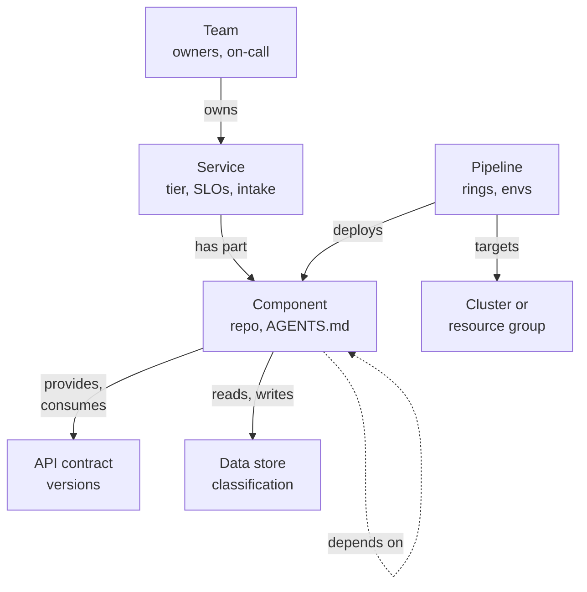
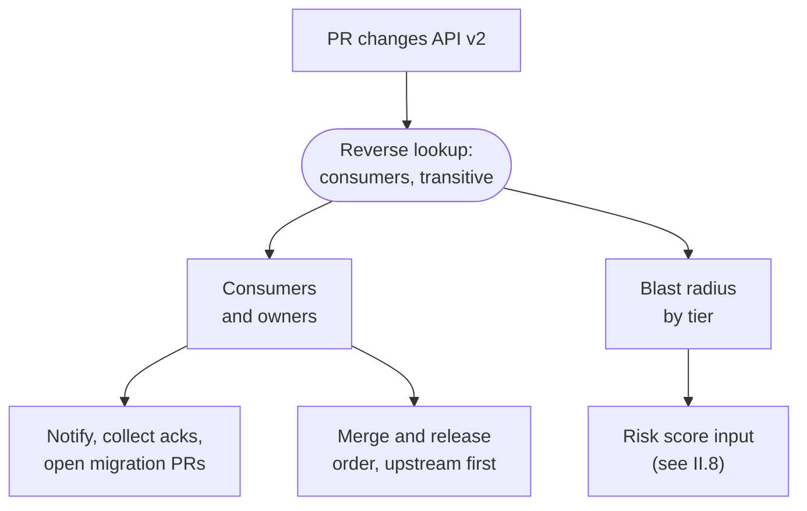
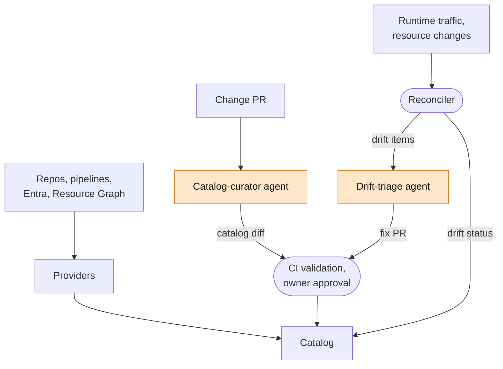

## V.1 The service catalog: the factory's backbone

### Purpose

The service catalog is the record every stage looks things up in: who owns a service, what it depends on, who depends on it, how it ships, what data it holds, and what agents may do to it. Routing (II.1), sign-offs (II.2), consumer acknowledgements (II.4), reviewers (II.6), rollout plans (II.9), migrations (II.12) and coordinated multi-repo changes (IV.1) are all lookups against it. Agents raise the cost of a wrong entry: a human notices a stale owner, an agent routes work there and waits.

### Real-world reference

**Microsoft Digital's service catalog** (Microsoft's internal IT organization) links services to repos, subscriptions and owners for 900+ services and 3,800 repos. Its metadata decides which compliance tasks apply: UI triggers accessibility checks, web endpoints trigger vulnerability scanning, Azure resources trigger Secure DevOps Kit policies [MS28]. "Every area path in Azure DevOps has a team and associated set of repositories." [MS28]. On Azure, Resource Graph is the tenant-wide, queryable inventory of resources and their changes, and Service Groups (public preview) group resources across subscriptions into one service [MS30, MS29].

**Backstage** is the open-source developer portal Spotify created. Per its docs, the catalog is built from descriptor YAML files in each repo: "The source of truth for the components in your software catalog are metadata YAML files stored in source control" [SPOT8]. Entities declare owners, `dependsOn`, and provided and consumed APIs [SPOT9]. Spotify's chief architect said in a 2026 conference talk that Backstage exposes ownership and docs to agents through MCP and a CLI [SPOT2].

**OWNERS files** at Google list owners per directory, and an owner of each touched directory must approve every change [GOOG8]. A 2023 GitHub engineering blog post describes SERVICEOWNERS, which maps every file in GitHub's monolith to a service and generates CODEOWNERS from it [GH3].

### What it stores

Components declare `dependsOn` other components; reverse edges are computed (next section).

| Entity | Key fields | Derived from |
|---|---|---|
| Team | Members, on-call rotation, chat channel, escalation | Entra groups, on-call tool |
| Service | Owning team, tier, lifecycle, architecture summary and design-doc links, SLOs and health signals, change-intake path, data classification roll-up | Catalog file (declared, owner-attested) |
| Component | Repo and paths, language, AGENTS.md location, allowed agent actions per rung (see D6), dependencies | Repo, SERVICEOWNERS-style mapping, build graph |
| API contract | Spec (OpenAPI, gRPC), version, deprecation window, consumers | Spec files, contract diff (see II.4), traffic |
| Data store | Classification, retention, owning component, readers and writers | IaC, classification scanner |
| Pipeline | System (ADO, GitHub Actions), ring plan (see D5), environments, bake policy | Pipeline definitions |
| Cluster or resource group | Subscription, region, Service Group, Fleet membership | Azure Resource Graph, Service Groups |

The full YAML schema is template D2.

**Recommendation:** the change-intake path ("how to ask this team for a change") is a machine-readable address, not prose: the team's work queue (an ADO area path, or a GitHub repo and label), a request template, and the expected response time. Agents that need another team's change, such as the grilling agent (II.2) or a coordinated migration (IV.1), file a request there instead of messaging people, and it is tracked like any work item.

### The reverse dependency graph for change management

Per the Backstage docs, descriptors may not contain hand-written relations. Processors derive them from each entity's forward fields and always emit inverse pairs (`dependsOn`/`dependencyOf`, `consumesApi`/`apiConsumedBy`) [SPOT9]. For change management, this lookup replaces the hand-written impact assessment in a change record:

Published uses of the graph:

- **Consumers and owners.** Spotify used Backstage endpoint lineage to get the consumer list and owners before migrating about 1,800 downstream pipelines [SPOT5]. Google's Rosie, its tool for splitting a large-scale change into per-owner pieces, "shards it based upon project boundaries and ownership rules" [GOOG6].
- **Order.** mabl, a 25-engineer vendor, reports a coordination graph across 79 repos that prescribes release order, upstream first (vendor-reported) [MABL1].
- **Blast radius.** InfoQ reports that Netflix built a runtime topology for blast-radius analysis and change management [NFLX1].

**Recommendation:** feed the transitive consumer count, weighted by tier, into the risk score (see II.8). [GAP: no source uses a reverse dependency graph as a risk-model input.]

### Keeping it current

The published answer is to derive facts, not declare them, and to make stale entries fail something.

- **Derive from sources of truth (published).** Per Microsoft Learn, Resource Graph records every resource create, update and delete with who changed it, and change records "should be available in less than five minutes" [MS30]; Service Group membership ties those resources to a service [MS29]. Backstage's providers ingest from Git, the directory and cloud APIs, and each entity has exactly one provider. A hand deletion does not stick, and an entity its parent stops emitting is flagged orphaned [SPOT10]. A processing error reportedly does not replace the last good version [SPOT10].
- **Catalog-as-code with CI validation (published).** GitHub's CI fails if a new file has no service owner, or if a pattern matches no file: "All patterns/directories/files must match at least one existing file." [GH3]. Backstage templates register new services at creation [SPOT8], and Microsoft Digital maps a repo to a service from creation [MS28].
- **Drift detection against runtime (published, partly).** Netflix reportedly derives its graph from eBPF (kernel-level network tracing) flows, IPC metrics and traces rather than from owners, and found wrong data "worse than no data at all" (per InfoQ) [NFLX1]. Resource Graph's `clientType` shows changes made from the portal rather than a pipeline [MS30]. **Recommendation:** a scheduled, deterministic reconciler compares declared `dependsOn` with observed edges, and out-of-band resource changes with the pipeline record. Each mismatch becomes a drift item, and the reconciler sets the entry's drift status. The drift-triage agent sorts real drift from telemetry noise and drafts the fix.
- **Owner attestation (our synthesis).** Some fields cannot be derived: the change-intake path, SLO targets, data classification, the architecture summary. **Recommendation:** owners re-confirm these on a schedule.
- **Agents propose catalog updates with every change (our synthesis).** In OpenAI's harness-engineering experiment, lints (automated checks in CI) verify that the in-repo knowledge base is current and cross-linked, and a "doc-gardening" agent opens fix-up PRs [OAI1]. **Recommendation:** treat the catalog the same way. A PR that adds a client call, a pipeline or a data store carries the catalog diff, and CI fails it when the build graph shows a dependency the catalog lacks.
- **Staleness lowers autonomy (our synthesis).** **Recommendation:** open drift or lapsed attestation caps every agent action on that service at Advise (L0) until fixed. Catalog-repair PRs for that entry are exempt; they still need owner approval.

### What to agentify, and how far

> **Takeaway:** **Recommendation, in one line:** only providers and merged PRs write the catalog; agents keep it current by proposing diffs with every change and triaging drift, and a stale entry lowers every agent's autonomy on that service.

The reconciler and CI validation are deterministic. Owners approve ownership and classification changes; allowed-action changes also need governance, and no agent edits its own allowed actions (see D6). Realistic ceiling today is Act on approval (L2).

Orange boxes are agents; everything else is the deterministic core.

| Agent role | Rung | What it does | Guardrail | Evidence to promote |
|---|---|---|---|---|
| Catalog-curator agent | Advise (L0) | Comments on a change PR with the catalog fields it makes stale | Read-only | Owners accept most flags |
| | Prepare (L1) | Suggests the catalog diff for the author to add to the change PR | Author adopts; CI validates | Diffs adopted unchanged |
| | Act on approval (L2) | Opens catalog PRs for gaps it finds (missing consumer, dead link) | Owner merges; allowed actions also need governance | Low revert rate on catalog PRs |
| | Act, then notify (L3) | Future proposal: catalog PRs touching only derived, non-ownership fields merge when CI passes | CI gate merges, not the agent; never ownership, classification or allowed actions | Clean L2 record over a long sample |
| Drift-triage agent | Advise (L0) | Explains each drift item: real drift or telemetry noise | Read-only on telemetry and Resource Graph | Owners confirm its verdicts |
| | Prepare (L1) | Drafts the fix for the owner | Owner adopts and submits | Drafts adopted |
| | Act on approval (L2) | Opens the fix PR; drift status stays with the reconciler | Owner merges | Few wrong-owner routings |

### Enterprise complications

- **Many sources of truth.** Backstage's one-provider-per-entity rule avoids two systems fighting over one record [SPOT10]. Service Groups are in preview, with no custom RBAC yet [MS29].
- **Monoliths and multi-repo services.** One repo can hold many services, and one service can span repos; GitHub handles both with SERVICEOWNERS and `ownership.yaml` [GH3].
- **Ownership is not authorization.** Backstage's descriptor docs reportedly say `owner` should not drive runtime access [SPOT9]; Service Group membership grants no access to resources [MS29]. Agent permissions come from identity (see IV.4), not from the owner field.
- **Uninstrumented legacy.** Traces miss old services; Netflix's eBPF layer reportedly covers them but without endpoint detail [NFLX1].
- **Orphans.** Without an owner mapping, Microsoft IT once found owners by turning machines off: the "Scream Test". Today Resource Graph queries feed Service 360 (S360), an internal tool that raises per-resource action items for owners [MS31]. **Recommendation:** keep orphaned production entities flagged and route them to triage instead of deleting them.

### Requirements

| ID | Priority | Statement | Rationale | Source |
|---|---|---|---|---|
| REQ-CTX-07 | MUST | Catalog entries live in repos as files using the D2 schema; CI validates required fields, references that resolve, and patterns that match existing files. | Stale entries must fail something | GH3, SPOT8 |
| REQ-OWN-10 | MUST | Every repo path, pipeline and production resource maps to a service with an owning team; new code or services without one fail CI, and templates register services at creation. | No unowned production | GH3, SPOT8, MS28 |
| REQ-CTX-08 | MUST | Derived facts come from exactly one provider per entity, and humans do not hand-edit them. | One writer, no drift by hand | SPOT10 |
| REQ-CTX-09 | MUST | Reverse edges are computed, never declared, and served through an API or MCP tool to gates and agents. | "Who depends on me" must be complete | SPOT9, SPOT2 |
| REQ-CTX-10 | MUST | A deterministic reconciler compares declared dependencies with observed traffic and flags resource changes made outside pipelines; it opens a drift item for the owner and sets the entry's drift status. | Declared edges rot | NFLX1, MS30; Recommendation |
| REQ-OWN-11 | MUST | Changes to ownership or data classification need the owning team's approval; changes to allowed agent actions also need governance; no agent changes its own allowed actions. | Agents never grant themselves scope | Recommendation; D6 |
| REQ-OWN-12 | MUST | Each service's change-intake path names a work queue, a request template and an expected response time; agents file cross-team requests there. | Asking for a change is a lookup | Recommendation |
| REQ-CTX-11 | SHOULD | A change PR that alters a dependency, pipeline or data store carries the matching catalog diff, or CI fails. | Update at the moment of change | OAI1; Recommendation |
| REQ-OWN-13 | SHOULD | Owners attest non-derivable fields on a schedule; open drift or lapsed attestation caps agent actions on that service at Advise (L0), except catalog-repair PRs, which still need owner approval. | Stale context should lower autonomy | Recommendation |

### Open gaps

- Microsoft Service Tree and S360 have no public schema, attestation process or rule for which checks apply; MS28 (2020) is the best public proxy. A public GitHub issue in Microsoft's `sre-agent` repo reportedly keys S360 findings by Service Tree ID (recorded in the MS31 note; no reference code of its own).
- No source documents owner attestation cadence; GitHub and Google rely on CI and review instead.
- No source measures catalog accuracy or freshness, or its effect on agent outcomes.
- No source uses a reverse dependency graph as a risk-score input.
- Netflix details are secondary reporting (InfoQ), not the original posts.
- No source shows an agent maintaining a service catalog; OpenAI's doc-gardening agent [OAI1] is the closest precedent, and the rungs are synthesis.
- No source describes a machine-readable change-intake path; the fields here are ours.
