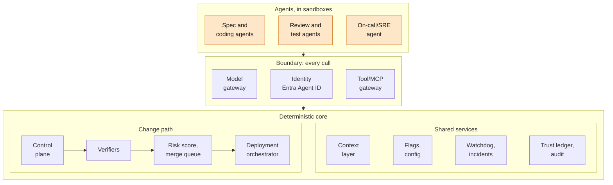

## V.2 Factory reference architecture: the other components

V.1 covers the service catalog. This section covers the other components: what each does, whether to adopt a Microsoft option or build it, a frontier reference, and the roadmap step (see III.4) by which it must exist.

> **Takeaway:** Most of the factory is deterministic plumbing. Agents sit at the edges and reach the core only through identity and two gateways.

Orange boxes are agents; everything below the boundary is deterministic. The watchdog halts the deployment orchestrator and opens incidents, and every component writes to the trust ledger.

### Components

**Control plane (intake, task queue, orchestrator).** It turns an approved work item into an agent task with a requester, an action ID from the agent action policy (template: D6), a budget and a sandbox, then runs the task as a sequence of steps. Microsoft first: in GitHub, every Copilot Coding Agent (CCA) PR in dotnet/runtime starts at a maintainer's request, and "CCA cannot open PRs on its own" [MS8]. Microsoft Digital's DevOps Assistant uses an Orchestrator Agent in Copilot Studio to route user requests to specialist agents, on the stated principle of inheriting existing ADO permissions [MS14] (an Inside Track post); it is the closest Microsoft analogue, not a task queue. Frontier: Stripe's blueprints interleave deterministic nodes (lint, push) with agent nodes (implement, fix CI) [STRIPE1]. Needed by II.1, II.5 and II.12, from Step 0, where readiness agents already run as tasks.

**Execution sandboxes.** Every agent task runs in a fresh environment with the repo's toolchain, no production access, no real customer data and limited egress (see II.5). Microsoft first: GitHub describes Copilot agents running in cloud sandboxes with an isolated working copy per task and enterprise managed settings [GH2] (product marketing). Microsoft's agent-security pilot used resettable Windows 365 Cloud PCs with Entra Agent IDs and network controls [MS18]. [GAP: no note describes GitHub Codespaces or Microsoft Dev Box as an agent sandbox.] Frontier: Stripe's devboxes are ready in about 10 seconds and isolated from production and the internet, so agents run without permission prompts [STRIPE1]. Needed by II.5, II.7 and II.12, from Step 0.

**Model gateway.** One endpoint for every model call. It attributes each request, enforces budgets, redacts sensitive data and records the model version for the ledger. Microsoft first: [GAP: no note names a Microsoft model gateway product.] Frontier: Shopify's head of engineering says in an interview that all AI traffic goes through a central LLM proxy for cost control, usage analytics and model switching [SHOP1]. One Uber talk describes an OpenAI- and Anthropic-compatible gateway with SPIRE (an open-source workload identity system), a data anonymizer and an AI guard; it attributes every request to a user, project and team and serves more than 100M requests a day [AIE2]. Needed by every stage, from Step 0 (see the cost requirement in III.4).

**Tool/MCP gateway.** It exposes existing internal APIs to agents as tools, with authentication, scope checks, logging and a registry, so services are not rewritten for agents. Microsoft first: [GAP: no published Microsoft MCP gateway in our notes.] The GA announcement says Azure SRE Agent consumes tools through MCP connectors [MS10]. **Recommendation:** make each tool server an audience-bound OAuth resource server, as the draft MCP authorization spec requires [MCP1], and use the Entra agent on-behalf-of (OBO) flow for calls made for a user [MS22] (see IV.4). Frontier: Uber's MCP gateway exposes any internal Thrift, Protobuf or HTTP endpoint as MCP by configuration and handles authN/authZ, telemetry, logging and the registry [UBER2]; Stripe's Toolshed holds 400 to 500 tools but gives each agent a small curated subset, under a control framework for destructive tools [STRIPE1]. Needed by II.5, II.9 and II.11, from Step 1 for read tools and Step 7 for mitigation tools.

**Identity.** Every agent, pipeline and service has its own identity, and the requester travels with each call. Microsoft first, per Microsoft Learn: Entra Agent ID for agents [MS12]; managed identity and workload identity federation (WIF) for services and pipelines, which "eliminates the risk of leaking secrets or having certificates expire" [MS17], with "the least permissions needed" [MS16]. Actor-of-record modes are in III.3 and token flows in IV.4. Frontier: Google's BeyondProd (see IV.4) [GOOG7]. Needed by every stage, from Step 0.

**Context layer.** The service catalog is V.1. Alongside it, each repo carries a short AGENTS.md that maps into versioned in-repo docs (template: D3), as OpenAI's harness experiment did [OAI1]. In dotnet/runtime, instructions and environment setup reportedly raised CCA success [MS8]; the GA announcement says Azure SRE Agent preloads code, logs, metrics and tools because "the most effective agents were those deeply grounded in their team's specific context." [MS10]. One Uber talk describes a context graph of 150 node and edge types linking mobile and backend code, the data lake, design docs, Jira and incidents [AIE2]. Needed by every stage, from Step 0.

**Verification service.** It runs every verifier an agent's output must pass, in a fixed order: local checks in the sandbox, CI, mutation and integration tiers, then LLM judges that may comment or veto but never approve (see II.7). Microsoft first: Microsoft's AI code review runs on 90% of PRs [MS7], and the same Copilot reviewer runs on staff, agent and community PRs in dotnet/runtime [MS8]. Frontier: Stripe layers lint in under five seconds, then at most two CI rounds over more than 3M tests, then a human [STRIPE1]; Meta's ACH test generator uses mutants (deliberately injected bugs) to guide tests [META1]. Needed by II.3, II.5 to II.7 and II.12, from Step 0.

**Risk scoring and merge queue.** The queue tests each PR on top of the ones ahead and advances a verified-main pointer; a versioned risk model sets gate strictness and whether auto-merge applies (see II.8). Microsoft first: [GAP: no Microsoft source describes a combined-state merge queue or a change risk score; see II.8.] GitHub's Agent Merge auto-merges once checks pass, if configured, but is not a combined-state queue [GH2] (product marketing). Frontier: Uber's SubmitQueue tests combined states and keeps a verified main under AI-driven load [AIE3] (one conference talk); Meta's Diff Risk Score predicts how likely a diff is to cause a production incident, and it let more than 10,000 changes land during a freeze [META2]. Needed by II.6, II.8 and II.12: the merge queue from Step 1, the risk gate from Step 3, which allow-lists mechanical classes.

**Deployment orchestrator.** It executes one ring plan, defined as data (template: D5), across every pipeline system, with bake set centrally and a halt it obeys from the watchdog (see II.9). Microsoft first: Azure Safe Deployment Practices (SDP) set rings and bake by policy [MS2]. AKS Fleet Manager stages cluster and node-image upgrades, not application rollouts, so the orchestrator must coordinate with it (see II.9) [MS21]. Frontier: Google's Binary Authorization checks signed build manifests and two-person review at deploy time [GOOG7]; the orchestrator should verify agent provenance the same way (see II.8). Needed by II.9 and II.10, from Step 0.

**Feature flag and config service.** It versions every flag and config change, sends it through the same rings as code, and turns a flag off in one call (see II.9, II.10, IV.6). It is the kill switch the on-call agent uses at Act, then notify (L3). Microsoft first: Microsoft Learn guidance ships code dark and enables it per tier, deployment or user [MS1], and Azure's Well-Architected guidance treats flags and config as deployments [MS3]. [GAP: no note names a Microsoft flag service product.] Frontier: config changes are "another large category" of Meta's production incidents [META2]; Amazon sends config and flags through the same safe pipelines [AWS1]. Needed by II.9 to II.12, from Step 0.

**Observability and watchdog.** Telemetry, legible to agents and humans, plus a deterministic go/no-go per ring. Microsoft first: Gandalf (see II.9) writes its decision to a store that the deployment engine reads to stop a rollout, and on a no-go opens an incident with evidence [MS5]. That incident record is the hook the SRE agent and the postmortem write to (see II.11). Azure SRE Agent sits on top, and per its GA announcement "Teams can choose how autonomous the agent should be" [MS10]. Frontier: OpenAI gives each worktree a bootable app and an ephemeral observability stack that Codex queries directly [OAI1]. Needed by II.9 to II.11: the halt from Step 0, agent read access from Step 7.

**Trust ledger and audit.** The per-action record that promotes or demotes each action (see III.2; template: D7). It joins identity, verifier, queue, deployment and incident events by run ID. Microsoft first: Entra Agent ID logs activity as an agent's [MS12], and Microsoft's Secure Future Initiative (SFI) requires signed, traceable identities and auditable engineering systems [MS19]. [GAP: no Microsoft product or note describes a per-action outcome ledger.] Frontier: Uber's Agent Studio keeps traces, versions and evals [UBER2]. Needed by every stage, live from Step 0 (see III.4).

### Component map

| Component | Microsoft-first option | Frontier reference | Build or buy | Necessary from |
|---|---|---|---|---|
| Control plane | Copilot Coding Agent; ADO assistant orchestrator (analogue) | Stripe blueprints | Build on CCA and ADO | Step 0 |
| Execution sandboxes | Copilot cloud sandboxes; Windows 365 Cloud PCs | Stripe devboxes | Adopt; build images | Step 0 |
| Model gateway | [GAP] | Shopify LLM proxy; Uber model gateway | Build | Step 0 |
| Tool/MCP gateway | [GAP]; Entra agent OBO (pattern); SRE Agent MCP connectors | Uber MCP gateway; Stripe Toolshed | Build | Step 1 (read), Step 7 (act) |
| Identity | Entra Agent ID, managed identity, WIF | Google BeyondProd | Adopt | Step 0 |
| Context layer | Service catalog (V.1); repo instructions, AGENTS.md | OpenAI AGENTS.md map; Uber context graph | Build (V.1, D3) | Step 0 |
| Verification service | AI code review; Copilot Code Review | Stripe layered CI; Meta ACH | Adopt review; build tiers | Step 0 |
| Risk scoring and merge queue | [GAP]; GitHub Agent Merge (not combined-state) | Uber SubmitQueue; Meta DRS | Build | Step 1 (queue), Step 3 (risk gate) |
| Deployment orchestrator | Azure SDP; AKS Fleet Manager for cluster upgrades | Google Binary Authorization | Adopt; build ring-plan adapter | Step 0 |
| Feature flag and config service | SDP flag guidance; [GAP] for a product | Meta config risk; AWS safe pipelines | Adopt or build | Step 0 |
| Observability and watchdog | Gandalf; Azure SRE Agent | OpenAI ephemeral observability | Adopt Gandalf-style halt | Step 0 (halt), Step 7 (agent) |
| Trust ledger and audit | Entra agent activity logs; SFI audit baseline | Uber Agent Studio | Build (D7) | Step 0 |

Three items have no Microsoft product in our sources and are build work: the model gateway, the merge queue with risk score, and the trust ledger. The tool gateway is build work on Microsoft identity.

### How the pieces fit

- **Agents never touch the core directly.** **Recommendation:** every model call goes through the model gateway and every tool call through the tool gateway, both under an agent identity. No agent has a write path into a gate, the queue or ring promotion, so a misled or prompt-injected agent can produce a bad change but cannot wave it through.
- **Standardize the platform, not the agent.** Shopify's head of engineering puts it as "in a rapidly evolving AI landscape, standardize infrastructure, not tools." [SHOP1]. Uber puts industry agents (Claude Code, Copilot, Codex) on one internal platform with a model gateway and shared context sources [UBER2]. **Recommendation:** treat the agent product as replaceable and the gateways, verifiers and ledger as the long-lived investment.
- **The core must work without models.** **Recommendation:** if the model gateway is down, builds, the merge queue, ring promotion and the watchdog halt still run, and the factory falls back to human-only work.
- **The factory changes like the service.** The factory's own components change through the same rings as the service (security scope: IV.7).

### Requirements

Only requirements not already stated in Part II, Part III, Part IV or V.1.

| ID | Priority | Statement | Rationale | Source |
|---|---|---|---|---|
| REQ-PIPE-06 | MUST | Agent work starts only from a control-plane task record that names the requester, the action ID from D6, the budget and the sandbox; no agent run touches shared repos or tools without one. | Every action needs an owner, a scope and a ledger key | MS8, STRIPE1; Recommendation |
| REQ-SEC-08 | MUST | The model gateway is the only model egress from sandboxes and agents. It attributes each request to agent, requester, team and task, redacts sensitive data, and records the model version. | One place for cost, data and version control | AIE2, SHOP1; Recommendation |
| REQ-IDN-09 | MUST | The tool gateway keeps a registry of tools; each agent gets a default small set, and a tool with write or destructive effect is callable only when the task's D6 entry allows it. | Fewer tools, smaller blast radius (complements IV.4) | STRIPE1, UBER2; Recommendation |
| REQ-GOV-18 | MUST | Trust-ledger records are written by deterministic components (gateways, verification service, merge queue, deployment orchestrator, watchdog), append-only and keyed by run ID; an agent's own report is never the record of an outcome. | Agents skew positive about their own work | AN3, MS19; Recommendation |
| REQ-OBS-09 | MUST | The deterministic core (build, verifiers, merge queue, ring promotion, watchdog halt, kill switches) has no runtime dependency on the model gateway or any agent. | Safety must not depend on the thing it guards | MS5; Recommendation |
| REQ-PIPE-07 | SHOULD | Components talk through versioned APIs (task, verification, merge, deploy, ledger), so an agent product can be replaced without changing gates. | Standardize infrastructure, not tools | SHOP1, UBER2; Recommendation |
| REQ-PIPE-08 | SHOULD | Each sandbox can boot the service and query an ephemeral telemetry stack, so agents verify behavior before a PR opens. | Earlier validation saves CI and review | OAI1, AIE2 |

### Open gaps

- No note names a Microsoft model gateway, MCP gateway or flag service product, or GitHub Codespaces or Microsoft Dev Box used as agent sandboxes.
- No Microsoft source describes a combined-state merge queue or a change risk score (also in II.8).
- No Microsoft product or note describes a per-action outcome ledger; D7 is our design.
- Most of the Uber platform detail (model gateway, SPIRE, context graph) comes from one conference talk and a partly paywalled newsletter.
- No source measures the gateway's own overhead (latency, availability) or the cost of running these components for one service.
- No source shows how the factory degrades when the model gateway fails.
- Proposed kit item: a component interface sheet listing the task, verification, merge, deploy and ledger APIs and which REQ-IDs each satisfies (template: proposed).
