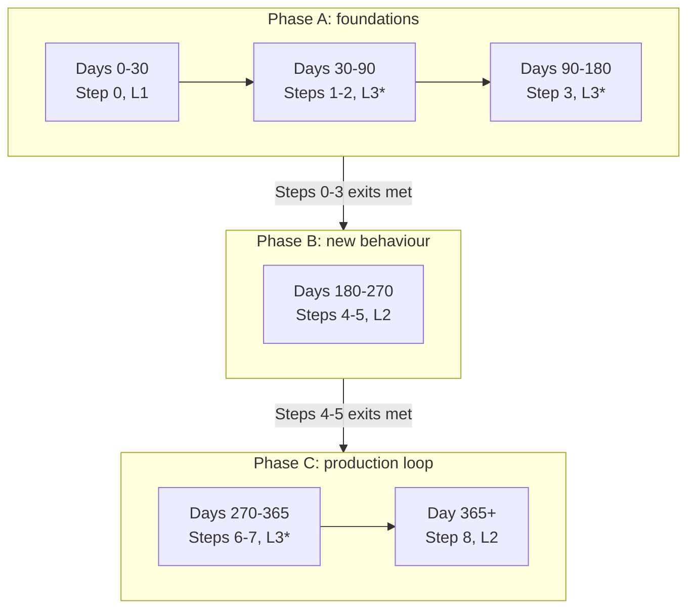

## Part VI: Transformation plan for an existing service

The goal is a service that ships high-quality features faster each quarter, not PR volume. This part maps the nine roadmap steps of III.4 onto calendar time for one service and one team. Steps, rungs, prerequisites and promotion metrics are in the III.4 table and are not repeated here. Uncited content is our synthesis.

### VI.1 Readiness assessment

**Recommendation:** Step 0 starts by measuring the service against the readiness checklist (template: D8; rationale in III.4). The summary below is what the sponsor reviews at the end of Step 0.

| Area | Ready means | Grounding |
|---|---|---|
| Safety net | Rings with bake and an automatic, deterministic halt (SDP with a Gandalf-style watchdog); health signals registered | II.9 |
| Verifiers | Reproducible build, reliable tests, flaky tests quarantined, lint enforced, each scored against the talk's eight pillars (testing, docs, code quality, build, environment, observability, security, standards) | [AIE8] (one conference talk) |
| Rollback practice | Revert and rollback are routine, not exceptional | [GOOG4] |
| Context layer | AGENTS.md drafted (template: D3); owners, dependencies and pipelines from the service catalog (see V.1) | [GOOG4] |
| Identity | Each agent has its own Entra Agent ID with a sponsor [MS12]; a kill switch per agent (see III.2) | [MS12], III.2 |
| Gateway and cost | All model traffic through one LLM gateway with per-team usage and spend | [SHOP1, UBER2] |
| Policy and ledger | Agent action policy (D6) and trust-ledger record (D7) live | III.2 |
| Baselines | Human-only DORA metrics and per-class merge and revert rates recorded | III.4 |
| AI stance | Permitted tools and expectations written down; experimentation supported | [GOOG4] |

### VI.2 Choosing the first pilot

**Recommendation:** make the first pilot test backfill on the target service (Step 1). A pending test-framework migration is a good second candidate (see Airbnb below). Do not pilot on new feature work. The reasons:

- **It is verifiable.** Tests either run or they don't, and a deterministic check can reject any diff that touches files outside test paths. Anthropic's engineers delegate verifiable, low-stakes, self-contained work first [AN4]. Microsoft Digital's Inside Track post reports starting with low-risk tasks such as test-case generation [MS15].
- **It changes no production behaviour and strengthens every later step,** which is judged by the same suite. The same talk puts it as "A slop test is better than no test." [AIE8].
- **The best evidence available supports it.** One conference talk reports that Duolingo merged over 700 agent test PRs, each one human-approved, and lifted repository-layer coverage from 11% to 72%. Early batches merged only 8 of 17 and 19 of 40 [AIE6]. Airbnb migrated about 3.5K test files from Enzyme to React Testing Library in six weeks, against a 1.5-year manual estimate; tuning took the bulk run from 75% to 97%, and the rest was done by hand [ABNB1].
- **The failure mode is known.** "A test PR could pass CI by weakening an existing test." [AIE6]. Spotify's early agents commented out failing tests [SPOT7]. So the test-only diff check and a check for deleted or disabled tests are pilot deliverables.

### VI.3 The phases

**Recommendation:** run the six windows below. They map onto III.4's phases: Phase A (Steps 0 to 3) fills days 0 to 180, Phase B (Steps 4 and 5) days 180 to 270, and Phase C (Steps 6 to 8) day 270 onward. Within a window, steps run in order (REQ-GOV-16 in Part III). Each window ends in a phase review chaired by the sponsor (template: D8), which checks every step's exit criterion from III.4 against the ledger.

Each box shows the highest rung reached in that window; L3* applies only to the classes III.4 names.

**Recommendation, when a step misses its exit criterion:** hold the step at its current rung, fix the verifier, context or class allow-list that caused the miss, and re-review at the next phase review. Never start the next step to stay on schedule. If the same step misses at two reviews in a row, the sponsor re-scopes it or demotes the failing action one rung.

#### Days 0–30: Step 0, readiness

- **Goals.** Put the safety net in place before any agent change can merge, and record human-only baselines.
- **Deliverables.** The D8 checklist filled in, plus the Step 0 prerequisites in III.4. Agents work only at Prepare (L1), drafting AGENTS.md and lint or test fixes that an engineer submits as their own. If the service has no rings with an automatic halt yet, Step 0 takes as long as that work takes.
- **Team.** A sponsor (director or GM); the service's tech lead; the factory platform team (gateway, harness, ledger); release engineering (rings, halt); security (agent identities, Conditional Access); on-call (health signals, kill switches).
- **Watch.** The DORA baselines, the flaky-test rate, and time from a clean checkout to a green build.

#### Days 30–90: Steps 1 and 2, test backfill, then AI review

- **Goals.** Run the pilot, then make AI review the first pass on every PR so that human review hours go further.
- **Deliverables.** Test-backfill agents open labelled PRs that the owner merges. AI code review on every PR: Microsoft's internal reviewer covers over 90% of PRs, proposes fixes the author must click to apply, and reports a 10 to 20% improvement in median PR completion time in early experiments [MS6]. Review comments start at Advise (L0) and click-to-apply fixes run at Act on approval (L2). A category may block through policy (Act, then notify, L3) only after Step 1 exits and its useful and addressed rate (see II.6) holds.
- **Team.** The pilot team's code owners as reviewers; the platform team; an AI ambassador in the team, the federated model an embedded-software case preferred [EMB1].
- **Watch.** Acceptance rate per batch, review hours per merged agent PR, and the override rate on blocking comments.

#### Days 90–180: Step 3, migrations (Phase A ends)

- **Goals.** Clear the service's backlog of mechanical change.
- **Deliverables.** Sharded, pre-verified migration PRs, with consumers and owners from the service catalog (see V.1) and the class and risk check at merge (see II.8). Plan to finish the long tail by hand: at Spotify the last 30% of a fleet migration lingered [SPOT7]. Humans prepare the D1 and D4 templates for Phase B.
- **Team.** A migration driver and the consumer owners named in the catalog.
- **Watch.** Revert rate per class, review queue age, and cost per accepted change.

#### Days 180–270: Steps 4 and 5, specs, then bounded features (Phase B)

- **Goals.** Make requirements agent-ready (Step 4: grilling agent and spec drafting, see II.2 and II.3), then turn frozen specs into PRs for bounded features (Step 5) with Copilot coding agent.
- **Deliverables.** The first features shipped from spec to PR. Expect a lower success rate than human PRs at first, rising with tuning (dotnet/runtime data in II.5).
- **Team.** The product owner and architect for specs; service-team owners as approvers, never the requester.
- **Watch.** Clarification requests after the ready gate, and lead time for features built this way against the baseline.

#### Days 270–365: Steps 6 and 7, rollout and SRE agents (Phase C)

- **Goals.** Let agents draft rollout plans and diagnose incidents while the watchdog and risk gate stay deterministic.
- **Deliverables.** Rollout-plan and risk-explanation agents at Act on approval (L2). Azure SRE Agent, whose autonomy Microsoft's GA announcement makes a per-team setting [MS10], diagnoses from the first page. Individual reversible mitigations are promoted only after they match human decisions on replayed past incidents (see III.2).
- **Team.** Release engineering, SRE and on-call.
- **Watch.** Change failure rate, time to mitigate, and wrong-target actions (target zero).

#### Day 365 and after: Step 8, closed loop

- **Goals.** Turn incidents into repair PRs and intake items.
- **Deliverables.** Repair PRs at Act on approval (L2); filing intake items may reach Act, then notify (L3).
- **Team.** The product owner and the incident manager.
- **Watch.** Rejected items, and whether repeat incidents fall [GAP: no source measures this].

### VI.4 Measurement

**Recommendation:** use two layers. The first is the four DORA delivery metrics: deployment frequency, lead time for changes, change failure rate and time to restore service. The second is the trust ledger for each agent action: success rate, revert rate, escaped defects, human override rate and cost per accepted change, with human review hours in the cost (see III.2).

**Recommendation:** report lead time for changes and change failure rate quarterly against the Step 0 baseline. The plan is working when lead time falls each quarter while change failure rate holds at or below baseline. That is "faster and faster" in a form a sponsor can check.

Do not report vanity metrics such as PR counts, lines of code or adoption rates (evidence on usage metrics in III.2). In an interview, Shopify's head of engineering gives a "humble estimate" of about 20% productivity, explicitly not measured in lines of code or PRs, with PR volume up slightly and the reversion rate roughly flat [SHOP1]. The embedded-software case names an "illusion of productivity" among its barriers [EMB1].

### VI.5 Operating-model changes

- **Review capacity.** **Recommendation:** treat review as a budgeted capacity (evidence in III.4). Cap open agent PRs per reviewer, route reviews by catalog owner, and allow auto-merge only for classes promoted to Act, then notify, much as Spotify auto-merges what is safe and focuses human review where it matters [SPOT2].
- **Who owns the harness and the verifiers.** Per the same interview, Shopify's LLM proxy is owned by an ML infrastructure team of about six engineers [SHOP1], the one sizing data point in the notes. **Recommendation:** the platform team owns the harness, the gateway, the verification service and the ledger. The service team owns its verifiers, health signals and AGENTS.md, because it knows what "correct" means for the service. Release engineering owns the risk thresholds.
- **On-call.** **Recommendation:** on-call owns every kill switch from day 0 (REQ-GOV-12), and an agent-caused incident demotes that action automatically. Mitigations stay human until Step 7 promotes them one by one.
- **Training and adoption.** Microsoft Digital's Inside Track post describes five phases (awareness and access, culture shift, upskilling and role evolution, embedding across the lifecycle, eliminating toil), with no mandates, and says "Toil reduction is the biggest thing." [MS15]. Per the same interview, Shopify uses demos, setup guides and a prompt library [SHOP1]. Uber found peer-shared wins beat mandates [UBER2]. **Recommendation:** demo pilot results weekly, and keep Shopify's rule that engineers understand systems 2 to 3 layers below their work, because skill atrophy is a reported concern [SHOP1, AN4].

### VI.6 Risks and mitigations

| Risk | Signal | Mitigation |
|---|---|---|
| Agents game verifiers | Deleted or weakened tests [AIE6, SPOT7] | Test-only diff check; mutation score (see II.7); a test area only humans can change [GH1] |
| Cost growth | Uber's AI costs up 6× since 2024 [UBER2] | Gateway spend alerts (see III.4); cost per accepted change |
| Over-privileged agents | Agent using a human or shared identity | Entra Agent ID with a sponsor [MS12]; kill switch (see III.2) |
| Slow tool approval | Approving MCP access took a long time in the embedded case [EMB1] | Approve the gateway and tool set in Step 0 |
| Stale context | Catalog drift | Drift caps that service at Advise (see V.1) |
| Long tail stalls | Last 30% lingers [SPOT7] | Planned manual tail [ABNB1] |
| Schedule pressure skips a gate | Step started before the previous exit | Miss rule (VI.3); sponsor signs each phase review |
| Agent change escapes to production | Health signal breach in a ring | Step 0 halt and LKG rollback (see II.9) |

### Open gaps

- No source note gives benchmarks for the four DORA delivery metrics, so the quarterly targets are relative to the service's own baseline.
- No source gives calendar durations for transforming one existing service; the windows are ours.
- No source publishes a review-capacity model, such as review hours per agent PR or a per-reviewer cap.
- The embedded-software roadmap [EMB1] is unvalidated, and the Microsoft Digital adoption phases [MS15] carry no numbers.
- The phase review record (exit criteria, ledger extract, sponsor sign-off) per window is part of the readiness checklist (template: D8).
