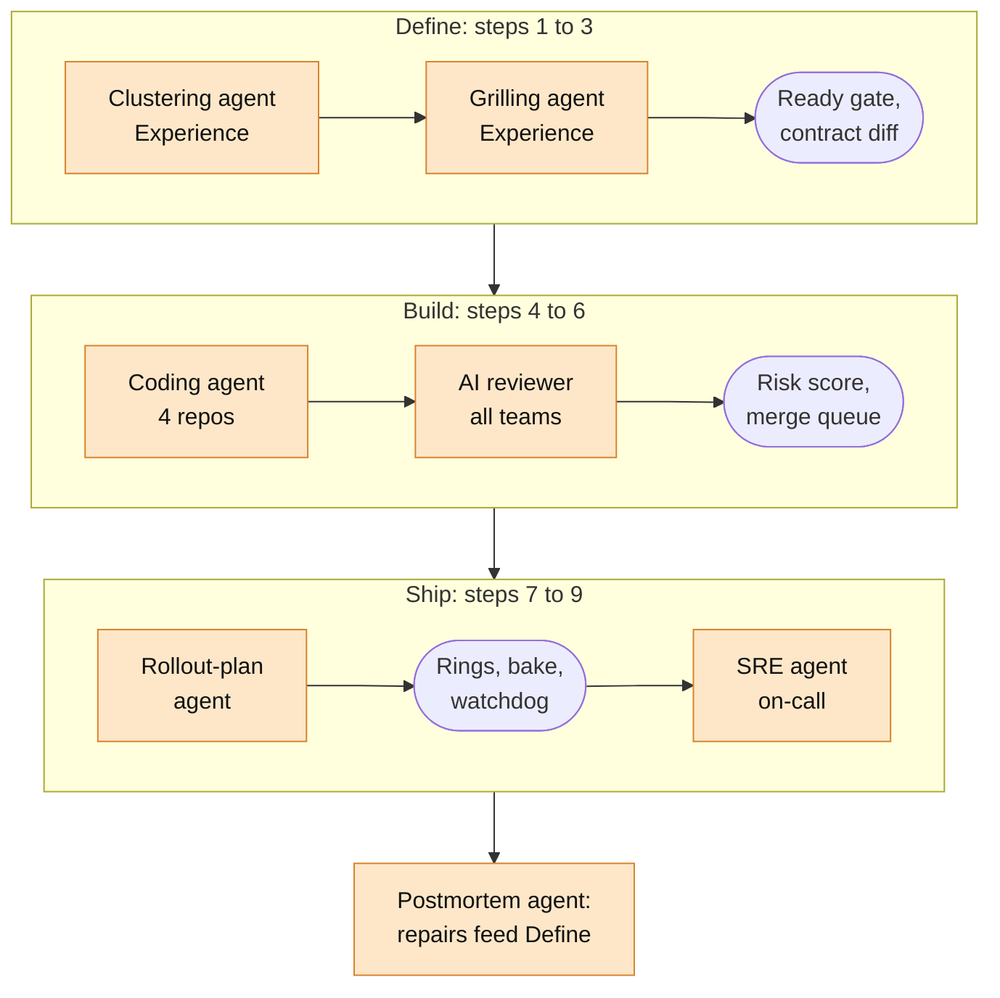
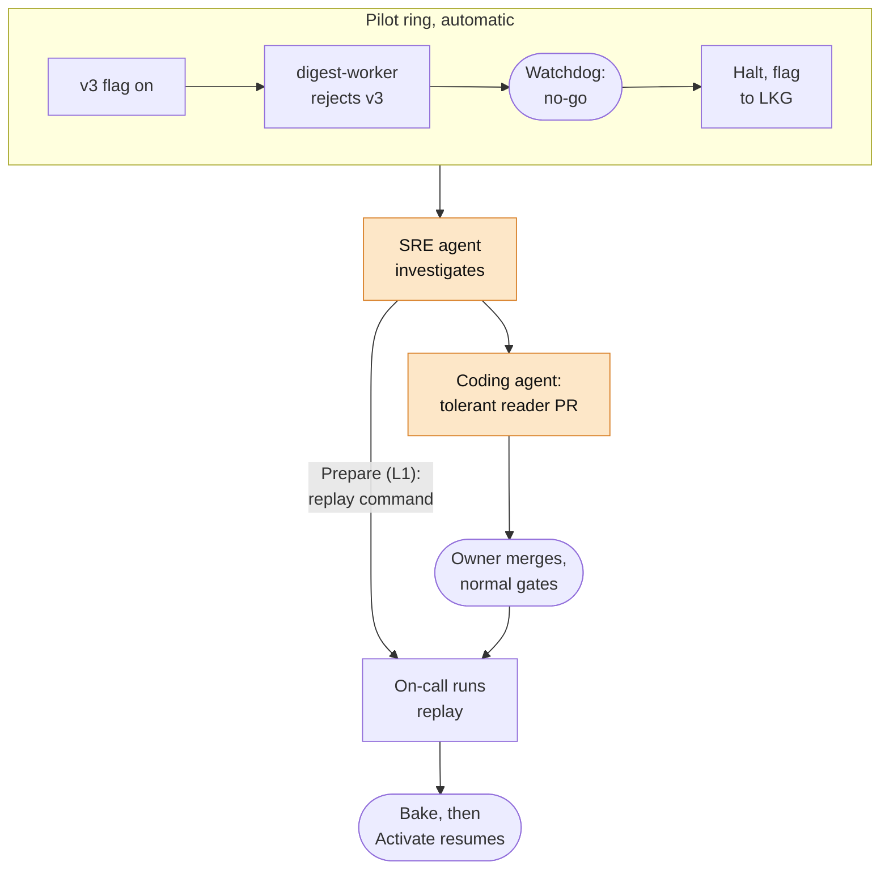

## Part VII: Worked example, one feature through the factory

This part follows one feature from signal to postmortem. The service, **Larkspur Notifications**, is an **illustrative composite**: it is not a real Microsoft product. Each step says who acts, at which rung (III.1), through which gate, and what goes into the trust ledger (III.2). Each mechanism is labelled:

- **[Published]**: a mechanism a named company describes, with its citation.
- **[Illustrative]**: our composition of those mechanisms, never presented as published fact.

### The service

Larkspur sends notifications across several Azure regions. Owners, dependencies, pipelines and contracts come from the service catalog (see V.1).

| Team | Repo and pipeline | Services | Platform |
|---|---|---|---|
| Profile | `profile-svc`, GitHub Actions | profile-api, profile-events (publishes profile changes to a shared topic) | .NET on AKS |
| Delivery | `delivery-svc`, GitHub Actions | delivery-router, channel-sender | .NET on AKS |
| Delivery | `digest-legacy`, Azure DevOps | digest-worker (daily digests) | Legacy App Service |
| Experience | `settings-portal`, Azure DevOps | settings-bff (backs the settings page) | .NET on AKS |

The delivery-router service calls profile-api service to service (S2S) over a managed identity granted only the permissions it needs, as Microsoft's guidance advises [MS16]. Each repo's pipeline deploys through the same SDP-style rings (see II.9), whether it runs in GitHub Actions or Azure DevOps (ADO).

**The feature: quiet hours.** A user sets hours during which non-urgent notifications are held. Profile must store the new preference and expose it in a new API version (the cross-team API change), profile-events must carry it in a new event schema, v3 (the data-format change), and Delivery must honour it. **The cast:** Maya, the Experience owner, requests the work; in each repo a maintainer assigns agent tasks, and a different code owner approves each PR. End to end, the feature takes about three weeks.

Orange boxes are agents (second line: the team they work for); rounded boxes are deterministic gates.

### Step 1. Intake: an incident pattern becomes a request

Over a quarter, support tickets and one incident complain about notifications sent at night. The clustering agent groups them into one theme with counts and links; the brief agent drafts an opportunity brief. Deterministic dedupe, routing and priority rules send it to the Experience team, and Maya accepts it (see II.1).

- **Acts:** clustering agent at Advise (L0), brief agent at Prepare (L1); Maya decides.
- **Gate:** II.1 dedupe, route and triage.
- **Ledger:** theme confirmed as real; brief accepted with light edits.
- **Label:** [Published] Uber describes a context graph linking incidents, design docs and Jira [AIE2] (one conference talk). [Illustrative] the clustering, the brief and the routing. [GAP: no source describes agents clustering tickets and incidents into intake themes.]

### Step 2. Grilling: PRD and SPEC.md

The grilling agent reads the incident history, then interviews Maya. It asks specific questions, such as whether security alerts are ever held. After Maya's click, two dependency questions go through the catalog's change-intake paths to Profile and Delivery, and their answers count as sign-offs. Unresolved items stay on the open-questions list (template: D1). The spec-drafting agent then opens a draft spec PR with one failing check per criterion, and Maya freezes the checks (see II.3; template: D4).

- **Acts:** grilling agent at Act on approval (L2) for dependency questions; spec-drafting agent at Prepare (L1).
- **Gate:** completeness lint, sign-offs, ready gate (II.2, II.3).
- **Ledger:** clarification requests after the gate, against the human baseline.
- **Label:** [Published] the interview that produces SPEC.md [AN5] and spec-driven development with Spec Kit [MS13] (both guidance, no measurements). [Illustrative] the questions and sign-offs.

### Step 3. Design: a breaking change caught before the PR

Profile's first design nests quiet hours inside the existing `channels` object, changing its type. The contract and compat agent drafts the OpenAPI change and a compatibility plan. The breaking-change agent runs the same diff CI uses before the PR, and it flags the change as breaking. In CI that verdict would add a label that only the review board can clear [MS25]. The agent proposes an additive field in a new API version instead, and Profile takes it. The reverse dependency graph lists delivery-router and settings-bff as consumers, and both owners acknowledge (see V.1). The threat-model agent flags the new S2S caller for security review (see II.4).

- **Acts:** contract and compat agent at Prepare (L1); breaking-change agent at Advise (L0); threat-model agent at Prepare (L1).
- **Gate:** breaking-change diff, consumer acknowledgements, design approved checklist (template: D9).
- **Ledger:** pre-PR verdict matched CI; compatibility plan accepted unchanged.
- **Label:** [Published] catalog metadata decides which checks apply at Microsoft Digital [MS28]. [Illustrative] the design.

### Step 4. Implementation: linked PRs in dependency order

After Maya approves the plan, the planner agent files tasks per repo (see II.3). In each repo a maintainer assigns the task to the coding agent, as dotnet/runtime does with Copilot coding agent [MS8]. Each task runs in a fresh sandbox with no production access [STRIPE1], reads that repo's AGENTS.md (template: D3), and works under its own Entra Agent ID, on behalf of the requesting engineer [MS22]. The catalog gives the PR order, provider first (see II.5): profile-api's new API version, then delivery-router and settings-bff, then profile-events v3 writing behind an off-by-default flag.

- **Acts:** planner agent and coding agent, both at Act on approval (L2): Maya's plan approval for the tasks, a code owner's merge for each PR.
- **Gate:** local verifiers, CI with a two-round cap.
- **Ledger:** CI rounds, human-pushed commits, merge outcome per task class.
- **Label:** [Published] see citations above; an upstream-first coordination graph across 79 repos [MABL1] (vendor-reported). [Illustrative] the plan.

### Step 5. Review and test

The AI reviewer comments on every PR. One finding in a proven category (a null time zone) feeds a required check and blocks the profile-api PR until fixed (see II.6). The test-generation agent, which did not write the change, pushes tests that kill surviving mutants in the quiet-hours logic after the owner's click (see II.7). CI runs an upgrade-downgrade test: v2 and v3 builds of profile-events against old and new delivery-router [AWS3].

- **Acts:** AI reviewer at Advise (L0), its block at Act, then notify (L3); test-generation agent at Act on approval (L2).
- **Gate:** required checks, protected tests, owner approval.
- **Ledger:** findings marked useful or dismissed per category; tests accepted.
- **Label:** [Published] AI first-pass review [MS6], mutation-guided tests [META1]. [Illustrative] the findings and the category-to-required-check block.

### Step 6. Merge: the risk score sets the gate

The risk model scores each PR. The Profile PRs change a contract and a data format with cross-team consumers, so they land in the top tier: two owner approvals, full combined-state tests, and no conflict relaxation or auto-merge (see II.8). The risk-explanation agent explains the score.

- **Acts:** risk-explanation agent at Advise (L0); the risk model and merge queue are deterministic gates, not agents.
- **Gate:** risk tier, merge queue, post-merge validation.
- **Ledger:** score, tier and post-merge outcome per PR.
- **Label:** [Published] Meta's Diff Risk Score [META2] and tiered gating of top-scoring diffs [META3]; combined-state queues [AIE3] (one conference talk). [Illustrative] the tiers.

### Step 7. Rollout: the Prepare phase, then the Activate phase

The rollout-plan agent opens the plan as data (template: D5) as a PR on Maya's behalf, and Profile's owner merges it. The **Prepare phase** ships the readers (delivery-router, settings-bff) through canary, pilot and region waves in their GitHub Actions and ADO ring pipelines, while profile-events still writes v2. The **Activate phase** turns on the v3 flag ring by ring; that flag change goes through the same rings as code. The entry gate checks that every instance of every listed reader runs the Prepare-phase build, as AWS verifies Prepare on every server [AWS3].

- **Acts:** rollout-plan agent at Act on approval (L2); the pipelines promote rings by themselves.
- **Gate:** entry gate, bake, watchdog verdict per ring.
- **Ledger:** plan accepted unchanged; ring results.
- **Label:** [Published] two-phase deploys [AWS3], SDP rings and config gated like code [MS2]. [Illustrative] the plan and the per-instance check.

### Step 8. Halt and recovery in the pilot ring

The Activate phase reaches the pilot ring. Within the hour, dead-lettered messages on digest-worker's profile-events subscription rise in the pilot region (digest-worker's health signals are registered as its own component). The watchdog ties them to the v3 flag change by time and place, writes no-go, halts the rollout and opens an incident with evidence, as Gandalf, Azure's deployment watchdog, does [MS4, MS5]. The rollback policy covers a config change, so the pipeline turns the flag back to the last known good (LKG) config. This follows AWS's rule of rolling back writers before readers [AWS3].

The SRE agent investigates. It finds that digest-worker, the legacy App Service component, also subscribes to profile-events, has a strict deserializer that rejects unknown fields, and never received a Prepare-phase build. Its subscription was never declared in the catalog, so neither design (step 3) nor the entry gate saw it. It prepares the mitigation: replay the dead-lettered messages once digest-worker is fixed. At the Delivery maintainer's request, the coding agent opens a tolerant-reader PR (it ignores and preserves unknown fields) [AWS3]; a code owner merges it, and it ships through digest-legacy's ADO rings. On-call then runs the replay, and the Activate phase resumes after bake.

Orange boxes are agents; rounded boxes are deterministic gates; the rest is the deterministic core.

- **Acts:** watchdog and rollback policy (deterministic); SRE agent at Advise (L0) for diagnosis and Prepare (L1) for the replay command; coding agent at Act on approval (L2).
- **Gate:** watchdog verdict, rollback policy, normal PR gates for the fix.
- **Ledger:** investigation matched the postmortem cause; prepared command run unchanged; time to mitigate.
- **Label:** [Published] Microsoft's GA announcement says Azure SRE Agent lets teams move from recommended actions to automated responses "within defined guardrails" [MS10]. [Illustrative] the failure.

### Step 9. Learning: repair items into verifiers and catalog

The postmortem agent drafts the timeline from the SRE agent's log, plus repair items, each approved by an owner (see II.11):

- **Catalog:** digest-worker declares that it consumes the profile-events contract, and App Service traffic feeds the reconciler, which had no traces for this component (see V.1).
- **Entry gate:** **Recommendation:** the "Prepare phase complete" check queries every consumer in the catalog across both pipeline systems, per instance.
- **Tests:** the upgrade-downgrade test adds digest-worker.
- **Context:** digest-legacy's AGENTS.md notes its strict deserializer.

The drift item opens when the catalog repair item is filed, after the fix has merged. While it is open, the catalog caps agent actions on Larkspur at Advise (L0); catalog-repair PRs are exempt (see V.1).

- **Acts:** postmortem agent at Prepare (L1); catalog-curator agent at Act on approval (L2) for the catalog PR.
- **Gate:** owner approval; every repair PR rides the normal gates.
- **Ledger:** the missed consumer is recorded as a catalog gap, not against the contract and compat agent; the SRE agent's diagnosis records a match.
- **Label:** [Illustrative] throughout. [GAP: no source measures whether repair items like these reduce repeat incidents.]

**What this shows:** no agent caused or approved the failure. The deterministic core (watchdog, rollback policy, normal gates) contained it, the gap was in context (an undeclared consumer), and the fix went into the catalog and verifiers, not into a prompt.

### Published vignettes: what already happens at scale

**Google: AI-assisted migrations.** Google used a fine-tuned Gemini inside a deterministic shell to migrate int32 IDs to int64 in Google Ads, a codebase of more than 500 million lines [GOOG2]. 80% of the modifications in landed changes were fully AI-authored, and about 50% of end-to-end time was saved, including review. "The bottleneck in the process was the speed at which engineers could review the changes." [GOOG2]. This matches steps 4 to 6.

**Spotify: a migration across many owning teams.** One Spotify data team used its Honk agent with Backstage and Fleetshift to move about 1,800 downstream pipelines, owned by many teams, off two deprecated datasets in six months, through 240 automated PRs [SPOT5]. Backstage endpoint lineage gave the consumer list and owners before any change: the reverse lookup of step 3. Owning teams kept merge authority, and because the repos rarely had tests, "we had to rely on the downstream owning teams to perform their own manual testing before merging the automated PRs." [SPOT5].

**Microsoft: Copilot coding agent in dotnet/runtime.** Over ten months, Copilot coding agent opened 878 PRs in dotnet/runtime, and 535 merged (67.9%, against 87.1% for Microsoft engineers' PRs; different populations, so directional only) [MS8]. Every PR exists because a maintainer asked for it: "CCA cannot open PRs on its own." Reverts were 3 of 535 [MS8]. This is step 4's rung, Act on approval, with metrics of the kind a trust ledger records.

### Open gaps

- No company has published an end-to-end run like this one; Larkspur is a composite, and the sequence of steps is ours.
- Step 8's SRE agent behaviour is synthesis on top of MS10 (see II.9 gaps).
- No source measures how often undeclared consumers break two-phase rollouts, or how well a reconciler finds them in legacy components.
- No source shows a "Prepare phase complete" check that spans two pipeline systems (ADO and GitHub Actions); the entry-gate repair is a Recommendation.
- Kit proposal: a worked example kept as a test fixture, a filled-in set of D1, D2, D5 and D7 records for one feature, so teams can check their own templates against it (template: proposed).
